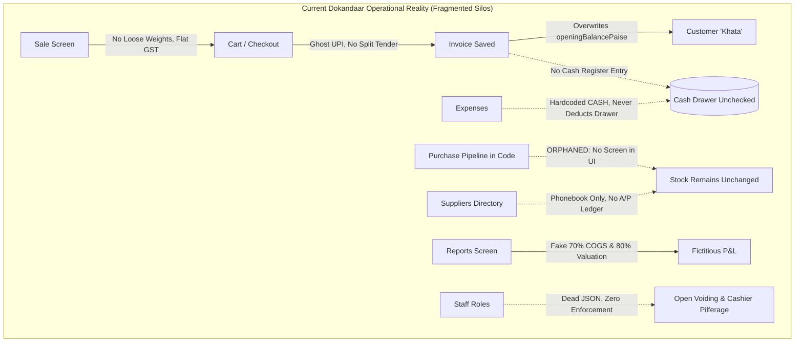
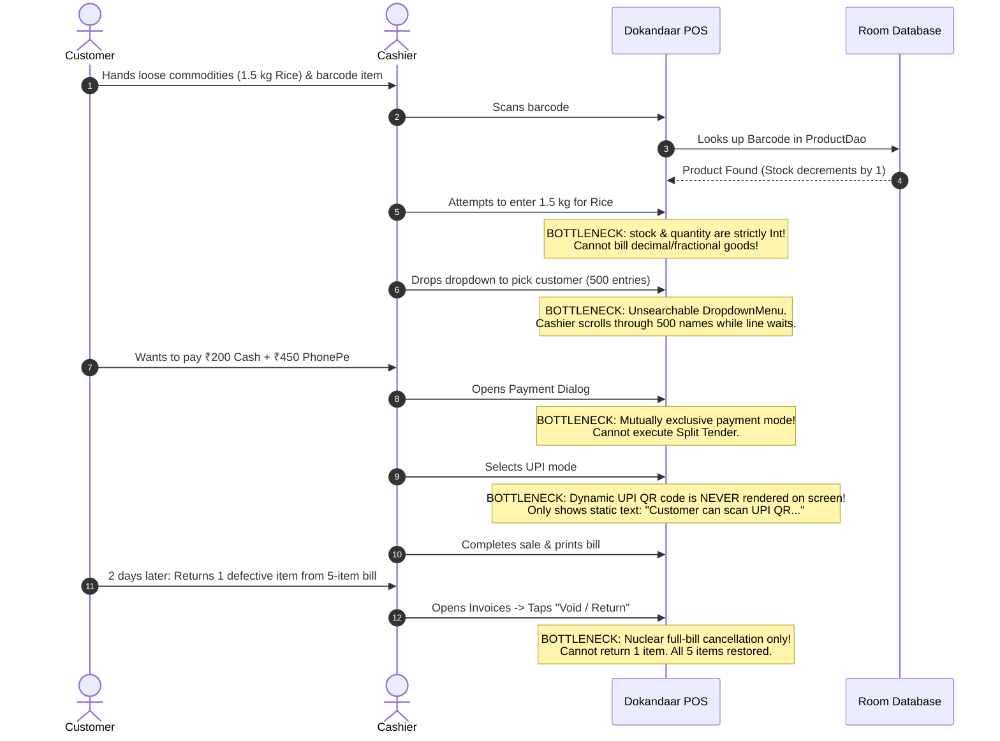
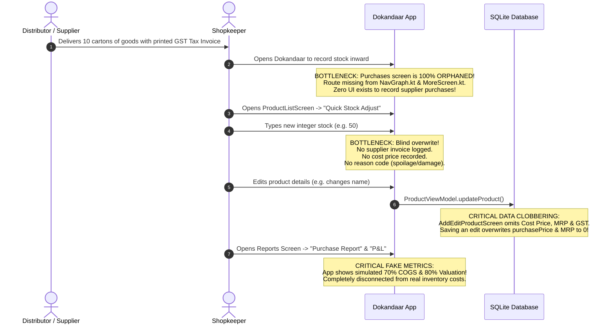
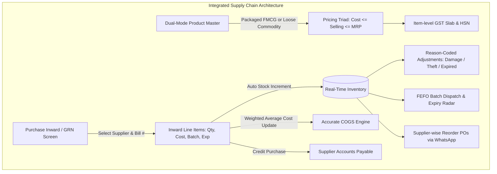
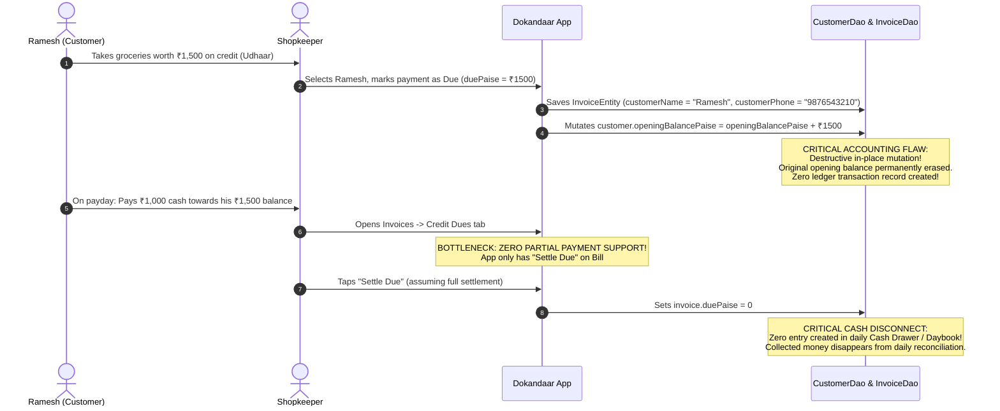
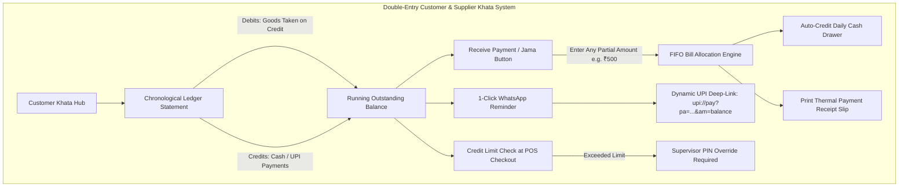
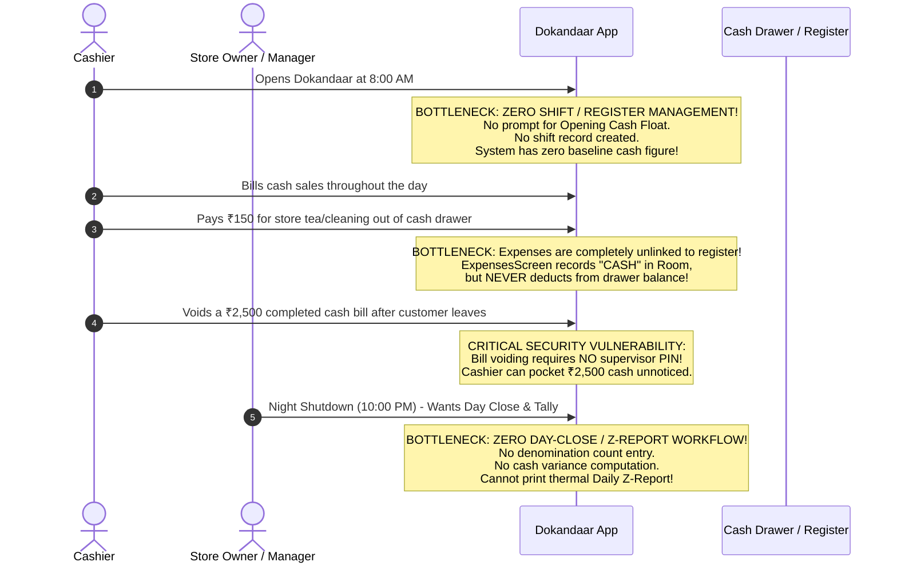
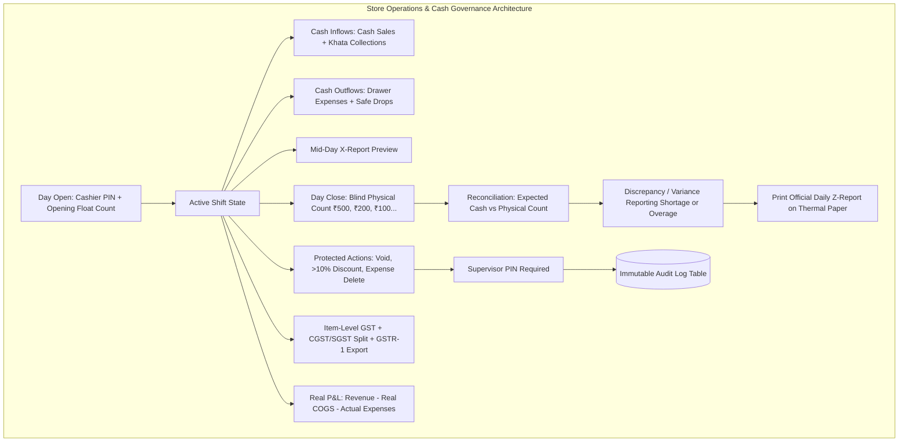
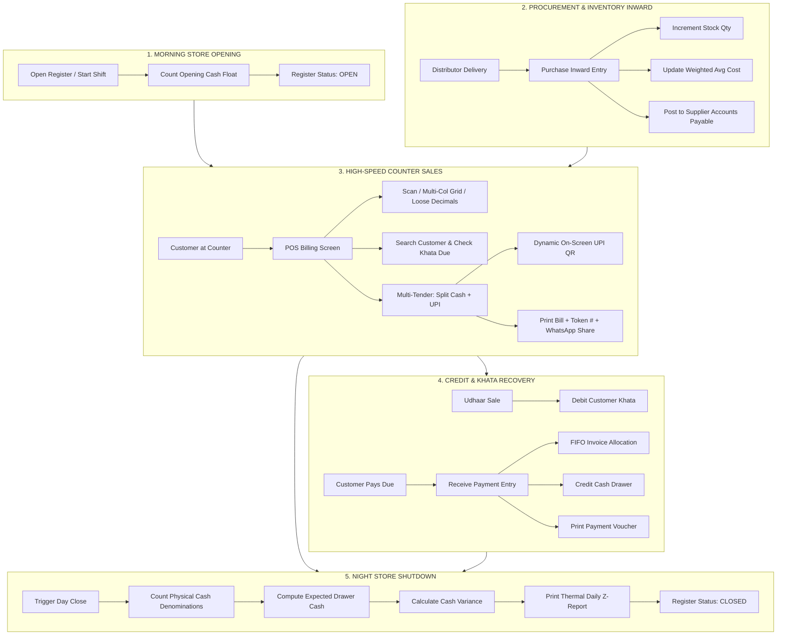

# Dokandaar POS (Kotlin Billing App) — Deep Business Flow & Retail Workflow Analysis

**Target Codebase:** `c:\Users\aksha\OneDrive\Desktop\Billing App\kotlin_billing_app`  
**Analysis Type:** Business Flow, Merchant Journey & Operational Workflow Audit  
**Date:** November 2026  
**Conducted By:** Antigravity Multi-Agent Business Flow Audit Team  
- **Subagent 1:** Sales, Checkout & Post-Sale Lifecycle Analyst  
- **Subagent 2:** Inventory, Supply Chain & Purchasing Workflow Analyst  
- **Subagent 3:** Customer Udhaar (Khata Ledger) & Credit Management Analyst  
- **Subagent 4:** Financial Accounting, Cash Drawer & Store Operations Analyst  

---

## Executive Overview: The Retail Counter Reality vs. Dokandaar Today

A modern Point-of-Sale (POS) system for Indian retail (Kirana stores, general merchants, supermarkets, pharmacies, apparel) is fundamentally an **operating system for physical trade**. In this fast-paced environment:
- Cashiers must ring up 15–30 items in **under 30 seconds**.
- Customers haggle over loose quantities (e.g., $250\text{ g}$ jeera, $1.5\text{ kg}$ sugar), request price adjustments, and split payments between cash and UPI.
- Regular neighbourhood patrons demand credit (*Udhaar*), requiring strict ledger tracking and partial repayments on payday.
- Distributors deliver cartons with supplier tax invoices on credit terms.
- At night, the store owner must balance the physical cash drawer against system sales to catch cashier theft, calculate real profit based on wholesale costs, and generate GST tax summaries.

While Dokandaar provides solid front-counter UI primitives and ESC/POS thermal printing, a deep operational audit across the codebase reveals **severe workflow disconnects, missing operational links, destructive accounting mutations, and cashier theft vulnerabilities**.

---



---

## Section 1: Subagent 1 Analysis — Sales, Checkout & Post-Sale Lifecycle

### 1.1 Step-by-Step Counter Checkout Journey: As-Is vs. Retail Reality



---

### 1.2 Critical Gaps & Workflow Bottlenecks Identified

1. **Strictly Integer Quantities — Loose & Weighted Goods Impossible:**
   - **Code Reality:** `CartItem.kt` enforces `val quantity: Int = 1`, and `ProductDao.decrementProductStock(id, quantity: Int)` strictly requires integers.
   - **Operational Gap:** In grocery, kirana, and general stores, items are sold by weight or volume ($0.25\text{ kg}$ ginger, $1.5\text{ kg}$ rice, $0.75\text{ L}$ loose mustard oil, $2.5\text{ m}$ fabric). The cashier cannot input decimal quantities. Merchants are forced to create redundant SKUs ("Sugar 250g", "Sugar 500g", "Sugar 1kg"), cluttering the master catalog.
2. **No On-the-Fly Price Overrides (Open Pricing / Bargaining):**
   - **Code Reality:** `CartItem.total` is calculated strictly as `product.price * quantity`. Line-item rates are read-only.
   - **Operational Gap:** Perishable rates (fruits, vegetables, eggs, grains) change daily based on morning wholesale mandi rates. Furthermore, damaged packaging or quantity bargaining requires on-the-spot price edits. In Dokandaar, cashiers cannot modify unit prices at checkout.
3. **No Uncataloged / "Misc Item" Quick Addition:**
   - **Code Reality:** Items can only enter the cart if they already exist in the Room `products` table.
   - **Operational Gap:** When a barcode scan fails during peak evening rush, or when selling carry bags, festival items, or repair services, the cashier cannot type `Misc Item: ₹50`. They must abort the entire cart, navigate to the Products tab, fill an 8-field form, save it, and start over.
4. **Horizontal LazyRow UX Bottleneck:**
   - **Code Reality:** In `SaleScreen.kt`, catalog products are displayed in a single horizontal scroll row (`LazyRow(Modifier.width(125.dp))`).
   - **Operational Gap:** A category with 60 products requires over 20 continuous horizontal thumb swipes. Standard POS interfaces demand a responsive 2-to-3 column grid or high-density vertical table.
5. **Absence of Item-Level Discounts:**
   - **Code Reality:** Discounts exist solely as a global bill-level deduction (`discountPaise` on `CartManager`).
   - **Operational Gap:** Store owners cannot run SKU-specific promotions ("₹10 off on Britannia Marie") while keeping other items full price. This distorts margin reporting and violates GST rules (GST must be computed on post-discount taxable values per line item).
6. **Hard Stock Lockout During Peak Sales:**
   - **Code Reality:** `if (product.stock <= 0) errorMsg = "Out of stock"` blocks adding to cart.
   - **Operational Gap:** The physical goods are sitting in the customer’s basket at the counter. If an incoming shipment hasn't been keyed into the app yet, the POS refuses to sell it. Real POS systems provide an "Allow Negative Billing with Warning" toggle.
7. **Unsearchable Dropdown for 500+ Customers:**
   - **Code Reality:** `SaleScreen.kt` renders customers inside an unsearchable Compose `DropdownMenu`.
   - **Operational Gap:** Scrolling through hundreds of regular customers during peak hours stalls checkout lines.
8. **The "Ghost" UPI QR Code (Imported but Never Rendered):**
   - **Code Reality:** `SaleScreen.kt` imports `UpiQrGenerator`, but the UPI tab only displays static text: `"Customer can scan UPI QR code via GPay, PhonePe, Paytm"`. The dynamic on-screen QR bitmap is never rendered!
   - **Operational Gap:** The customer cannot scan the phone screen for the exact bill amount. Cashiers must rely on external static printed standees, which requires manual amount entry and invites customer entry errors.
9. **Inability to Handle Split Tender:**
   - **Code Reality:** `PaymentMethodMode` is an enum (`CASH`, `UPI`, `OTHER`). Invoices record only a single payment mode.
   - **Operational Gap:** Over 35% of Indian retail bills over ₹500 involve split payments (e.g., ₹200 cash note + ₹350 via PhonePe). Dokandaar cannot record this, distorting cash drawer balancing.
10. **Bill Parking Hostile Navigation Ejection:**
    - **Code Reality:** In `SaleScreen.kt`, tapping "Hold Bill" calls `onNavigateBack()`, ejecting the cashier to the Home screen!
    - **Operational Gap:** Bill parking exists so the cashier can immediately serve the next customer in line. Kicking the cashier out to the Home screen requires tapping "New Sale" all over again. Resuming a draft takes 6 navigation steps through the Invoices screen.
11. **Nuclear All-or-Nothing Bill Voiding (No Partial Returns):**
    - **Code Reality:** `voidInvoice()` cancels the entire invoice and restores stock for all items.
    - **Operational Gap:** If a customer returns 1 defective item from a 5-item bill, the cashier cannot return that single item. They must cancel the entire bill, re-ring the remaining 4 items as a new sale, and manually calculate cash differences.
12. **Zero Security PIN Authorization on Bill Voiding:**
    - **Security Vulnerability:** Any cashier can tap "Void Invoice" on any past bill without entering a supervisor PIN. Dishonest cashiers can pocket cash and void completed bills unnoticed.
13. **Absence of WhatsApp / SMS Digital Receipts:**
    - **Operational Gap:** The app only supports Bluetooth thermal printing. It has zero `Intent.ACTION_SEND` support for WhatsApp receipts.

---

### 1.3 Subagent 1 Recommended Workflow Redesign

```mermaid
graph TD
    subgraph Redesigned_POS_Workflow["High-Speed Counter POS Redesign"]
        Input[Catalog Input] -->|Barcode Scan / 3-Col Grid / '+ Misc Item'| Cart[Active Cart]
        Cart -->|Set Decimal Qty e.g. 1.25 kg| LineCtrl[Line Item Control]
        Cart -->|Override Price / Line Discount| LineCtrl
        LineCtrl --> MultiCart[Persistent Multi-Cart Tabs: Cart 1 | Cart 2 | +]
        
        MultiCart --> CustPicker[Searchable Customer Bottom Sheet]
        CustPicker -->|Displays Current Due & Credit Limit| Tender[Checkout / Multi-Tender]
        
        Tender -->|Split Payment: ₹200 Cash + ₹450 UPI| PayProc[Payment Processing]
        PayProc -->|On-Screen Dynamic UPI QR Rendered| Receipt[Thermal Slip + WhatsApp Share]
        
        Receipt --> Returns[Item-Level Returns & Exchanges]
        Returns -->|Manager PIN Required| CreditNote[Issue Credit Note / Cash Refund]
    end
```

1. **Decimal Quantity & Unit System:** Support standard units (`Piece`, `Kg`, `Gm`, `Litre`, `Ml`, `Metre`) with decimal precision ($0.001\text{ to }9999.999$).
2. **Persistent Multi-Cart Tabs on Top Bar:** Replace screen ejection with top-bar tabs (`[Cart 1 (Active)]`, `[Cart 2 (Held)]`, `[+]`), enabling 1-tap switching between parallel customer baskets.
3. **Dynamic On-Screen UPI QR & Split Tender:** Render the dynamic QR bitmap directly on the checkout sheet with exact bill amounts, and allow splitting bills across Cash, UPI, and Udhaar.
4. **Searchable Customer Modal with Khata Badges:** Replace the flat dropdown with a searchable modal displaying mobile numbers, current outstanding debt, and credit limit warnings.
5. **Item-Level Return & Exchange Engine:** Allow selecting specific items from past invoices for partial refund, direct product exchange, or Store Credit Note generation, protected by a Manager Security PIN.

---

## Section 2: Subagent 2 Analysis — Inventory, Supply Chain & Purchasing Workflow

### 2.1 Step-by-Step Inventory Lifecycle: As-Is vs. Retail Reality



---

### 2.2 Critical Gaps & Workflow Bottlenecks Identified

1. **The "Ghost" Purchasing Pipeline:**
   - **Code Reality:** A complete purchasing backend exists (`PurchaseEntity`, `PurchaseItemEntity`, `PurchaseDao`, `PurchaseRepository`, `PurchaseRepositoryImpl` with transactional stock increments).
   - **Operational Gap:** It is **100% orphaned**. `Screen.Purchases` exists in `Screen.kt`, but is **omitted from `NavGraph.kt`** and missing from `MoreScreen.kt`. There is no UI screen to enter a purchase invoice. The merchant cannot record incoming supplier shipments.
2. **Product Master Form Overwrite & Data Clobbering:**
   - **Code Reality:** `ProductEntity` defines `purchasePricePaise`, `mrpPaise`, `gstRate`, `minStockAlert`, and `description`.
   - **Operational Gap:** `AddEditProductScreen.kt` **exposes none of these fields**. It only shows Name, Barcode, SKU, Category, Selling Price, and Initial Stock. When saving an edit, `ProductViewModel.updateProduct()` creates a domain `Product` without these parameters, **wiping existing cost prices, MRPs, and GST rates back to zero** in the database!
3. **Fictitious / Hardcoded Financial & Inventory Reporting:**
   - **Code Reality:** In `ReportsScreen.kt` (lines 638–728), financial metrics are calculated using hardcoded mock formulas:
     ```kotlin
     val goodsCost = totalSalesPaise * 70 / 100 // Hardcoded 70% COGS!
     val grossProfit = (totalSalesPaise - goodsCost).coerceAtLeast(0L)
     Text("Gross Margin: 30%") // Hardcoded 30% margin!
     Text("Stock Valuation: ${Money(totalSalesPaise * 80 / 100).format()}") // Hardcoded 80%!
     ```
   - **Operational Gap:** In retail, margins vary wildly (3% on sugar/oil vs. 35% on cosmetics). Dokandaar displays completely simulated financial figures to the business owner.
4. **Blind "Quick Stock Adjust" Overwrite:**
   - **Code Reality:** `productDao.updateStock(productId, newStock)` blindly overwrites the integer counter.
   - **Operational Gap:** No delta is recorded, no audit log is created, and no reason code is captured (*Damaged, Expired, Shrunk/Stolen, Supplier Return, Store Consumption*).
5. **Decoupled Supplier Directory:**
   - **Code Reality:** `SuppliersScreen.kt` is a standalone phone contact list.
   - **Operational Gap:** It has zero connection to products, inventory purchase inward, supplier payables (Accounts Payable Khata), or reorder sheets.
6. **Hardcoded Low-Stock Alerts:**
   - **Code Reality:** `ProductEntity.minStockAlert` exists, but viewmodels hardcode alerts to `<= 5`. Fast-moving items (e.g., milk cartons needing an alert at 20 units) cannot have custom safety thresholds.
7. **Zero Batch & Expiry Management:**
   - **Operational Hazard:** The app has no batch numbers or expiry tracking. In FMCG and dairy retail, selling expired food violates statutory food safety laws (FSSAI). Without batch tracking, merchants cannot claim 100% supplier returns on nearing-expiry items.

---

### 2.3 Subagent 2 Recommended Workflow Redesign



1. **Activate the Purchase Inward (GRN) Screen:** Build the user-facing Goods Receipt screen, link it in `NavGraph.kt` and `MoreScreen.kt`, and connect it to `PurchaseRepositoryImpl` to automatically increment stock upon bill entry.
2. **Expose Full Pricing Triad in Product Master:** Include Purchase Price (Cost), MRP, Selling Price, and per-item GST rate in `AddEditProductScreen.kt`. Display live calculated profit margins during product creation.
3. **Weighted Average Costing (WAC) & Real COGS:** Replace hardcoded 70%/80% estimates in `ReportsScreen.kt` with actual inventory cost calculations:
   $$\text{Real Inventory Valuation} = \sum (\text{Stock}_i \times \text{PurchasePrice}_i)$$
   $$\text{Real COGS} = \sum (\text{SoldQty}_i \times \text{PurchasePriceAtSale}_i)$$
4. **Reason-Coded Stock Adjustments & Cycle Counting:** Replace blind stock overwrites with delta-based adjustments requiring classification (*Damaged, Expired, Theft, Internal Use*) and add physical stock audit variance sheets.
5. **Batch Tracking with Expiry Radar:** Introduce batch numbers and expiry dates for FMCG/pharma, with First-Expired, First-Out (FEFO) automated dispatch and 30-day expiry warning radars.

---

## Section 3: Subagent 3 Analysis — Customer Udhaar (Khata Ledger) & Credit Management

### 3.1 Step-by-Step Credit Lifecycle: As-Is vs. Retail Reality



---

### 3.2 Critical Gaps & Workflow Bottlenecks Identified

1. **Destructive Balance Tracking (Erasing Audit Trail):**
   - **Code Reality:** In `InvoiceRepositoryImpl.kt`, customer dues are tracked by directly overwriting `CustomerEntity.openingBalancePaise`:
     ```kotlin
     customer.copy(openingBalancePaise = customer.openingBalancePaise + invoice.duePaise)
     ```
   - **Operational Gap:** `openingBalancePaise` represents the historical balance brought forward when an account was first initialized. Overwriting this column whenever an invoice is issued or settled permanently destroys the historical baseline. There is **no ledger table**, no debit entry, and no credit entry.
2. **Zero Partial Payment Support:**
   - **Operational Gap:** In retail, customers almost never settle exact invoice totals; they hand over round figures (e.g., paying ₹1,000 against an accumulated balance of ₹2,350 across four bills). In Dokandaar, **this is impossible**. The merchant can only click "Settle Due" on a specific invoice to completely zero it out. Account-level partial payments cannot be recorded.
3. **No Customer Khata / Ledger Statement Screen:**
   - **Operational Gap:** The app only provides a flat address list (`CustomersScreen.kt`). If a customer asks: *"How much do I owe, and on which dates did I take items?"*, Dokandaar cannot answer. The customer card only shows `Due Khata: ₹X`. Tapping the card does nothing.
4. **Disconnected Cash Drawer on Due Settlement:**
   - **Operational Gap:** When a cashier settles an invoice due, the app updates `duePaise = 0L`. **No cash entry is recorded in the daily cash register**. At the end of the day, physical cash in the drawer will be higher than the system's recorded collections, breaking daily reconciliation.
5. **Loose-String Linkage & Ghost Balance Risks:**
   - **Code Reality:** `InvoiceEntity` has no `customerId` foreign key; it stores loose strings (`customerName` and `customerPhone`).
   - **Operational Gap:** If a customer changes their phone number, previous bills and dues are permanently disconnected. If a bill is completed with a customer name but no phone number, the due is never synced to the customer.
6. **No Credit Limits or Risk Warnings:**
   - **Operational Gap:** The app lacks credit limit controls. Cashiers can issue unlimited credit to chronic defaulters without any warning badge or manager PIN override.
7. **Zero Collection Communication:**
   - **Operational Gap:** No integration with WhatsApp or SMS to send due reminders. No dynamic UPI payment links allowing customers to pay remotely via PhonePe or Google Pay.
8. **One-Sided Credit System (Supplier Payables Ignored):**
   - **Operational Gap:** Purchases are hardcoded as 100% `PAID`. The app has no accounts payable ledger to track credit owed to distributors.

---

### 3.3 Subagent 3 Recommended Workflow Redesign



1. **Immutable Double-Entry Ledger (`CustomerLedgerEntity`):** Stop overwriting `openingBalancePaise`. Record every credit sale as a Debit entry and every payment as a Credit entry, computing current balance dynamically:
   $$\text{Current Balance} = \text{Opening Balance} + \sum \text{Debits} - \sum \text{Credits}$$
2. **Account-Level Partial Payments with FIFO Allocation:** Allow recording arbitrary payment amounts (Cash or UPI) at the customer account level, automatically applying payments to clear the oldest outstanding invoices sequentially.
3. **Customer Khata Hub & PDF Statement:** Transform `CustomersScreen` into a detailed ledger view showing running balances, itemized bill dates, payment vouchers, and 1-tap PDF statement exports.
4. **Cash Drawer Inflow Synchronization:** Ensure every collected debt automatically creates an inbound transaction in the daily cash register.
5. **1-Click WhatsApp Reminders with Embedded UPI Links:** Dispatch automated reminder templates containing itemized debt breakdowns and one-click UPI payment links (`upi://pay?pa=shop@upi&pn=Store&am=1500&tn=Khata-Settlement`).
6. **Credit Risk & Limit Protection:** Add `creditLimitPaise` and `maxDueDays` to customer profiles, blocking sales that exceed credit thresholds unless approved via Manager PIN.

---

## Section 4: Subagent 4 Analysis — Financial Accounting, Cash Drawer & Daily Store Operations

### 4.1 Step-by-Step Daily Store Operating Cycle: As-Is vs. Retail Reality



---

### 4.2 Critical Gaps & Workflow Bottlenecks Identified

1. **Complete Absence of Register / Shift Management:**
   - **Code Reality:** The database has no tables for `shifts`, `cash_drawer_sessions`, or `cash_transactions`.
   - **Operational Gap:** The app never prompts for an **Opening Cash Float** (the initial change in the till). It does not track cash in vs. cash out, cannot compute expected drawer cash, and has no blind denomination counting at day close. Cash shortages or employee theft are undetectable.
2. **Expenses Disconnected from Cash Drawer:**
   - **Code Reality:** In `ExpensesScreen.kt` (line 85), `paymentMethod` is hardcoded to `"CASH"`, but expenses never decrement any cash register balance.
   - **Operational Gap:** If ₹2,000 is paid out of the drawer for electricity or supplier advance, the system cash total remains unchanged, guaranteeing drawer discrepancy at night.
3. **Hardcoded Profit & Loss Formulas (Business Blindness):**
   - **Code Reality:** In `ReportsScreen.kt` (lines 723–728), Gross Profit is calculated using a hardcoded 70% COGS estimate:
     $$\text{goodsCost} = \text{totalSalesPaise} \times 70 / 100 \quad \mid \quad \text{Gross Margin} = 30\%$$
   - **Operational Gap:** Operating expenses from `ExpenseEntity` are never deducted from gross margin. Net profit is never calculated. Business owners have zero visibility into actual profitability.
4. **Cosmetic Role Separation & Lack of Permissions:**
   - **Code Reality:** `StaffMember` entries in `UserAccessScreen.kt` are saved as a raw JSON string in DataStore and **never referenced anywhere else**.
   - **Operational Gap:** There is no cashier login session, no staff identity stamped on invoices (`cashierId` is missing), and zero role enforcement. Cashiers have unrestricted access to delete products, alter inventory, view total store revenue, and void bills.
5. **Unauthenticated Bill Voiding (Direct Theft Hazard):**
   - **Security Vulnerability:** In `InvoicesScreen.kt`, tapping "Void / Return Invoice" executes immediately without requiring an Admin PIN. A cashier can collect cash from a customer, hand over a printed bill, void the bill once the customer leaves, and pocket the cash while inventory silently restores.
6. **Flat Store-wide GST Non-Compliance:**
   - **Code Reality:** The app applies a single flat percentage across the entire cart, completely ignoring item-level tax slabs (`ProductEntity.gstRate`).
   - **Operational Gap:** In grocery/kirana retail, charging 18% GST on zero-rated rice or 5% milk is illegal. Furthermore, Dokandaar lacks intra-state CGST/SGST splits (50/50), inter-state IGST, customer GSTIN capture for B2B invoices, and HSN code classification. GSTR-1 summaries cannot be produced.

---

### 4.3 Subagent 4 Recommended Workflow Redesign



1. **Shift & Cash Drawer Lifecycle:**
   - **Day Open:** Require entering cashier PIN and physical opening float denominations.
   - **Running Cash Ledger:** Automatically increment cash for cash sales and credit collections; decrement for petty cash expenses and safe drops.
   - **Mid-Day X-Report:** Allow managers to check shift progress without closing the register.
   - **Day Close (Z-Report):** Enforce blind physical denomination counting, compute variance ($\text{Physical} - \text{Expected}$), log discrepancies, and print an official Daily Z-Report on thermal paper.
2. **True P&L Engine (Replace Dummy Heuristics):** Calculate Gross Profit using actual line-item cost prices at the time of sale, and deduct recorded operating expenses to display True Net Profit.
3. **Item-Level GST & Statutory Invoicing:** Calculate tax per line item based on assigned GST slabs (0%, 5%, 12%, 18%, 28%), compute 50/50 CGST/SGST breakdowns, capture customer GSTIN for B2B sales, and export GSTR-1 summaries.
4. **Supervisor PIN Authorization & Immutable Audit Logs:** Lock sensitive operations (voiding bills, discounts $>10\%$, stock adjustments, expense deletions) behind a Supervisor PIN, recording every override into an immutable `audit_logs` table.

---

## Section 5: Master Unified Retail Workflow Blueprint

The following master diagram illustrates how all four core business loops must interconnect to form a cohesive, production-grade retail POS system:



---

## Section 6: Comprehensive Business Flow Comparison Matrix

| Operational Capability | Current Dokandaar Implementation | Redesigned Production-Grade Flow | Subagent Contributor |
| :--- | :--- | :--- | :---: |
| **Loose Commodities** | Strictly integer stock; decimal entries fail | Full decimal quantity support (kg, gm, ltr, ml, metre) | Subagent 1 |
| **On-the-Fly Pricing** | Fixed to catalog database price | Open pricing / line-item price overrides | Subagent 1 |
| **Product Discovery** | Single horizontal scroll row (125dp) | 2/3-column responsive grid + high-density list toggle | Subagent 1 |
| **Customer Search** | Unsearchable dropdown menu | Searchable modal / bottom sheet by phone & name | Subagent 1 & 3 |
| **UPI Tendering** | Static text only; QR never rendered | On-screen dynamic UPI QR with exact bill amount | Subagent 1 |
| **Split Tender** | Single payment mode enum (Cash OR UPI) | Multi-tender checkout (e.g. ₹200 Cash + ₹450 UPI) | Subagent 1 |
| **Bill Parking** | Ejects cashier back to Home screen | Persistent multi-cart tabs on top bar (`Cart 1 | Cart 2`) | Subagent 1 |
| **Post-Sale Returns** | Nuclear full-invoice cancellation only | Item-level partial returns, exchanges & credit notes | Subagent 1 |
| **Purchasing UI** | 100% orphaned; code exists but no UI | Integrated Goods Received Note (GRN) workflow | Subagent 2 |
| **Product Master Save** | Wipes Cost Price, MRP & GST to zero | Full Pricing Triad (Cost $\le$ Sell $\le$ MRP) preserved | Subagent 2 |
| **Stock Adjustments** | Blind integer overwrite | Delta-based, reason-coded audit logging (*Damage/Theft*) | Subagent 2 |
| **Inventory Costing** | Simulated 70% COGS / 80% Valuation | Exact Weighted Average Costing (WAC) engine | Subagent 2 & 4 |
| **Batch & Expiry** | Completely absent | Full Batch lot tracking with FEFO and Expiry Radars | Subagent 2 |
| **Reorder Engine** | Hardcoded `<= 5` alert | Per-item safety points + Supplier-wise WhatsApp POs | Subagent 2 |
| **Customer Credit Model**| Destructive in-place balance overwrite | Immutable double-entry ledger (`CustomerLedgerEntity`) | Subagent 3 |
| **Debt Settlement** | Binary zeroing of single invoice due | Account-level payment with FIFO allocation across bills | Subagent 3 |
| **Debt Inflows** | Settled dues bypass cash drawer | Collected debt automatically debited to Cash Drawer | Subagent 3 & 4 |
| **Credit Reminders** | Cellular voice phone call only | 1-Click WhatsApp/SMS reminders with embedded UPI links | Subagent 3 |
| **Supplier Credit** | Purchases hardcoded 100% PAID | Supplier Accounts Payable ledger with payment vouchers | Subagent 2 & 3 |
| **Register Management** | No opening float or shift concept | Full Day Open / Day Close with blind cash tally | Subagent 4 |
| **Daily Z-Report** | Static dialog with 4 numbers; no print | Comprehensive thermal Z-Report with cash variance | Subagent 4 |
| **P&L Reporting** | Hardcoded 70% COGS & 30% margin | True Gross & Net Profit (Revenue - Real COGS - Expenses)| Subagent 4 |
| **Tax Compliance** | Single flat shop-wide GST % | Itemized GST tax slabs (0% to 28%) + HSN codes | Subagent 4 |
| **Security & Auditing** | Free-for-all bill voiding; dead roles | Supervisor PIN authorization + immutable audit logs | Subagent 4 |

---
*Report compiled and verified by Antigravity Multi-Agent Orchestrator.*
