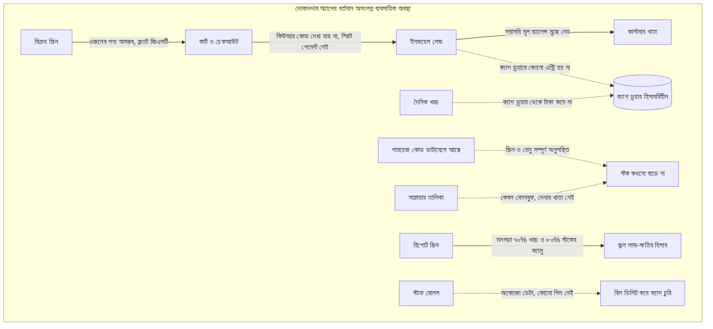
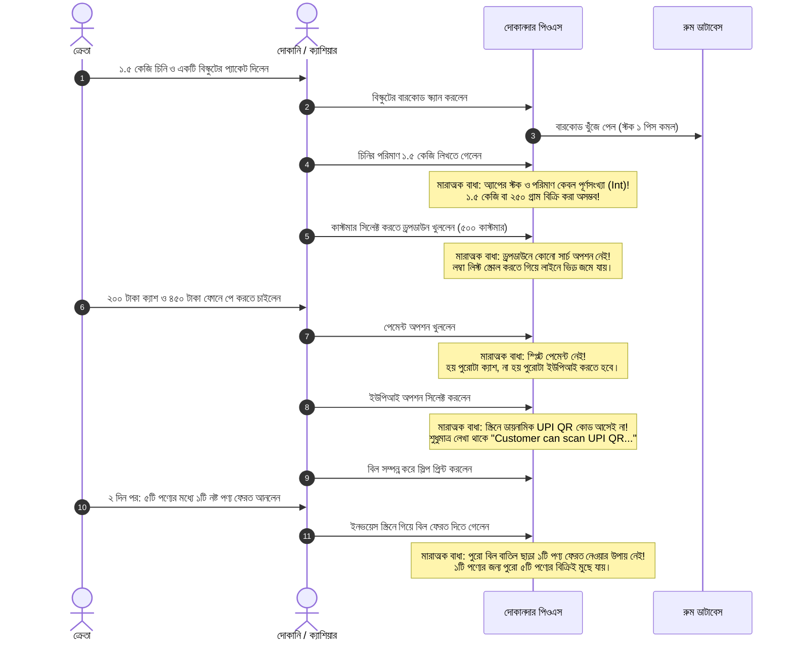
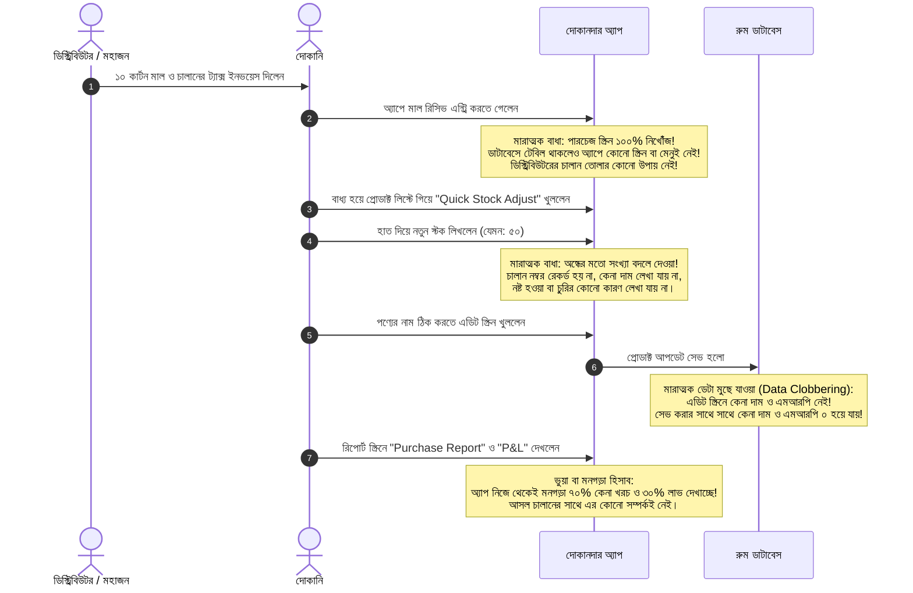
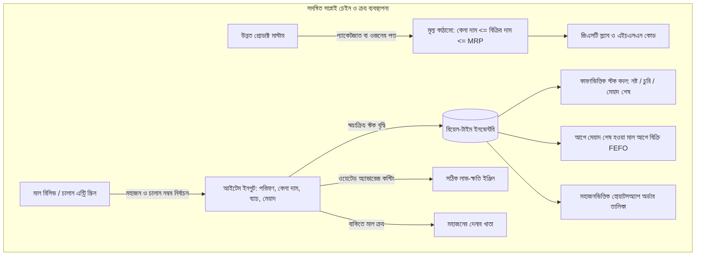
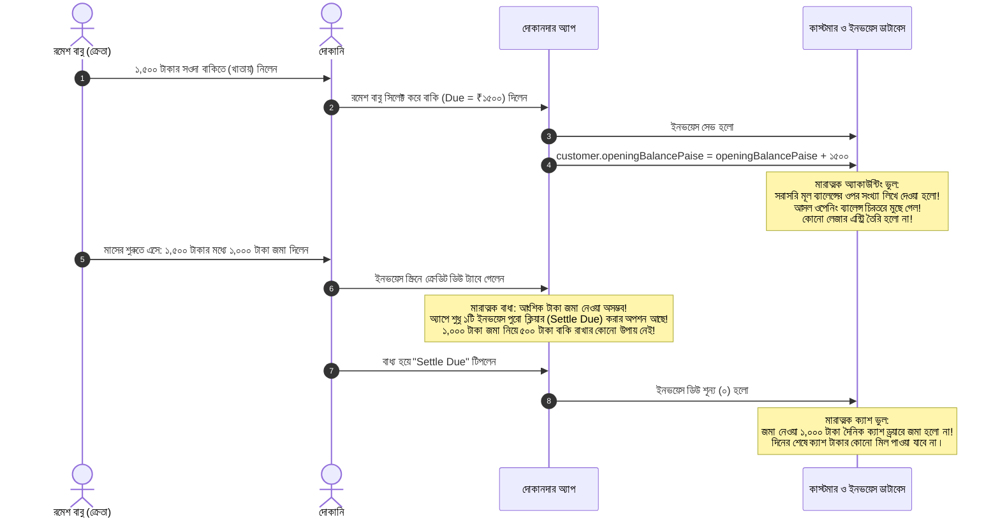
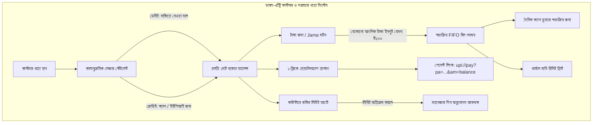
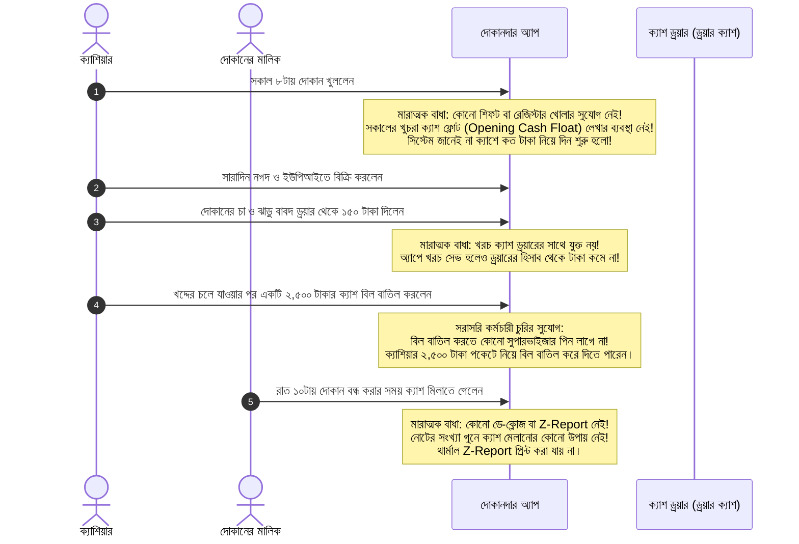
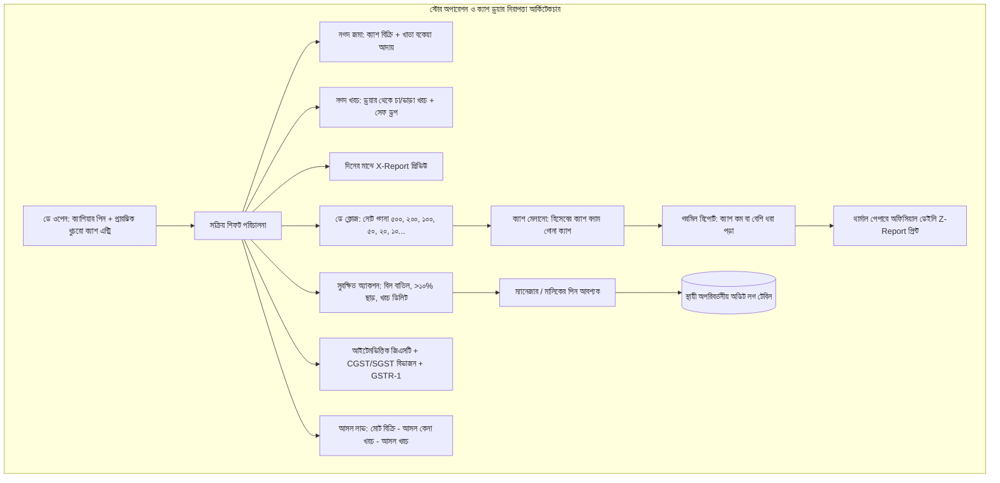

# দোকানদার পিওএস (Dokandaar POS) — ব্যবসায়িক প্রক্রিয়া ও রিটেল ওয়ার্কফ্লোর গভীর বিশ্লেষণ

**বিশ্লেষিত প্রজেক্ট:** `c:\Users\aksha\OneDrive\Desktop\Billing App\kotlin_billing_app`  
**প্রতিবেদনের ধরন:** ব্যবসায়িক প্রক্রিয়া (Business Flow), গ্রাহক/দোকানি সফর (User Journey) এবং পরিচালনাগত নিরীক্ষা  
**তারিখ:** নভেম্বর ২০২৬  
**বিশ্লেষক দল:** অ্যান্টিগ্র্যাভিটি মাল্টি-এজেন্ট বিজনেস অ্যানালিসিস টিম  
- **সাব-এজেন্ট ১:** বিক্রয়, চেকআউট ও বিক্রয়োত্তর লাইফসাইকেল বিশ্লেষক  
- **সাব-এজেন্ট ২:** ইনভেন্টরি, সাপ্লাই চেইন ও ক্রয় (Purchasing) বিশ্লেষক  
- **সাব-এজেন্ট ৩:** কাস্টমার খাতা (বাকির লেজার) ও ক্রেডিট ম্যানেজমেন্ট বিশ্লেষক  
- **সাব-এজেন্ট ৪:** আর্থিক হিসাবরক্ষণ, ক্যাশ ড্রয়ার ও দৈনিক পরিচালনা বিশ্লেষক  

---

## নির্বাহী সারসংক্ষেপ: রিটেল কাউন্টারের বাস্তব চিত্র বনাম বর্তমান দোকানদার অ্যাপ

ভারতীয় ও দক্ষিণ এশিয়ার মুদি দোকান (কিরানা স্টোর), ডিপার্টমেন্টাল শপ এবং খুচরা ব্যবসার জন্য পয়েন্ট-অফ-সেল (POS) সিস্টেম কেবল একটি বিল প্রিন্টার নয়, এটি পুরো ব্যবসার চালিকাশক্তি। এই বাস্তবতায়:
- ক্যাশিয়ারকে প্রতি ক্রেতার বিল **১৫ থেকে ৩০ সেকেন্ডের মধ্যে** শেষ করতে হয়।
- ক্রেতারা প্রায়ই ওজনের বা খোলা পণ্য নেন (যেমন: ২৫০ গ্রাম জিরে, ১.৫ কেজি চিনি, ৭৫০ মিলি তেল), দরদাম করেন এবং ক্যাশ ও ইউপিআই (PhonePe, GPay) মিলিয়ে স্প্লিট পেমেন্ট করতে চান।
- পাড়ার পরিচিত ক্রেতারা বাকিতে (খাতায়) পণ্য নেন, যার সঠিক লেজার রাখা এবং কিস্তিতে আংশিক টাকা পরিশোধ নেওয়া জরুরি।
- ডিস্ট্রিবিউটররা বাকিতে পণ্য ডেলিভারি দিয়ে চালান দিয়ে যান।
- রাতে দোকান বন্ধের সময় ক্যাশ ড্রয়ারের নগদ টাকার সাথে সিস্টেমের বিক্রির হিসাব মিলিয়ে কর্মচারী চুরি ধরা, আসল পাইকারি খরচের ওপর লাভ দেখা এবং জিএসটি হিসাব বের করা আবশ্যক।

দোকানদার অ্যাপটি অ্যান্ড্রয়েড জেটপ্যাক কম্পোজ এবং ব্লুটুথ থার্মাল প্রিন্টারে সক্ষম হলেও, এর **ব্যবসায়িক লজিক ও পরিচালনাগত প্রক্রিয়ায় বড় ধরনের বিচ্ছিন্নতা, মারাত্মক হিসাবগত ত্রুটি এবং ক্যাশ চুরির ঝুঁকি** রয়েছে।

---



---

## সেকশন ১: সাব-এজেন্ট ১ বিশ্লেষণ — বিক্রয়, চেকআউট এবং বিক্রয়োত্তর লাইফসাইকেল

### ১.১ কাউন্টারে চেকআউটের বর্তমান ধাপ বনাম বাস্তব চিত্র



---

### ১.২ চিহ্নিত প্রধান ব্যবসায়িক সমস্যা ও পরিচালনাগত বাধা

1. **ভগ্নাংশ বা ওজনের পণ্য বিক্রি অসম্ভব (Strictly Integer Quantities):**
   - **কোডের বাস্তবতা:** `CartItem.kt` ফাইলে পণ্যের পরিমাণ `val quantity: Int = 1` হিসেবে নির্দিষ্ট।
   - **ব্যবসায়িক সমস্যা:** মুদি ও জেনারেল স্টোরে আলু, চিনি, চাল, তেল, ডাল ইত্যাদি ওজনে বিক্রি হয় (যেমন: ২৫০ গ্রাম, ১.৫ কেজি, ৭৫০ মিলি)। পূর্ণসংখ্যা ছাড়া দশমিক না নেওয়ায় ক্যাশিয়ার এগুলো বিক্রি করতে পারেন না। নিরুপায় হয়ে দোকানিকে "Sugar 250g", "Sugar 500g", "Sugar 1kg" নামে অপ্রয়োজনীয় আলাদা পণ্য তৈরি করতে হয়।
2. **কাউন্টারে তাৎক্ষণিক দাম পরিবর্তনের সুযোগ নেই (No On-the-Fly Pricing):**
   - **ব্যবসায়িক সমস্যা:** কাঁচাবাজার ও পচনশীল পণ্যের পাইকারি দাম প্রতিদিন বদলায়। তাছাড়া সামান্য ছেঁড়া প্যাকেটের পণ্য ছাড়ে বিক্রি বা বিশেষ ক্রেতার জন্য দরদাম করার প্রয়োজন পড়ে। বর্তমান অ্যাপে লাইন-আইটেমের বিক্রির দাম এডিট করার কোনো অপশন নেই।
3. **আনলিস্টেড বা তাৎক্ষণিক মিসেলেনিয়াস পণ্য যোগ করা যায় না:**
   - **ব্যবসায়িক সমস্যা:** ভিড়ের সময় কোনো পণ্যের বারকোড কাজ না করলে বা কাস্টমার হঠাৎ ক্যারি-ব্যাগ চাইলে ক্যাশিয়ার `Misc Item: ₹50` লিখে বিক্রি করতে পারেন না। তাকে বিলিং থামিয়ে প্রোডাক্ট ট্যাবে গিয়ে সম্পূর্ণ ফর্ম পূরণ করে পণ্য বানাতে হয়।
4. **এক লাইনে স্ক্রোল করা অস্বস্তিকর ইউজার ইন্টারফেস (Horizontal LazyRow):**
   - **ব্যবসায়িক সমস্যা:** সেলস স্ক্রিনে পণ্যগুলো একটিমাত্র আনুভূমিক লাইনে থাকে (`LazyRow`)। একটি ক্যাটাগরিতে ৫০টি পণ্য থাকলে আঙুল দিয়ে ২০ বারের বেশি সোয়াইপ করতে হয়, যা কাউন্টারে বিলিংয়ের গতি কমিয়ে দেয়।
5. **আইটেম-ভিত্তিক ডিসকাউন্টের অভাব:**
   - **ব্যবসায়িক সমস্যা:** অ্যাপে শুধু পুরো বিলের ওপর ডিসকাউন্ট দেওয়া যায়। নির্দিষ্ট কোনো পণ্যের ওপর "₹১০ ছাড়" দেওয়ার ব্যবস্থা নেই। ফলে লাভ-ক্ষতির হিসাব এবং জিএসটি হিসাব ভুল হয়।
6. **স্টক শেষ হলে বিলিং সম্পূর্ণ আটকে যাওয়া (Hard Stock Lockout):**
   - **ব্যবসায়িক সমস্যা:** নতুন আসা পণ্যের কার্টন দোকানে ঢুকেছে কিন্তু অ্যাপে এখনো স্টক এন্ট্রি করা হয়নি। ক্রেতা পণ্য কাউন্টারে আনলে অ্যাপ বলে "Out of Stock" এবং বিল আটকে দেয়। বাস্তবসম্মত পিওএস-এ ওয়ার্নিং দিয়ে বিক্রি চালিয়ে নেওয়ার সুবিধা থাকে।
7. **সার্চবিহীন কাস্টমার ড্রপডাউন (৫০০+ কাস্টমার):**
   - **ব্যবসায়িক সমস্যা:** কাস্টমার খোঁজার ড্রপডাউনে কোনো সার্চ বার নেই। শত শত খাতা ক্রেতার মধ্যে নাম খুঁজতে গেলে কাউন্টারে দীর্ঘ লাইন লেগে যায়।
8. **স্ক্রিনে ডায়নামিক UPI QR কোড না আসা:**
   - **ব্যবসায়িক সমস্যা:** কোডে ZXing লাইব্রেরি দিয়ে সঠিক টাকার কিউআর তৈরির কোড থাকলেও পেমেন্ট স্ক্রিনে কোনো QR কোড দেখানো হয় না! শুধু লেখা থাকে "Customer can scan UPI QR..."। ক্রেতা নিজের ফোন দিয়ে স্ক্রিন স্ক্যান করে পেমেন্ট করতে পারেন না।
9. **স্প্লিট পেমেন্ট (Split Tender) না থাকা:**
   - **ব্যবসায়িক সমস্যা:** ৫০০ টাকার বিলে ক্রেতা ২০০ টাকা ক্যাশ এবং ৩০০ টাকা ইউপিআই দিতে চাইলে অ্যাপে তা নেওয়া যায় না। ক্যাশিয়ারকে জোর করে যেকোনো একটি মাধ্যম বেছে নিতে হয়, ফলে ক্যাশ ড্রয়ারের ব্যালেন্স ভুল হয়।
10. **বিল হোল্ড করলে হোম স্ক্রিনে বের করে দেওয়া:**
    - **ব্যবসায়িক সমস্যা:** কোনো ক্রেতা পণ্য আনতে ভুলে গেলে তার বিল "Hold" করলে অ্যাপ ক্যাশিয়ারকে সরাসরি হোম স্ক্রিনে বের করে দেয়। অথচ উদ্দেশ্য ছিল সাথে সাথে পরবর্তী ক্রেতার বিল শুরু করা। হোল্ড বিল ফিরিয়ে আনতে ৬টি ধাপ পার হতে হয়।
11. **আংশিক পণ্য ফেরত নেওয়া অসম্ভব (Nuclear All-or-Nothing Void):**
    - **ব্যবসায়িক সমস্যা:** ক্রেতা ৫টি পণ্যের মধ্যে ১টি নষ্ট পণ্য ফেরত আনলে পুরো ইনভয়েস বাতিল করতে হয়। বাকি ৪টি পণ্য আবার নতুন করে স্ক্যান করে বিল করতে হয়।
12. **পিন ছাড়া বিল ক্যানসেল (চুরির ঝুঁকি):**
    - **নিরাপত্তা ঝুঁকি:** যেকোনো কর্মচারী ক্যাশিয়ারের ফোন থেকে এক ট্যাপে যেকোনো পুরনো বিল ক্যানসেল করে ক্যাশ টাকা পকেটে ঢুকিয়ে নিতে পারে, কারণ এতে কোনো অ্যাডমিন পিন চাওয়া হয় না।
13. **হোয়াটসঅ্যাপ ডিজিটাল রসিদ না থাকা:**
    - কাগজের রোল শেষ হয়ে গেলে বা ক্রেতা মেসেজে বিল চাইলে হোয়াটসঅ্যাপে সরাসরি ডিজিটাল চালান পাঠানোর কোনো ব্যবস্থা নেই।

---

### ১.৩ সাব-এজেন্ট ১ প্রস্তাবিত ওয়ার্কফ্লো রিডিজাইন

```mermaid
graph TD
    subgraph Redesigned_POS_Workflow["উন্নত ও দ্রুতগতির পিওএস ওয়ার্কফ্লো"]
        Input[পণ্য ইনপুট] -->|বারকোড / ২-৩ কলাম গ্রিড / '+ কাস্টম আইটেম'| Cart[সক্রিয় কার্ট]
        Cart -->|ওজনের দশমিক পরিমাণ: ১.২৫ কেজি| LineCtrl[লাইন আইটেম নিয়ন্ত্রণ]
        Cart -->|দাম পরিবর্তন / আইটেম ডিসকাউন্ট| LineCtrl
        LineCtrl --> MultiCart[টপ-বারে একাধিক কার্ট ট্যাব: কার্ট ১ | কার্ট ২ | +]
        
        MultiCart --> CustPicker[সার্চেবল কাস্টমার বটম শীট]
        CustPicker -->|পূর্বের বাকি ও লিমিট প্রদর্শন| Tender[চেকআউট ও পেমেন্ট]
        
        Tender -->|স্প্লিট পেমেন্ট: ২০০ ক্যাশ + ৪৫০ ইউপিআই| PayProc[পেমেন্ট প্রসেসিং]
        PayProc -->|স্ক্রিনে ডায়নামিক কিউআর কোড প্রদর্শন| Receipt[থার্মাল প্রিন্ট + হোয়াটসঅ্যাপে শেয়ার]
        
        Receipt --> Returns[আংশিক পণ্য ফেরত ও বদল]
        Returns -->|ম্যানেজার পিন আবশ্যক| CreditNote[ক্রেডিট নোট / ক্যাশ ফেরত]
    end
```

1. **দশমিক পরিমাণ ও পরিমাপের একক:** `Piece`, `Kg`, `Gm`, `Litre`, `Ml`, `Metre` ইত্যাদি একক সহ দশমিক পরিমাণের ($0.00১\text{ থেকে }৯৯৯৯.৯৯৯$) সমর্থন চালু করা।
2. **স্ক্রিনের ওপরে মাল্টি-কার্ট ট্যাব:** ক্যাশিয়ারকে হোম স্ক্রিনে বের না করে ওপরে একাধিক ট্যাব রাখা (`[কার্ট ১ (চালু)]`, `[কার্ট ২ (হোল্ড)]`, `[+]`), যাতে ১ ক্লিকে ক্রেতা বদলানো যায়।
3. **স্ক্রিনে ডায়নামিক UPI QR ও স্প্লিট পেমেন্ট:** সঠিক টাকার কিউআর সরাসরি পেমেন্ট শিটে দেখানো এবং ক্যাশ, ইউপিআই ও বাকির মিশ্রণে বিল করার সুবিধা।
4. **সার্চযোগ্য কাস্টমার প্যানেল ও বাকির সতর্কবার্তা:** কাস্টমার বাছাইয়ের জন্য সার্চ বার যুক্ত করা এবং নাম সিলেক্ট করলেই তার আগের মোট বাকি লাল রঙে ফুটিয়ে তোলা।
5. **আইটেম-ভিত্তিক রিটার্ন ও ক্রেডিট নোট:** বিলের নির্দিষ্ট ১টি পণ্য ফেরত নিয়ে ক্যাশ ফেরত বা পরবর্তী কেনাকাটার জন্য ক্রেডিট ভাউচার ইস্যু করার সুযোগ (ম্যানেজার পিন দ্বারা সুরক্ষিত)।

---

## সেকশন ২: সাব-এজেন্ট ২ বিশ্লেষণ — ইনভেন্টরি, সাপ্লাই চেইন ও ক্রয় (Purchasing) ওয়ার্কফ্লো

### ২.১ মাল তোলার বর্তমান ধাপ বনাম খুচরা ব্যবসার বাস্তব চিত্র



---

### ২.২ চিহ্নিত প্রধান ব্যবসায়িক সমস্যা ও পরিচালনাগত বাধা

1. **"ভূতুড়ে" পারচেজ পাইপলাইন (কোড আছে কিন্তু স্ক্রিন নেই):**
   - **কোডের বাস্তবতা:** ডাটাবেসে `PurchaseEntity`, `PurchaseItemEntity`, `PurchaseDao`, এবং `PurchaseRepository` সবই তৈরি করা আছে।
   - **ব্যবসায়িক সমস্যা:** কিন্তু অ্যাপে পারচেজ এন্ট্রি করার **কোনো স্ক্রিনই নেই**! `Screen.kt`-তে রুট থাকলেও `NavGraph.kt` এবং `MoreScreen.kt`-তে তা যুক্ত করা হয়নি। দোকানি কোনোভাবেই ডিস্ট্রিবিউটরের থেকে পাওয়া চালানের স্টক সিস্টেমে তুলতে পারেন না।
2. **পণ্য এডিট করলে কেনা দাম ও এমআরপি মুছে ০ হয়ে যাওয়া (Data Clobbering):**
   - **কোডের বাস্তবতা:** ডাটাবেসে `purchasePricePaise`, `mrpPaise`, `gstRate`, `minStockAlert` কলাম আছে।
   - **ব্যবসায়িক সমস্যা:** কিন্তু `AddEditProductScreen.kt` ফাইলে কেনা দাম বা এমআরপি লেখার কোনো ঘরই নেই! ফলে একবার কোনো পণ্য এডিট করে সেভ করলেই তার কেনা দাম ও এমআরপি ডাটাবেসে রিসেট হয়ে **শূন্য (০)** হয়ে যায়।
3. **রিপোর্টে সম্পূর্ণ মনগড়া আর্থিক হিসাব (Fake 70% COGS):**
   - **কোডের বাস্তবতা:** `ReportsScreen.kt` ফাইলে লাভের হিসাব এভাবে লেখা:
     ```kotlin
     val goodsCost = totalSalesPaise * 70 / 100 // মনগড়া ৭০% খরচ!
     val grossProfit = (totalSalesPaise - goodsCost).coerceAtLeast(0L)
     Text("Gross Margin: 30%") // মনগড়া ৩০% লাভ!
     Text("Stock Valuation: ${Money(totalSalesPaise * 80 / 100).format()}") // মনগড়া ৮০% স্টক ভ্যালু!
     ```
   - **ব্যবসায়িক সমস্যা:** মুদি দোকানে তেলে লাভ থাকে ৩%, প্রসাধনীতে ৩০%। কিন্তু দোকানদার অ্যাপ কোনো হিসাব না করেই ধরে নেয় সব পণ্যে ৭০% খরচ এবং ৩০% লাভ! এটি ব্যবসায়ীকে সম্পূর্ণ ভুল পথে পরিচালিত করে।
4. **অন্ধের মতো স্টক পরিবর্তন ("Quick Stock Adjust"):**
   - **ব্যবসায়িক সমস্যা:** স্টক ১০ থেকে ৭ হলে ক্যাশিয়ার সরাসরি ৭ লিখে দেন। কিন্তু বাকি ৩ পিস নষ্ট হলো, ইঁদুরে খেলো, চুরি হলো নাকি ফেরত গেল—তার কোনো কারণ কোড বা অডিট ট্রেইল থাকে না।
5. **বিচ্ছিন্ন সাপ্লায়ার ডিরেক্টরি:**
   - **ব্যবসায়িক সমস্যা:** সাপ্লায়ার স্ক্রিনটি কেবল একটি ফোনবুক ডিরেক্টরি। কোন সাপ্লায়ার থেকে কী মাল নেওয়া হয়েছে বা মহাজনের কত টাকা বাকি—তার কোনো হিসাব অ্যাপে নেই।
6. **ব্যাচ নম্বর ও মেয়াদের (Expiry) সম্পূর্ণ অনুপস্থিতি:**
   - **ব্যবসায়িক ঝুঁকি:** মুদি, দুধ, বেকারি ও ওষুধে ব্যাচ নম্বর এবং এক্সপায়ারি ডেট থাকা বাধ্যতামূলক। মেয়াদোত্তীর্ণ পণ্য বিক্রি করলে দোকান সিলগালা হতে পারে। তাছাড়া কোম্পানি থেকে এক্সপায়ারি ফেরত নেওয়ার সুযোগও অ্যাপে নেই।

---

### ২.৩ সাব-এজেন্ট ২ প্রস্তাবিত ওয়ার্কফ্লো রিডিজাইন



1. **মাল রিসিভ (GRN / Purchases) স্ক্রিন চালু করা:** ডিস্ট্রিবিউটরের চালান দেখে পণ্য স্ক্যান করে স্টক বৃদ্ধি করা এবং বিলের হিসাব রাখা।
2. **প্রোডাক্ট ফর্মে কেনা দাম ও এমআরপি উন্মুক্ত করা:** কেনা দাম $\le$ বিক্রির দাম $\le$ এমআরপি বাধ্যতামূলক করা এবং পণ্য তৈরির সময়ই সম্ভাব্য লাভের মার্জিন দেখানো।
3. **ওয়েটেড অ্যাভারেজ কস্টিং (WAC) ও আসল লাভ:** মনগড়া ৭০/৩০ হিসাব সরিয়ে ইনভয়েস চালানের কেনা দাম থেকে আসল লাভ হিসাব করা:
   $$\text{আসল কেনা খরচ (COGS)} = \sum (\text{বিক্রির পরিমাণ} \times \text{ঐ চালানের কেনা দাম})$$
4. **কারণ সহ স্টক সংশোধন ও ফিজিক্যাল অডিট:** নষ্ট, ভাঙা, মেয়াদ শেষ বা চুরির কারণ সিলেক্ট করে স্টক কমানোর ব্যবস্থা এবং দোকান মিলানোর অডিট শিট।
5. **ব্যাচ ও এক্সপায়ারি ট্র্যাকিং (FEFO):** যেসব পণ্যের মেয়াদ আগে শেষ হবে সেগুলো আগে বিক্রির ওয়ার্কফ্লো এবং ৩০ দিন আগের মেয়াদোত্তীর্ণ সতর্কবার্তা।

---

## সেকশন ৩: সাব-এজেন্ট ৩ বিশ্লেষণ — কাস্টমার খাতা (বাকির লেজার) ও ক্রেডিট ম্যানেজমেন্ট

### ৩.১ বাকির লাইফসাইকেল: বর্তমান অবস্থা বনাম বাস্তব খাতা



---

### ৩.২ চিহ্নিত প্রধান ব্যবসায়িক সমস্যা ও পরিচালনাগত বাধা

1. **আসল খাতা বা লেজার সম্পূর্ণ অনুপস্থিত:**
   - **ব্যবসায়িক সমস্যা:** অ্যাপে কোনো কাস্টমার লেজার বা স্টেটমেন্ট নেই। ক্রেতা এসে বললে: *"আমার মোট কত বাকি এবং কোন তারিখে কী মাল নিয়েছি দেখান"*, দোকানদার তা দেখাতে পারে না। কাস্টমার কার্ডে শুধু মোট টাকার সংখ্যা লেখা থাকে, ট্যাপ করলে কিছু খোলে না।
2. **লেজার না রেখে মূল ব্যালেন্স মুছে ফেলা (Destructive Mutation):**
   - **কোডের বাস্তবতা:** ইনভয়েস ডিউ হলে অ্যাপ সরাসরি `customer.openingBalancePaise`-এর ওপর যোগ করে দেয়।
   - **ব্যবসায়িক সমস্যা:** `openingBalancePaise` হলো অ্যাকাউন্ট খোলার সময়কার মূল উদ্বৃত্ত। বিক্রির পর এটি পরিবর্তন করলে পেছনের সব হিসাব মুছে যায়। কোনো ডেবিট বা ক্রেডিট ট্রানজ্যাকশন টেবিল না থাকায় অডিট করা অসম্ভব।
3. **আংশিক টাকা জমা নেওয়া অসম্ভব (Zero Partial Payment):**
   - **ব্যবসায়িক সমস্যা:** পাড়ার দোকানে ক্রেতারা কখনোই এক চালানের সঠিক টাকা দেন না; তারা রাউন্ড ফিগারে টাকা দেন (যেমন: ২,৩৫০ টাকা বাকির মধ্যে ১,০০০ টাকা জমা)। দোকানদার অ্যাপে **আংশিক টাকা জমা নেওয়ার কোনো অপশনই নেই**! শুধু নির্দিষ্ট একটি ইনভয়েস পুরো শূন্য করার ব্যবস্থা আছে।
4. **বাকি আদায়ের টাকা ক্যাশ ড্রয়ারে যুক্ত না হওয়া:**
   - **ব্যবসায়িক সমস্যা:** কাস্টমারের থেকে বকেয়া টাকা আদায় করলে তা ইনভয়েসে শূন্য হয়, কিন্তু **দিনের ক্যাশ ড্রয়ার বা ক্যাশবইয়ে কোনো এন্ট্রি হয় না**। ফলে রাতে ক্যাশিয়ার বা মালিকের হাতে থাকা টাকার সাথে সিস্টেমের বিক্রির টাকার গরমিল দেখা দেয়।
5. **কাস্টমার আইডি না থাকা ও নাম্বারের ওপর নির্ভরতা:**
   - **কোডের বাস্তবতা:** বিলে কাস্টমারের কোনো ইউনিক আইডি থাকে না, শুধু নাম ও ফোন নাম্বার স্ট্রিং হিসেবে থাকে। কাস্টমার নাম্বার বদলালে বা নাম্বার ছাড়া বাকি দিলে তা খাতার ব্যালেন্সে কখনো যুক্ত হয় না।
6. **বাকির কোনো সীমা বা ওয়ার্নিং না থাকা:**
   - কাস্টমারকে সর্বোচ্চ কত টাকা পর্যন্ত বাকি দেওয়া যাবে (Credit Limit), তার কোনো ব্যবস্থা নেই। নতুন কর্মচারী অনির্দিষ্টকালের জন্য যে কাউকেই বাকি দিয়ে দিতে পারে।
7. **হোয়াটসঅ্যাপে তাগাদা পাঠানোর ব্যবস্থা না থাকা:**
   - খাতায় বাকি থাকা কাস্টমারদের ১ ক্লিকে হোয়াটসঅ্যাপ বা এসএমএসে মোট বাকি ও ইউপিআই পেমেন্ট লিংক সহ রিমাইন্ডার পাঠানোর কোনো সুযোগ নেই।

---

### ৩.৩ সাব-এজেন্ট ৩ প্রস্তাবিত ওয়ার্কফ্লো রিডিজাইন



1. **স্থায়ী ডাবল-এন্ট্রি লেজার (`CustomerLedgerEntity`):** সরাসরি ব্যালেন্স না মুছে প্রতিটি বাকি বিক্রিকে ডেবিট এবং প্রতিটি জমাকে ক্রেডিট হিসেবে রেকর্ড করা:
   $$\text{চলতি মোট বাকি} = \text{প্রারম্ভিক বাকি} + \sum \text{বাকিতে বিক্রি} - \sum \text{নগদ/ইউপিআই জমা}$$
2. **অ্যাকাউন্ট লেভেলে আংশিক জমা ও FIFO বিল সমন্বয়:** ক্রেতা যেকোনো পরিমাণ টাকা দিলে তা গ্রহণ করা এবং স্বয়ংক্রিয়ভাবে সবচেয়ে পুরনো চালানগুলোর বাকি আগে মেটানো।
3. **খাতা স্টেটমেন্ট ও পিডিএফ রসিদ:** কাস্টমার প্রোফাইল খুললেই বিগত সব কেনাকাটা ও জমার তারিখভিত্তিক তালিকা দেখা এবং ১ ক্লিকে পিডিএফ স্টেটমেন্ট ডাউনলোড।
4. **আদায়ের টাকা ক্যাশ ড্রয়ারে যোগ করা:** বাকি আদায় হওয়া মাত্র ক্যাশ ড্রয়ারের ব্যালেন্স বাড়িয়ে দেওয়া।
5. **হোয়াটসঅ্যাপ রিমাইন্ডার ও ইউপিআই লিংক:** ১ ক্লিকে ক্রেতার হোয়াটসঅ্যাপে বকেয়া হিসাব এবং পেমেন্ট করার ডিরেক্ট ইউপিআই লিংক (`upi://pay?pa=...`) পাঠানো।
6. **মহাজনের দেনার খাতা (Supplier Payables):** কাস্টমার খাতার মতো ডিস্ট্রিবিউটরের চালানের বাকি এবং পরিশোধ ট্র্যাক করার পৃথক মহাজন খাতা।

---

## সেকশন ৪: সাব-এজেন্ট ৪ বিশ্লেষণ — আর্থিক হিসাবরক্ষণ, ক্যাশ ড্রয়ার ও দৈনিক পরিচালনা

### ৪.১ দৈনিক দোকান পরিচালনার বাস্তব চিত্র বনাম বর্তমান অ্যাপ



---

### ৪.২ চিহ্নিত প্রধান ব্যবসায়িক সমস্যা ও পরিচালনাগত বাধা

1. **শিফট ও ক্যাশ ড্রয়ার ব্যবস্থাপনার সম্পূর্ণ অনুপস্থিতি:**
   - **ব্যবসায়িক সমস্যা:** অ্যাপে `shifts`, `cash_drawer_sessions`, বা `cash_transactions` নামে কোনো টেবিলই নেই। সকালে খুচরো বাবদ ড্রয়ারে কত টাকা রাখা হলো (Opening Float) তা লেখার কোনো ব্যবস্থা নেই। দিনের শেষে কত টাকা জমা হওয়ার কথা আর ড্রয়ারে গুনে কত পাওয়া গেল—তার কোনো ভ্যারিয়েন্স হিসাব হয় না। ফলে ক্যাশিয়ার টাকা চুরি করলে তা ধরা অসম্ভব।
2. **খরচের টাকা ক্যাশ ড্রয়ার থেকে না কমা:**
   - **কোডের বাস্তবতা:** `ExpensesScreen.kt` ফাইলে পেমেন্ট মেথড `"CASH"` লেখা থাকলেও তা ড্রয়ারের ক্যাশ কমায় না।
   - **ব্যবসায়িক সমস্যা:** ড্রয়ার থেকে দোকান ভাড়া বা বিদ্যুৎ বিলের ৫,০০০ টাকা দিলে সিস্টেমে ক্যাশ একই থেকে যায়, ফলে রাতে ক্যাশ মেলাতে গেলে ৫,০০০ টাকার গরমিল নিশ্চিত।
3. **বিল বাতিল করে সরাসরি ক্যাশ চুরি করার সুযোগ:**
   - **মারাত্মক নিরাপত্তা ঝুঁকি:** ইনভয়েস স্ক্রিনে গিয়ে যেকোনো বিল এক ট্যাপেই বাতিল (`voidInvoice`) করা যায়। কোনো মালিকের পিন চাওয়া হয় না। অসাধু কর্মচারী ক্যাশ বিক্রি করে রসিদ ক্রেতাকে দিয়ে, ক্রেতা চলে যাওয়ার পর বিল ডিলিট করে টাকা নিজের পকেটে ঢুকিয়ে নিতে পারে।
4. **স্টাফ রোলসের নামে কাগুজে ফিচার (Cosmetic Roles):**
   - **কোডের বাস্তবতা:** `UserAccessScreen.kt` ফাইলে "Cashier", "Manager", "Admin" রোল তৈরি করা যায়, যা শুধুই ডাটা স্টোরে একটি টেক্সট হিসেবে সেভ থাকে।
   - **ব্যবসায়িক সমস্যা:** কোনো লগইন স্ক্রিন নেই, বিলে ক্যাশিয়ারের নাম ওঠে না এবং রোলের কোনো কার্যকারিতাই অ্যাপে নেই। ক্যাশিয়ার মালিকের সব লাভ-ক্ষতি ও সেটিংসে ঢুকতে পারে।
5. **ফ্ল্যাট জিএসটি ট্যাক্স ও ভুল বিলিং:**
   - **ব্যবসায়িক সমস্যা:** অ্যাপে পুরো দোকানের জন্য একটিমাত্র ট্যাক্স রেট (যেমন ১৮%) থাকে। চাল-ডালে ০%, তেলে ৫%, বিস্কুটে ১৮% জিএসটি থাকা সত্ত্বেও অ্যাপ পুরো বিলের ওপর ১৮% ট্যাক্স বসিয়ে দেয়, যা আইনের দৃষ্টিতে বেআইনি। তাছাড়া ইনভয়েসে CGST/SGST ভাগ এবং HSN কোড থাকে না, ফলে এই বিল দিয়ে কোনো ব্যবসায়ী জিএসটি রিটার্ন (GSTR-1) দাখিল করতে পারবে না।

---

### ৪.৩ সাব-এজেন্ট ৪ প্রস্তাবিত ওয়ার্কফ্লো রিডিজাইন



1. **শিফট ও ক্যাশ ড্রয়ার লাইফসাইকেল:**
   - **ডে ওপেন (Day Open):** সকালে ক্যাশিয়ার পিন এবং ড্রয়ারে রাখা প্রারম্ভিক ক্যাশ (Opening Float) লিখে শিফট শুরু।
   - **চলতি ক্যাশ হিসাব:** সারাদিনের নগদ বিক্রি এবং বকেয়া আদায়ের টাকা স্বয়ংক্রিয়ভাবে ড্রয়ার ব্যালেন্সে যোগ হবে; ড্রয়ার থেকে খরচ দিলে তা মাইনাস হবে।
   - **ডে ক্লোজ ও Z-Report:** রাতে দোকান বন্ধের সময় ৫০০, ২০০, ১০০, ৫০, ২০ টাকার কয়েন/নোট গুনে ইনপুট দেওয়া। সিস্টেমের হিসাবের সাথে বাস্তব টাকার পার্থক্য (Variance) বের করা এবং থার্মাল পেপারে সিলগালা **Daily Z-Report** প্রিন্ট করা।
2. **আসল প্রফিট ও লস ইঞ্জিন (True P&L):**
   মনগড়া ৭০% বাদ দিয়ে আসল চালানের কেনা দাম ও পরিচালন খরচ বাদ দিয়ে লাভ নির্ধারণ:
   $$\text{গ্রস প্রফিট} = \text{মোট বিক্রি (ট্যাক্স ছাড়া)} - \text{বিক্রিত পণ্যের আসল ক্রয়মূল্য (COGS)}$$
   $$\text{নেট প্রফিট} = \text{গ্রস প্রফিট} - \text{দোকানের মোট খরচ}$$
3. **দ্বি-স্তরীয় জিএসটি কমপ্লায়েন্স:** প্রতিটি পণ্যের জন্য নির্দিষ্ট জিএসটি স্ল্যাব (০%, ৫%, ১২%, ১৮%, ২৮%) এবং HSN কোড অনুযায়ী বিলে ৫০/৫০ CGST ও SGST ভাগ দেখানো এবং GSTR-1 রিপোর্ট তৈরি।
4. **সুপারভাইজার পিন ও অপরিবর্তনীয় অডিট লগ:** বিল বাতিল, ১০%-এর বেশি ডিসকাউন্ট, পণ্যের স্টক পরিবর্তন বা খরচ মোছার মতো ঝুঁকিপূর্ণ কাজগুলোতে ম্যানেজারের পিন বাধ্যতামূলক করা এবং কে কোন সময়ে কী কাজ করেছে তার স্থায়ী অডিট লগ রাখা।

---

## সেকশন ৫: সমন্বিত মাস্টার রিটেল ওয়ার্কফ্লো ব্লুপ্রিন্ট

দোকানের দৈনন্দিন কাজগুলোকে একটি পূর্ণাঙ্গ চেইনে বাঁধার মাস্টার ফ্রেমওয়ার্ক:

```mermaid
flowchart TD
    subgraph Morning_Opening["১. সকাল: দোকান ও শিফট শুরু"]
        OpenReg[রেজিস্টার ওপেন] --> FloatCount[সকালের ক্যাশ ফ্লোট গণনা]
        FloatCount --> SetRegister[রেজিস্টার স্ট্যাটাস: OPEN]
    end

    subgraph Procurement_Loop["২. সরবরাহ: মহাজনের চালান ও স্টক এন্ট্রি"]
        DistDelivery[মাল ডেলিভারি] --> GRNEntry[চালান এন্ট্রি / GRN]
        GRNEntry --> UpdateStock[স্টক বৃদ্ধি]
        GRNEntry --> UpdateWAC[কেনা দাম আপডেট]
        GRNEntry --> SuppKhata[মহাজনের খাতায় বাকি পোস্টিং]
    end

    subgraph Sales_Loop["৩. কাউন্টার: দ্রুতগতির চেকআউট ও বিক্রি"]
        CustomerBasket[ক্রেতার পণ্যের ঝুড়ি] --> POS[পিওএস বিলিং স্ক্রিন]
        POS --> ScanAdd[বারকোড স্ক্যান / ওজনের পণ্য / ২-৩ কলাম গ্রিড]
        POS --> CustSelect[কাস্টমার সার্চ ও বকেয়া যাচাই]
        POS --> Tender[স্প্লিট পেমেন্ট: ক্যাশ + ইউপিআই]
        Tender --> DynQR[স্ক্রিনে ডায়নামিক UPI QR]
        Tender --> PrintSlip[থার্মাল স্লিপ প্রিন্ট + হোয়াটসঅ্যাপ রসিদ]
    end

    subgraph Khata_Loop["৪. খাতা: বাকির হিসাব ও বকেয়া আদায়"]
        UdhaarSale[বাকিতে বিক্রি] --> DebitCust[কাস্টমার খাতায় ডেবিট]
        Payday[ক্রেতার টাকা জমা] --> JamaEntry[জমা এন্ট্রি (Jama)]
        JamaEntry --> FIFOAlloc[পুরনো চালানের বাকি সমন্বয়]
        JamaEntry --> RegCashIn[ক্যাশ ড্রয়ারে টাকা জমা]
        JamaEntry --> PayReceipt[টাকা জমার থার্মাল রসিদ]
    end

    subgraph Night_Closing["৫. রাত: দোকান বন্ধ ও ক্যাশ মেলানো"]
        EndShift[ডে ক্লোজ ট্রিগার] --> BlindTally[শারীরিক ক্যাশ নোট গণনা]
        BlindTally --> CalcExpected[হিসাবের সম্ভাব্য ক্যাশ নির্ধারণ]
        CalcExpected --> Discrepancy[ক্যাশ কম/বেশি গরমিল যাচাই]
        Discrepancy --> PrintZReport[থার্মাল পেপারে Daily Z-Report প্রিন্ট]
        PrintZReport --> LockRegister[রেজিস্টার স্ট্যাটাস: CLOSED]
    end

    Morning_Opening --> Sales_Loop
    Procurement_Loop --> Sales_Loop
    Sales_Loop --> Khata_Loop
    Sales_Loop --> Night_Closing
    Khata_Loop --> Night_Closing
```

---

## সেকশন ৬: ব্যবসায়িক প্রক্রিয়ার সামগ্রিক তুলনামূলক ম্যাট্রিক্স

| ব্যবসায়িক বৈশিষ্ট্য | বর্তমান দোকানদার অ্যাপের অবস্থা | প্রস্তাবিত পূর্ণাঙ্গ রিটেল ওয়ার্কফ্লো | অবদানকারী সাব-এজেন্ট |
| :--- | :--- | :--- | :---: |
| **ওজনের খোলা পণ্য** | কেবল পূর্ণসংখ্যা (Int); দশমিক দিলে কাজ করে না | দশমিক ওজনের সম্পূর্ণ সমর্থন (কেজি, গ্রাম, লিটার, মিটার) | সাব-এজেন্ট ১ |
| **কাউন্টারে দরদাম** | ডাটাবেসের নির্দিষ্ট দামে আটকে থাকে | তাৎক্ষণিক লাইন আইটেমের দাম পরিবর্তনের সুবিধা | সাব-এজেন্ট ১ |
| **পণ্য খোঁজার ইউআই** | এক লাইনের অনুভূমিক স্ক্রোল (LazyRow) | ২/৩ কলামের রেসপন্সিভ গ্রিড ও লিস্ট ভিউ | সাব-এজেন্ট ১ |
| **কাস্টমার বাছাই** | স্ক্রোলিং ড্রপডাউন (কোনো সার্চ নেই) | মোবাইল ও নাম দিয়ে দ্রুত সার্চ করার বটম শিট | সাব-এজেন্ট ১ ও ৩ |
| **ইউপিআই কিউআর** | স্ক্রিনে কিউআর দেখায় না, শুধু টেক্সট | স্ক্রিনে সঠিক টাকার ডায়নামিক UPI QR প্রদর্শন | সাব-এজেন্ট ১ |
| **স্প্লিট পেমেন্ট** | হয় ক্যাশ, না হয় ইউপিআই | মিশ্র পেমেন্ট (যেমন: ২০০ ক্যাশ + ৪৫০ ইউপিআই) | সাব-এজেন্ট ১ |
| **বিল হোল্ড/পার্কিং** | ক্যাশিয়ারকে হোম স্ক্রিনে বের করে দেয় | ওপরে মাল্টি-কার্ট ট্যাব (`কার্ট ১ | কার্ট ২`) | সাব-এজেন্ট ১ |
| **পণ্য ফেরত (Returns)** | আংশিক ফেরত নেই, পুরো বিল বাতিল করতে হয় | নির্দিষ্ট ১টি পণ্য ফেরত, বদল ও ক্রেডিট নোট | সাব-এজেন্ট ১ |
| **মাল কেনার ইউআই** | কোড আছে কিন্তু কোনো স্ক্রিন বা মেনু নেই | চালান রিসিভ (GRN) ও স্টক বৃদ্ধির স্ক্রিন | সাব-এজেন্ট ২ |
| **প্রোডাক্ট এডিট** | এডিট করলেই কেনা দাম ও এমআরপি ০ হয়ে যায় | কেনা দাম $\le$ বিক্রির দাম $\le$ এমআরপি সংরক্ষিত থাকে | সাব-এজেন্ট ২ |
| **স্টক সংশোধন** | কারণ ছাড়া অন্ধের মতো সংখ্যা বদলে দেওয়া | নষ্ট, ভাঙা, মেয়াদ শেষ কারণ সহ অডিট লগ | সাব-এজেন্ট ২ |
| **পণ্যের মূল্যায়ন** | মনগড়া ৭০% খরচ ও ৮০% স্টকের ভ্যালু | আসল ইনভয়েসের ওয়েটেড অ্যাভারেজ কস্টিং (WAC) | সাব-এজেন্ট ২ ও ৪ |
| **ব্যাচ ও মেয়াদ** | কোনো ব্যাচ বা এক্সপায়ারি ট্র্যাকিং নেই | ব্যাচ ট্র্যাকিং, FEFO বিক্রি ও ৩০ দিনের সতর্কতা | সাব-এজেন্ট ২ |
| **কাস্টমার খাতা** | ব্যালেন্স মুছে সরাসরি নতুন সংখ্যা লেখা হয় | অপরিবর্তনীয় ডেবিট-ক্রেডিট ডাবল এন্ট্রি লেজার | সাব-এজেন্ট ৩ |
| **বাকি পরিশোধ** | আংশিক টাকা নেওয়া যায় না | যেকোনো পরিমাণ জমা ও পুরনো বিলে স্বয়ংক্রিয় সমন্বয় | সাব-এজেন্ট ৩ |
| **বাকি আদায়ের ক্যাশ** | ড্রয়ারে কোনো এন্ট্রি ছাড়াই হারিয়ে যায় | বাকি জমার টাকা সাথে সাথে ক্যাশ ড্রয়ারে যোগ | সাব-এজেন্ট ৩ ও ৪ |
| **হোয়াটসঅ্যাপ তাগাদা** | শুধু সাধারণ ফোন কলের অপশন আছে | ১-ক্লিকে বকেয়া হিসাব ও ইউপিআই পেমেন্ট লিংক মেসেজ | সাব-এজেন্ট ৩ |
| **মহাজনের দেনা** | সব কেনাকাটা ১০০% পেইড ধরে নেয় | মহাজনের বাকি ও পেমেন্ট ভাউচার ট্র্যাকিং | সাব-এজেন্ট ২ ও ৩ |
| **ক্যাশ রেজিস্টার** | ওপেনিং ফ্লোট বা শিফটের ধারণাই নেই | ডে ওপেন (ফ্লোট এন্ট্রি) ও রাতে ব্লাইন্ড ক্যাশ মেলানো | সাব-এজেন্ট ৪ |
| **ডেইলি Z-Report** | ৪টি সংখ্যা সহ পপ-আপ, প্রিন্ট নেই | থার্মাল পেপারে ভ্যারিয়েন্স সহ সম্পূর্ণ Z-Report প্রিন্ট | সাব-এজেন্ট ৪ |
| **আসল লাভ-ক্ষতি** | মনগড়া ৭০/৩০ পারসেন্টেজ হিসাব | আসল কেনা খরচ ও পরিচালন খরচ বাদ দিয়ে নিট লাভ | সাব-এজেন্ট ৪ |
| **জিএসটি ইনভয়েস** | পুরো দোকানের জন্য একটিমাত্র ফ্ল্যাট রেট | পণ্যভিত্তিক স্ল্যাব (০-২৮%), CGST/SGST ও GSTR-1 | সাব-এজেন্ট ৪ |
| **চুরি রোধ ও নিরাপত্তা**| কোনো পিন ছাড়া যে কেউ বিল মুছে দিতে পারে | ম্যানেজার পিন ছাড়া বিল বাতিল বন্ধ ও অডিট ট্রেইল | সাব-এজেন্ট ৪ |

---
*প্রতিবেদনটি অ্যান্টিগ্র্যাভিটি মাল্টি-এজেন্ট অর্কেস্ট্রেটর দ্বারা প্রস্তুত ও যাচাইকৃত।*
