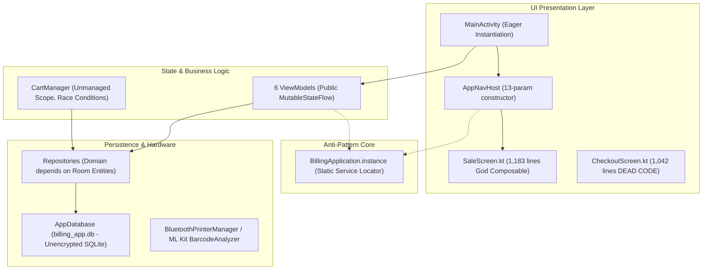
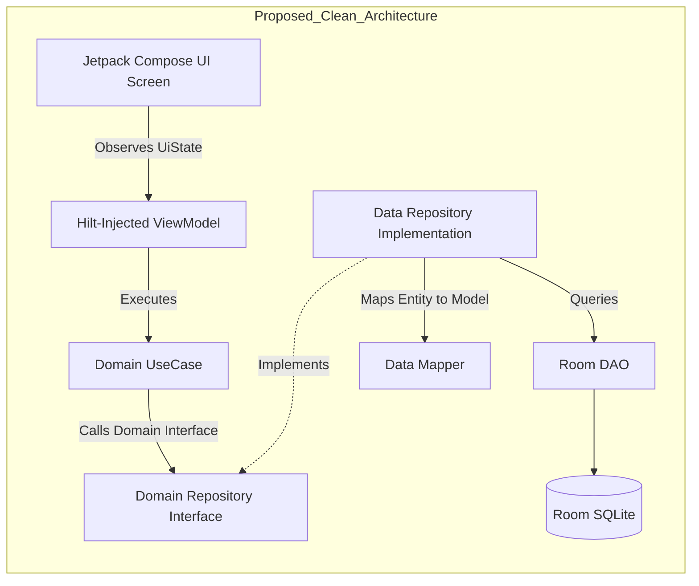
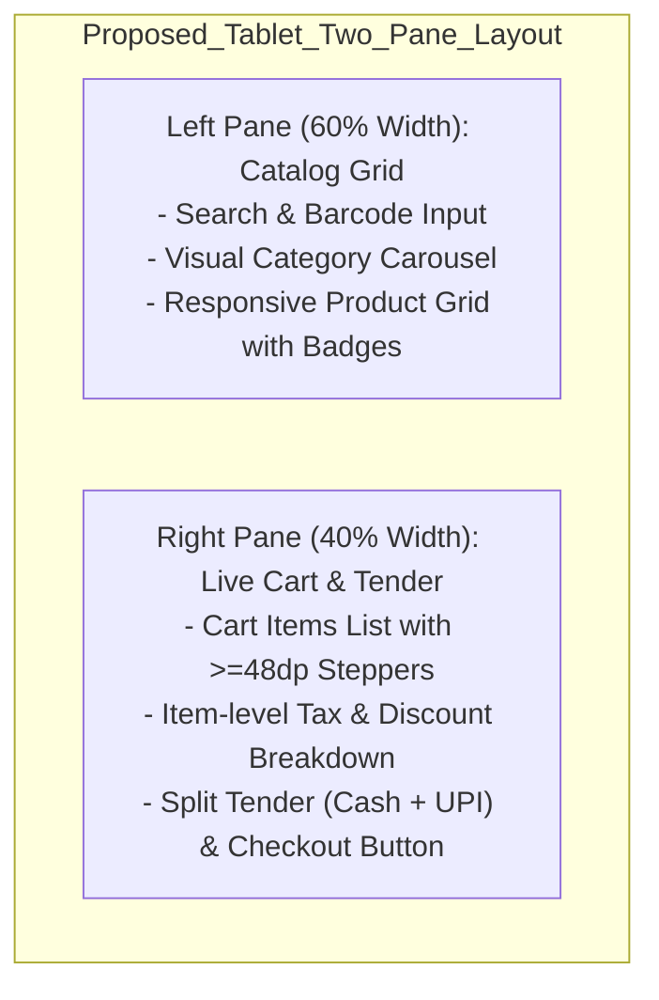
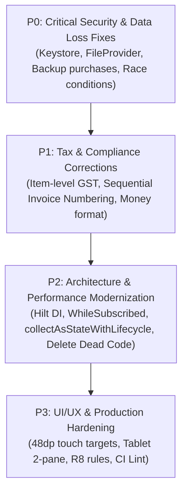

# Dokandaar POS (Kotlin Billing App) — Comprehensive Deep Analysis Report

**Target Project:** `c:\Users\aksha\OneDrive\Desktop\Billing App\kotlin_billing_app`  
**Analysis Date:** November 2026  
**Analyzed By:** Antigravity Multi-Agent Audit Team  
- **Subagent 1:** Architecture, Code Quality & Design Patterns Analyst  
- **Subagent 2:** Data Layer, Security & Business Logic Analyst  
- **Subagent 3:** UI/UX, Jetpack Compose & Feature Completeness Analyst  
- **Subagent 4:** Testing, Performance & Production Readiness Analyst  

---

## Executive Overview & Scorecard

**Dokandaar** is a standalone, offline-first Point-of-Sale (POS) and inventory management Android application built with Kotlin, Jetpack Compose, Room SQLite, CameraX, and Google ML Kit. It is specifically tailored for retail merchants (Kirana/grocery stores in India), supporting thermal receipt printing via ESC/POS, UPI QR code generation, barcode scanning, multilingual UI (English, Hindi, Bengali), and local database backup.

While the app demonstrates clear domain intent, atomic transaction usage for sales, integer paise monetary representation, and an isolated crash recovery process, **critical technical debt, security liabilities, data loss risks, and architectural issues** must be addressed before production deployment.

### System Health Scorecard

| Domain | Rating | Status | Primary Concern |
| :--- | :---: | :---: | :--- |
| **Security & Privacy** | **F** | 🔴 Critical | Keystore binary and plaintext password (`Dokandaar@2026`) committed in Git history (`19c0433d6`); unencrypted database at rest. |
| **Data Integrity & Backup** | **D** | 🔴 Critical | `BackupManager` ignores `purchases` on restore; sequence gaps in GST invoice numbering; FileProvider crash on CSV export. |
| **Testing & Verification** | **F** | 🔴 Critical | 0% test coverage for ViewModels, DAOs, and Repositories; existing unit tests are pseudo-tests of stdlib math; no AndroidTest suite. |
| **Architecture & DI** | **D** | 🟠 High Risk | No DI framework; static `BillingApplication.instance` service locator; Clean Architecture domain-data inversion. |
| **Performance & Lifecycle** | **C-** | 🟠 High Risk | All 6 ViewModels eagerly instantiated in `onCreate`; 22+ eager flows; native ML Kit scanner memory leak; UI thread QR rendering. |
| **Compose UI & Design** | **C** | 🟡 Moderate | 1,042 lines of dead code (`CheckoutScreen.kt`); sub-48dp touch targets in checkout; unremembered filters in composition; tablet layout absent. |
| **Business Logic & Tax** | **C** | 🟡 Moderate | Item-level GST rates ignored in checkout; `Money.format()` negative paise bug; broken Customer Khata balance sync. |
| **Crash Recovery** | **A** | 🟢 Exemplary | Exemplary process-isolated (`:crash`) crash handler with stacktrace persistence and clean restart mechanism. |

---



---

## Section 1: Subagent 1 Analysis — Architecture, Code Quality & Design Patterns

### 1.1 Dependency Injection & Service Locator Anti-Pattern
* **Affected Files:**
  - `BillingApplication.kt` (lines 43–78)
  - `MainActivity.kt` (lines 49–121, 165–179)
  - `NavGraph.kt` (lines 59–73, 380)
  - `CheckoutViewModel.kt` (line 299)
* **Detailed Finding:**
  The project completely lacks a modern Dependency Injection framework (such as Dagger Hilt or Koin). Instead, it relies on a global static service locator pattern via `BillingApplication.instance`:
  ```kotlin
  // BillingApplication.kt:44-47
  companion object {
      lateinit var instance: BillingApplication
          private set
  }
  ```
  `MainActivity.onCreate()` manually instantiates all 6 ViewModels using boilerplate `ViewModelProvider.Factory` implementations and passes all ViewModels, 4 Repositories, `CartManager`, and `SoundHapticManager` down into `AppNavHost` via a **13-parameter constructor**.
  Furthermore:
  - `NavGraph.kt:380` accesses `BillingApplication.instance.productRepository` directly.
  - `CheckoutViewModel.kt:299` accesses `BillingApplication.instance` directly to trigger stock notifications.
* **Architectural Impact:**
  - All ViewModels are scoped to `MainActivity` rather than navigation destinations. They remain permanently alive in memory even when screens are never visited.
  - Extreme parameter coupling across navigation screens.
  - Unit testing ViewModels and Composables in isolation is severely impeded.

### 1.2 Clean Architecture Boundary Inversion
* **Affected Files:**
  - `domain/repository/InvoiceRepository.kt` (lines 1–10)
  - `domain/repository/CustomerRepository.kt` (line 3)
  - `domain/repository/SupplierRepository.kt` (line 3)
  - `domain/repository/ExpenseRepository.kt` (line 3)
  - `core/database/AppDatabase.kt` (lines 1–28)
* **Detailed Finding:**
  While `Product` and `ShopProfile` have pure domain models in `domain.model.*`, **Invoices, InvoiceItems, Customers, Suppliers, Expenses, and Categories have NO domain models**.
  The domain repository interfaces directly import and expose Room database entities:
  ```kotlin
  // InvoiceRepository.kt:3-7
  import com.billing.app.data.local.dao.CategorySalesSummary
  import com.billing.app.data.local.dao.TopProductSummary
  import com.billing.app.data.local.entity.InvoiceEntity
  import com.billing.app.data.local.entity.InvoiceItemEntity
  import com.billing.app.data.local.entity.InvoiceStatus
  ```
  Additionally, `AppDatabase` resides in `core.database`, yet it depends directly on `data.local.entity.*` and `data.local.dao.*`.
* **Architectural Impact:**
  The dependency rule is inverted: the pure `domain` layer depends directly on the persistence `data` layer. Any database schema refactoring immediately breaks domain interfaces and UI presentation models.

### 1.3 State Encapsulation & Flow Anti-Patterns
* **Affected Files:**
  - `CheckoutViewModel.kt` (lines 53–61)
  - `ProductViewModel.kt` (lines 29–33)
  - `InvoiceViewModel.kt` (lines 51–54)
  - `ReportsViewModel.kt` (lines 35–46)
  - `HomeViewModel.kt` (lines 37–61)
* **Detailed Finding:**
  1. **Public `MutableStateFlow` Properties:**
     Across all ViewModels, internal mutable state flows are exposed as public mutable properties:
     ```kotlin
     // CheckoutViewModel.kt:53-60
     val selectedPaymentMethod = MutableStateFlow(PaymentMethodMode.UPI)
     val discountPaise = MutableStateFlow(0L)
     val cashReceivedPaise = MutableStateFlow(0L)
     val customerName = MutableStateFlow("Walk-in Customer")
     val customerPhone = MutableStateFlow("")
     val selectedCategory = MutableStateFlow("All")
     val searchQuery = MutableStateFlow("")
     ```
     This allows navigation callbacks and external composables to directly write into state without ViewModel validation (e.g., `NavGraph.kt:165` mutating `invoiceViewModel.statusTab.value` and `NavGraph.kt:456` mutating `productViewModel.searchQuery.value`).
  2. **Unbounded `SharingStarted.Eagerly`:**
     In `HomeViewModel`, `CheckoutViewModel`, and `SettingsViewModel`, flows are converted using `stateIn(viewModelScope, SharingStarted.Eagerly, ...)`. These flows remain actively subscribed to database queries even when the application is backgrounded.
  3. **Fragmented UI State:**
     Instead of exposing a single consolidated immutable `ScreenUiState` per feature, ViewModels expose 8–15 separate StateFlows, causing multiple recomposition passes and asynchronous race conditions.

### 1.4 God Classes, Dead Code & Anti-Patterns
* **1,042 Lines of Dead Code (`CheckoutScreen.kt`):**
  `CheckoutScreen.kt` is completely orphaned. Both `Screen.Sale` and `Screen.Checkout` route to `SaleScreen.kt` in `NavGraph.kt`. `CheckoutScreen.kt` is an unmaintained duplicate that bloats the codebase.
* **God Composables:**
  - `SaleScreen.kt` (1,183 lines): Coordinates catalog, cart, customer picker, customer dialog, discounts, cash calculations, UPI QR, drafts, and printer dialogs.
  - `ReportsScreen.kt` (1,041 lines): Combines KPI metrics, date range filtering, product breakdowns, trend canvas drawing, and export dialogs.
* **Passing `Context` into ViewModel Functions:**
  `SettingsViewModel.kt` (lines 392–468) defines functions taking `Context`: `createDatabaseBackup(context)`, `exportBackupToUri(context, uri)`, `importBackupFromUri(context, uri)`, `shareBackup(context, file)`, `listBackups(context)`, and `triggerSalesSummaryNotification(context)`. This leaks UI context and blocks headless unit testing.
* **"Fake" Slicing Pagination vs Room Paging 3:**
  In `ProductViewModel.kt` (lines 49–61) and `InvoiceViewModel.kt` (lines 69–81), the entire database table is loaded into RAM in a single list. The "pagination" merely slices the in-memory list (`_visibleItemCount = minOf(current + 20, total)`). For 10,000+ SKUs, this exhausts memory and drops UI frames.

---

### Subagent 1 Suggestions & Architectural Blueprint



1. **Delete Dead Code:** Immediately delete `app/src/main/java/com/billing/app/feature/checkout/CheckoutScreen.kt` to remove 1,042 dead lines.
2. **Adopt Dagger Hilt:**
   - Add `dagger.hilt.android.plugin` to Gradle.
   - Annotate `BillingApplication` with `@HiltAndroidApp` and `MainActivity` with `@AndroidEntryPoint`.
   - Remove `BillingApplication.instance` static companion object.
   - Inject ViewModels at destination level via `hiltViewModel()` inside `NavGraph.kt`.
3. **Establish Pure Domain Boundaries:**
   - Create domain models `Invoice`, `InvoiceItem`, `Customer`, `Supplier`, `Expense` in `domain/model/`.
   - Map Room entities to domain models inside repository implementations (`InvoiceRepositoryImpl`).
4. **Encapsulate ViewModel State:**
   - Back all state flows with `private val _uiState = MutableStateFlow(UiState())` and expose `val uiState: StateFlow<UiState> = _uiState.asStateFlow()`.
   - Change `SharingStarted.Eagerly` to `SharingStarted.WhileSubscribed(5_000)`.
5. **Migrate to Type-Safe Navigation:**
   - Replace string-based routes with Kotlin `@Serializable` route objects (Navigation Compose 2.8+).
   - Configure deep link intents so low stock notifications route directly to `Screen.Products(filter = LowStock)`.

---

## Section 2: Subagent 2 Analysis — Data Layer, Security & Business Logic

### 2.1 Critical Security Vulnerabilities
* **Compromised Keystore in Git History (CRITICAL):**
  - **Location:** Git commit `19c0433d687ee80bc5d038654c0bb14416df0d61` and workspace root `dokandaar-release.jks`.
  - **Finding:** Git commit `19c0433d6` committed the release keystore binary `dokandaar-release.jks` (4,357 bytes). In that same commit, `app/build.gradle.kts` contained hardcoded plaintext credentials:
    ```kotlin
    storePassword = "Dokandaar@2026"
    keyAlias = "dokandaar-release"
    keyPassword = "Dokandaar@2026"
    ```
    While later commit `304cf26d7` removed `dokandaar-release.jks` from git tracking, **the keystore and passwords remain in git history forever**, and the file is still present in the working tree. Anyone cloning the repository can extract the signing key and sign malicious APK updates.
* **Unencrypted Database at Rest:**
  `billing_app.db` and DataStore files (`billing_settings.preferences_pb`) are stored unencrypted in app private storage. On rooted devices or via Android backup extraction, all customer PII, sales records, financial figures, and PIN hashes are accessible.
* **SQL Wildcard Crash Vulnerability:**
  In `ProductDao.kt` (line 28), the query specifies `WHERE name LIKE '%' || :query || '%' ESCAPE '\\'`. Unlike `InvoiceRepositoryImpl`, `ProductRepositoryImpl.searchProducts` fails to escape `\`. If a user or barcode scanner inputs a string ending in `\` (e.g. `test\`), SQLite throws `android.database.sqlite.SQLiteException: LIKE pattern must not end with escape character` and crashes the app.
* **FileProvider Export Crash Bug:**
  In `app/src/main/res/xml/file_paths.xml`, only `backups/`, `crash_logs/`, and `product_images/` are declared under `<files-path>`. However, `ImportExportScreen.kt` (lines 301, 313, 323, 333) writes CSV export files to `context.cacheDir`. Clicking "Export Products to CSV" or "Download Sample CSV" throws `IllegalArgumentException: Failed to find configured root that contains .../cache/...`, crashing the feature.

### 2.2 Critical Data Loss in Backup & Restore
* **Affected File:** `BackupManager.kt` (lines 43–56, 201–214, 293–490)
* **Detailed Finding:**
  1. In `createBackupJson`, the `purchases` table is serialized, but `purchase_items` is never queried or exported.
  2. In `restoreBackupFromJson`, `root.has("purchases")` is **never checked or restored**. Steps 1–9 restore Shop, Products, Invoices, Items, Customers, Categories, Suppliers, Expenses, and Counter, but **completely omit Purchases**.
  3. Restoring a backup completely wipes all purchase history and stock inward records.
  4. The backup envelope uses an unauthenticated SHA-256 digest (`calculateSha256(jsonString)`) without HMAC or encryption. Furthermore, if an imported file lacks `"checksum"`, line 281 executes `dataJson = envelopeJson`, bypassing integrity checks entirely.

### 2.3 Business Logic & Calculation Flaws
* **Gaps in Sequential Invoice Numbers (GST Non-Compliance):**
  - In `InvoiceRepositoryImpl.kt` (lines 95–102), `generateNextInvoiceNumber()` increments `invoice_counter.lastNumber` *before* the sale is completed. If `completeSale` fails, the number is burned.
  - Parking a draft bill (`holdDraft`) consumes an official invoice number (e.g. `INV-000004`). When resumed and completed, `completeSale` generates a new number (`INV-000005`) and deletes draft `INV-000004`, leaving a permanent hole in the sequence. Under GST law, non-sequential numbering triggers tax audit penalties.
* **Item-Level GST Ignored & Truncation Errors:**
  - `ProductEntity.kt` (line 30) defines `gstRate: Int` (e.g. 0%, 5%, 12%, 18%), but `CheckoutViewModel.calculateTax` applies a flat store-wide `taxRatePercent` to the entire cart. Applying 18% to 0% grains or 5% staples is illegal in India.
  - `(taxablePaise * (taxRatePercent / 100.0)).toLong()` truncates with `.toLong()` rather than rounding half-up (`Math.round`), causing rounding discrepancies.
  - No CGST / SGST split is calculated or displayed on invoices.
* **Negative Formatting Bug in `Money.format()`:**
  - In `Money.kt` (lines 14–19):
    ```kotlin
    fun format(includeSymbol: Boolean = true): String {
        val rupees = paise / 100
        val remainder = kotlin.math.abs(paise % 100)
        val formatted = String.format(Locale.US, "%d.%02d", rupees, remainder)
        return if (includeSymbol) "₹$formatted" else formatted
    }
    ```
    For `-50L` paise (=-₹0.50), `-50 / 100 = 0` (losing the sign) and `abs(-50 % 100) = 50`. The string formats as `"₹0.50"` instead of `"-₹0.50"`, converting negative customer debts or refunds into positive amounts.

### 2.4 Database Schema Integrity Issues
* **Inconsistent Foreign Keys:** `InvoiceEntity` has an auto-increment `id: Long`, but `InvoiceItemEntity` establishes its foreign key on `invoiceNumber: String` without `onUpdate = CASCADE`.
* **UNIQUE Index Collisions on Empty Strings:** `ProductEntity` indexes `barcode` as UNIQUE; `CustomerEntity` indexes `phone` as UNIQUE. In SQLite, empty strings `""` collide. Adding two loose products with blank barcodes or two walk-in customers with blank phones crashes with `SQLiteConstraintException`.

---

### Subagent 2 Suggestions & Security Hardening Blueprint

1. **Immediate Credential Invalidation:**
   - Invalidate and replace `dokandaar-release.jks`. Generate a new release keypair outside the git workspace.
   - Purge git history using `git-filter-repo` or BFG to expunge commit `19c0433d6` before any public release.
   - Delete `dokandaar-release.jks` and `.apk` files from workspace root.
2. **Fix FileProvider Configuration:**
   Add `<cache-path name="cache" path="." />` to `app/src/main/res/xml/file_paths.xml` to prevent crashes when exporting CSVs.
3. **Fix Purchase Backup & Restore:**
   Add serialization and deserialization of `purchases` and `purchase_items` in `BackupManager.kt`. Encrypt backup archives using AES-256-GCM.
4. **GST Compliant Sequential Invoicing:**
   - Assign and increment official invoice numbers **inside the atomic `completeSale` Room transaction**.
   - Use a separate prefix and sequence for drafts (`DFT-000001`).
5. **Item-Level Tax Calculation:**
   Refactor `calculateTax` to sum tax per cart item using `product.gstRate`, round half-up, and provide CGST and SGST splits.
6. **Fix `Money.format()`:**
   Handle negative paise explicitly:
   ```kotlin
   val isNegative = paise < 0
   val absPaise = kotlin.math.abs(paise)
   val rupees = absPaise / 100
   val remainder = absPaise % 100
   val formatted = String.format(Locale.US, "%s%d.%02d", if (isNegative) "-" else "", rupees, remainder)
   return if (includeSymbol) "₹$formatted" else formatted
   ```

---

## Section 3: Subagent 3 Analysis — UI/UX, Jetpack Compose & Feature Completeness

### 3.1 Jetpack Compose Recomposition & Stability Issues
* **Unstable Domain Models:**
  `Product.kt`, `CartItem.kt`, and `InvoiceEntity.kt` are standard data classes lacking `@Immutable` or `@Stable` annotations. When passing Kotlin standard collections (`List<CartItem>`, `List<Product>`) to composables (`SaleScreen.kt:108`, `ProductListScreen.kt:91`), the Compose compiler treats standard `List<T>` as unstable. Every state update triggers full recomposition of screens and item rows.
* **Unremembered Filtering in Composition Scope:**
  - `CustomersScreen.kt` (lines 112–116): Filters entire customer list on every single recomposition without `remember(customers, searchQuery)`.
  - `SuppliersScreen.kt` (lines 93–97): Identical unremembered filtering on every recomposition.
  - `ExpensesScreen.kt` (line 87): Recalculates `expenses.sumOf { it.amountPaise }` on every recomposition pass.
* **Absence of `@Preview` Functions:**
  Across the entire repository, there are **0 `@Preview` functions**. Developers cannot inspect UI components in Android Studio without compiling and deploying to an emulator or physical device.

### 3.2 Accessibility Deficiencies (<48dp Touch Targets)
Google Accessibility and Material Design standards mandate minimum 48x48 dp interactive touch bounds. In high-pressure retail checkout environments, shopkeepers will struggle with these undersized buttons:
1. `SaleScreen.kt` (lines 705–738): Quantity increment/decrement buttons are `Box(modifier = Modifier.size(22.dp))` with `clickable`.
2. `SaleScreen.kt` (line 754): Remove item from cart button is `IconButton(modifier = Modifier.size(24.dp))`.
3. `DokandaarButtons.kt` (lines 55–56): `DokandaarActionPill` total height is only ~28 dp.
4. `DokandaarInvoiceCard.kt` (line 301): 3-dot options menu icon button is `size(24.dp)`.
5. `BottomDokandaarNav.kt` (lines 138–141): `indication = null` completely removes touch ripples, and items lack `Role.Tab` semantics for TalkBack.

### 3.3 Theme & Material 3 Compliance
* **Missing Material 3 Semantic Tokens:**
  `Theme.kt` (lines 14–38) defines only 10 basic color tokens, completely omitting `surfaceVariant`, `outline`, `outlineVariant`, `surfaceContainer`, `errorContainer`, and `tertiary`. Dynamic color (Android 12+) is unsupported.
* **Dark Mode Visual Flaws:**
  In `SaleScreen.kt` (lines 906–937), `CategoryCard.kt` (line 50), and `HomeScreen.kt` (lines 353–433), hardcoded light pastel backgrounds (`PastelPurpleBg` #F3E8FF, `PastelBlueBg` #E0F2FE, `PastelOrangeBg` #FEF3C7) are used directly as card containers without dark theme variants, producing blinding white/pastel blocks in dark mode.

### 3.4 Retail POS Feature Completeness Gaps
* **Customer Udhaar (Khata) Balance Out-of-Sync:**
  While invoices support credit dues (`duePaise`), `CustomerEntity.openingBalancePaise` is **never updated** when a credit bill is finalized. `CustomersScreen.kt` displays `Due Khata: Money(cust.openingBalancePaise)` which permanently remains 0 or initial value. There is no customer ledger showing credit history and no partial repayment flow.
* **Missing Split / Multi-Payment:**
  `PaymentMethodMode` in `CheckoutViewModel.kt` is a single exclusive enum (`CASH`, `UPI`, `OTHER`). In real-world retail, split tender (e.g. ₹600 Cash + ₹400 UPI) is frequent and currently impossible.
* **Missing Partial Returns:**
  `InvoiceRepositoryImpl.voidInvoice` can only cancel an entire invoice. There is no workflow to return 1 item from a 5-item bill or issue a credit note.
* **No Tablet / Landscape Adaptation:**
  Retail POS systems heavily utilize 8"–10" counter tablets. All screens in Dokandaar are hardcoded single-column phone layouts. On a tablet, `SaleScreen.kt` squashes the cart vertically while leaving 60% of horizontal screen width empty. No `WindowSizeClass` two-pane layout exists.

### 3.5 Localization Divergence & Scanner Audio Leak
* **Dual Out-of-Sync Translation Systems:**
  - `AppStrings.kt` contains ~300 in-memory strings for English, Hindi, and Bengali.
  - `res/values/strings.xml`, `values-hi`, and `values-bn` contain only **64 strings**.
  - Multiple screens contain raw hardcoded English strings (e.g., `HomeScreen.kt:129` `"Store Notifications"`, `SaleScreen.kt:853` `"New Customer"`, `SaleScreen.kt:899` `"Add Discount"`). Switching the app to Hindi/Bengali leaves prominent UI elements in English.
* **Resource Leak in `BarcodeScannerDialog`:**
  `BarcodeScannerDialog.kt` (line 79) allocates a new `SoundHapticManager` in composition scope via `remember { SoundHapticManager(context) }`. In `onDispose`, it is **never released**, leaking native `SoundPool` and `ToneGenerator` audio handles every time the scanner opens.

---

### Subagent 3 Suggestions & UI/UX Enhancement Blueprint



1. **Enlarge Interactive Touch Targets:**
   Wrap quantity `+`/`-` buttons, trash buttons, and action pills in `Modifier.sizeIn(minWidth = 48.dp, minHeight = 48.dp)` and restore `indication = ripple()` on `BottomDokandaarNav`.
2. **Implement Tablet Two-Pane Layout:**
   Use AndroidX `calculateWindowSizeClass`. On `WindowWidthSizeClass.Expanded`, render a 2-pane layout for `SaleScreen`: Product Catalog on the left pane (60%) and Live Cart & Tender on the right pane (40%).
3. **Synchronize Customer Khata & Ledger:**
   Update `CustomerEntity.openingBalancePaise` when `duePaise > 0` during sale completion, and build a Customer Ledger screen supporting partial balance repayments.
4. **Implement Split Payment:**
   Expand `CheckoutViewModel` to support composite payment models (`cashAmountPaise`, `upiAmountPaise`).
5. **Fix Scanner Audio Leak:**
   Inject the application-level `SoundHapticManager` singleton into `BarcodeScannerDialog` instead of instantiating unreleased local instances. Add distinct error vibration/audio tones for unregistered barcodes.
6. **Harmonize Dark Mode & Localization:**
   Replace raw pastel background constants with dark-adaptive colors (`MaterialTheme.colorScheme.surfaceVariant`). Replace all hardcoded English strings with `appStrings()` calls.

---

## Section 4: Subagent 4 Analysis — Testing, Performance & Production Readiness

### 4.1 Test Coverage & Testing Quality Reality
* **0% Architectural Test Coverage:**
  - **ViewModels:** 0 of 6 ViewModels are tested. Zero tests for `CheckoutViewModel`, `HomeViewModel`, or `ReportsViewModel`.
  - **DAOs & Room Migrations:** 0 of 8 DAOs are tested. Zero integration tests for Room database queries.
  - **Missing Schemas for Migrations:** Schemas for versions 1 and 2 (`1.json`, `2.json`) are absent from `app/schemas/`, making `MigrationTestHelper` tests impossible to write from v1.
  - **Repositories & CartManager:** 0% test coverage.
  - **UI & Instrumented Tests:** The entire `app/src/androidTest` directory does not exist!
* **Pseudo-Tests Testing Stdlib Rather Than App Code:**
  Existing unit tests in `app/src/test/` provide a false sense of security by testing Kotlin standard library functions on local primitives rather than actual classes:
  - `CompleteSaleValidationTest.kt` (lines 7–71): Tests `attemptedDiscount.coerceIn(0L, subtotalPaise)` and raw local arithmetic; does not test `CheckoutViewModel` or any domain validator.
  - `BackupRestoreTest.kt` (lines 8–33): Tests a private SHA-256 helper in the test class; never instantiates or validates `BackupManager`.
  - `InvoiceNumberGeneratorTest.kt` (lines 8–34): Tests `String.format("INV-%06d")` and a local `for` loop; does not test `InvoiceRepositoryImpl` or Room counter transactions.
  - `InvoiceStatusTest.kt` (lines 18–47): Tests `List.filter` on an in-memory list; does not test `InvoiceDao`.

### 4.2 Performance Bottlenecks & Memory Leaks
* **Eager Upfront Instantiation in `onCreate`:**
  `MainActivity.onCreate()` instantiates all 6 ViewModels simultaneously. With pervasive `SharingStarted.Eagerly` across `HomeViewModel`, `CheckoutViewModel`, and `SettingsViewModel`, **over 22 Room observers and DataStore flows are active continuously from application startup**, querying SQLite and dispatching UI state even when the user remains on the splash screen.
* **Absence of Lifecycle-Aware Flow Collection:**
  There are 50+ usages of `collectAsState()` across screens; `collectAsStateWithLifecycle()` is used **zero times**. Flows continue collecting and burning battery even when the device is locked or the app is minimized.
* **Coroutine Collector Leak in `ReportsViewModel`:**
  In `ReportsViewModel.kt` (lines 62–98), every time `setPeriod(period)` is called, a new un-cancelled `invoiceRepository.getInvoicesSince(startTime).collect { ... }` is launched in `viewModelScope`. Toggling period filters accumulates concurrent leaking collectors in the background.
* **Unmanaged Scope & Race Conditions in `CartManager`:**
  `CartManager.kt:19` creates `private val scope = CoroutineScope(Dispatchers.Main)` with no `SupervisorJob` or cancellation hook. Methods `addProduct`, `increment`, and `decrement` execute non-atomic read-modify-write operations on `_cartItems.value`. Concurrent camera scanner emissions cause race conditions and dropped items.
* **ML Kit `BarcodeScanner` Native Memory Leak:**
  `BarcodeAnalyzer.kt` implements `close()` to release the ML Kit scanner. However, neither `BarcodeScannerDialog` nor `FullScannerScreen` ever calls `.close()`. Every camera open/close cycle leaks a native C++ scanner handle.
* **Synchronous `.get()` on Main Thread:**
  In `FullScannerScreen.kt` (line 355) and `BarcodeScannerDialog.kt` (line 217), `ProcessCameraProvider.getInstance(context).get()` is called synchronously on the Main thread, blocking UI rendering until the camera future completes.

### 4.3 Production Readiness & CI/CD Deficiencies
* **ProGuard / R8 Rules Over-Preservation:**
  In `app/proguard-rules.pro` (lines 26–59):
  ```proguard
  -keep class com.google.mlkit.** { *; }
  -keep class androidx.camera.** { *; }
  -keep class androidx.compose.** { *; }
  -keep class androidx.datastore.** { *; }
  ```
  Keeping `*` on the entirety of Compose, CameraX, DataStore, and ML Kit completely disables R8 tree-shaking and dead code removal for the four largest dependencies, artificially bloating release APK/AAB size by 15–25 MB.
* **Missing Log Stripping in Release:**
  No `-assumenosideeffects` rules exist. `android.util.Log` and `printStackTrace()` calls remain in production release builds, leaking diagnostics to logcat.
* **CI/CD Pipeline Gaps (`.github/workflows/android.yml`):**
  - Only executes `./gradlew testDebugUnitTest` and `./gradlew assembleDebug`.
  - Never executes `./gradlew lintDebug` or `./gradlew lintRelease`.
  - Never compiles release builds (`assembleRelease` or `bundleRelease`); broken ProGuard rules will only be discovered upon manual deployment.
  - Zero code coverage tracking (no JaCoCo / Kover).

---

### Subagent 4 Suggestions & Production Readiness Blueprint

1. **Establish Real Unit Test Suite:**
   - Add `mockk`, `turbine`, and `androidx.room:room-testing` to `app/build.gradle.kts`.
   - Write real ViewModel unit tests for `CheckoutViewModel` (testing discount clamping, cash change, stock validation, and draft transitions) and `InvoiceRepositoryImpl` using Room in-memory databases.
2. **Eliminate Performance Leaks:**
   - Add `androidx.lifecycle:lifecycle-runtime-compose` and replace all `collectAsState()` with `collectAsStateWithLifecycle()`.
   - Change `SharingStarted.Eagerly` to `SharingStarted.WhileSubscribed(5_000)` across all ViewModels.
   - Cancel prior jobs in `ReportsViewModel.loadReportData()` or migrate to `selectedPeriod.flatMapLatest { ... }`.
3. **Make `CartManager` Thread-Safe:**
   Replace the unmanaged `CoroutineScope` with a supervised lifecycle scope and update cart items atomically using `_cartItems.update { current -> ... }`.
4. **Fix Hardware Resource Cleanup:**
   - Call `BarcodeAnalyzer.close()` inside `DisposableEffect.onDispose` in both scanner screens.
   - Call `bluetoothPrinterManager.disconnect()` inside `MainActivity.onDestroy()`.
5. **Optimize ProGuard Rules:**
   Remove broad `-keep class` directives on Compose and CameraX, and add rules to strip debug logs in release:
   ```proguard
   -assumenosideeffects class android.util.Log {
       public static boolean isLoggable(java.lang.String, int);
       public static int v(...);
       public static int d(...);
       public static int i(...);
   }
   ```
6. **Harden CI/CD Pipeline:**
   Update `.github/workflows/android.yml` to run `./gradlew lintDebug`, execute unit tests with report archiving, and compile `./gradlew assembleRelease`.

---

## Section 5: Consolidated Master Remediation Plan

The following prioritized roadmap synthesizes the recommendations from all 4 subagents into an actionable execution sequence:



### Phase 1: P0 — Critical Security & Data Integrity (Immediate)
1. **Keystore Revocation:** Discard `dokandaar-release.jks`. Generate a new release key outside git. Clean git commit `19c0433d6` before any public release.
2. **FileProvider Fix:** Add `<cache-path name="cache" path="." />` to `app/src/main/res/xml/file_paths.xml` to resolve CSV export crashes.
3. **Backup & Restore Purchase Repair:** Add `purchases` and `purchase_items` to `BackupManager.createBackupJson` and `restoreBackupFromJson`.
4. **SQL Wildcard Escape:** Add `.replace("\\", "\\\\").replace("%", "\\%").replace("_", "\\_")` to `ProductRepositoryImpl.searchProducts`.
5. **CartManager Thread Safety:** Guard `_cartItems` updates with `_cartItems.update { ... }`.

### Phase 2: P1 — Business Logic & Tax Compliance (Sprint 1)
1. **GST Sequential Invoicing:** Move invoice number generation inside the atomic `completeSale` Room transaction; assign a separate prefix/sequence for drafts (`DFT-`).
2. **Item-Level GST Calculation:** Refactor tax calculation to apply `ProductEntity.gstRate` per line item with half-up rounding and CGST/SGST breakdown.
3. **Fix `Money.format()`:** Handle negative paise explicitly so negative balances format as `"-₹0.50"`.
4. **Customer Khata Sync:** Update `CustomerEntity.openingBalancePaise` when invoices with `duePaise > 0` are finalized.
5. **Fix Resource Leaks:** Call `BarcodeAnalyzer.close()` and release `SoundHapticManager` in `BarcodeScannerDialog` disposable effect.

### Phase 3: P2 — Architecture & Performance Modernization (Sprint 2)
1. **Delete Dead Code:** Delete `CheckoutScreen.kt` (-1,042 lines).
2. **Adopt Dagger Hilt:** Implement Hilt DI; remove `BillingApplication.instance` static service locator; inject ViewModels at the composable destination level.
3. **Clean Architecture Separation:** Create pure domain models for `Invoice`, `Customer`, `Supplier`, `Expense`; decouple domain repositories from Room entities.
4. **Lifecycle-Aware Flow Collection:** Add `androidx.lifecycle:lifecycle-runtime-compose` and replace `collectAsState()` with `collectAsStateWithLifecycle()`.
5. **Eager Flow Elimination:** Change `SharingStarted.Eagerly` to `SharingStarted.WhileSubscribed(5_000)` across all ViewModels.
6. **Reports ViewModel Coroutine Fix:** Replace leaky collectors in `ReportsViewModel` with `selectedPeriod.flatMapLatest { ... }`.

### Phase 4: P3 — UI/UX Polish & CI/CD Hardening (Sprint 3)
1. **Enlarge Touch Targets:** Expand quantity steppers, delete icons, and action pills to minimum 48x48 dp.
2. **Tablet Two-Pane POS Layout:** Implement `WindowSizeClass` two-pane layout for `SaleScreen` on tablets.
3. **Split Payment Tender:** Support multi-tender checkout (Cash + UPI).
4. **R8 Rule Optimization:** Remove blanket `-keep class` on Compose/CameraX in `proguard-rules.pro` and strip debug logs.
5. **CI/CD Pipeline Upgrade:** Add `./gradlew lintDebug` and release compilation to `.github/workflows/android.yml`.

---
*Report compiled and verified by Antigravity Multi-Agent Orchestrator.*
