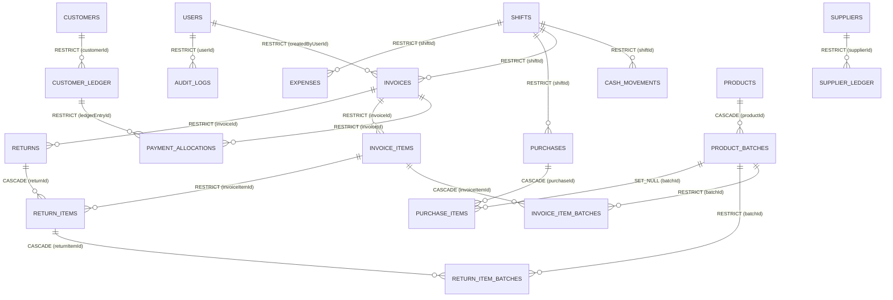
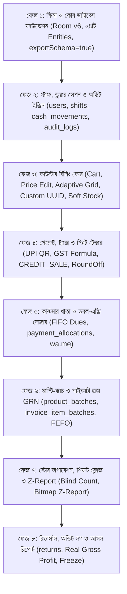

# দোকানদার পিওএস (Dokandaar POS) — স্থাপত্য ও বাস্তবায়ন স্পেসিফিকেশন (Version 6.4 Architecture Specification)

**প্রজেক্ট পাথ:** `c:\Users\aksha\OneDrive\Desktop\Billing App\kotlin_billing_app`  
**সম্পর্কিত রেফারেন্স:** [DOKANDAAR_BUSINESS_FLOW_ANALYSIS_BN.md](file:///c:/Users/aksha/OneDrive/Desktop/Billing%20App/kotlin_billing_app/DOKANDAAR_BUSINESS_FLOW_ANALYSIS_BN.md)  
**উদ্দেশ্য:** গভীর রিভিউ ফিডব্যাকের ভিত্তিতে ২৪টি রুম এন্টিটি, ইনভয়েস টোটাল ও রাউন্ড-অফ সংজ্ঞা, মিশ্র রিফান্ড কলাম, নন-ব্যাচ পণ্যের এলপিপি কস্টিং, একই-শিফটে ভয়েড নীতি, ড্রয়ার সেশনে ক্যাশিয়ারওয়াইজ ব্রেকডাউন, এবং ব্যাকআপে জিরো-ট্রাস্ট পিন নিরাপত্তা সহ পরিপূর্ণ কোডিং ব্লুপ্রিন্ট।  
**তারিখ:** নভেম্বর ২০২৬ | **সংস্করণ:** ৬.৪ (Pre-Implementation Architecture Specification)  

---

## ১. নির্বাহী স্কিমা সিদ্ধান্ত ও ডাটাবেস নীতি

> [!IMPORTANT]
> **ডেভেলপমেন্ট ও ডাটাবেস নীতিসমূহ:**
> 1. **প্রাক-উৎপাদন ক্লিন স্কিমা ও প্রথম দিন থেকেই স্কিমা ট্র্যাকিং:**
>    - ডেভেলপমেন্টে ডেটা ক্লিয়ারের সুবিধার্থে শুধুমাত্র ডিবাগ বিল্ডে ডেস্ট্রাকটিভ মাইগ্রেশন সক্রিয় থাকবে:
>      ```kotlin
>      if (BuildConfig.DEBUG) { builder.fallbackToDestructiveMigration() }
>      ```
>    - ডাটাবেস পরিবর্তনের প্রাতিষ্ঠানিক অডিট ট্র্যাকিংয়ের স্বার্থে **ফেজ ১ থেকেই `AppDatabase.kt`-এ `exportSchema = true` এবং `app/build.gradle.kts`-এ KSP আর্গুমেন্ট `arg("room.schemaLocation", "$projectDir/schemas")` যুক্ত করে গিটে ট্র্যাক করা হবে**।
> 2. **আর্থিক টেবিলে ক্যাসকেড ডিলিট সম্পূর্ণ নিষিদ্ধ:** কোনো আর্থিক বা লেজার টেবিলে (`cash_movements`, `customer_ledger`, `supplier_ledger`, `payment_allocations`) `onDelete = CASCADE` সম্পূর্ণ নিষিদ্ধ। সর্বদা `ForeignKey.RESTRICT` কার্যকর হবে।
> 3. **Room DAO-তে `@Upsert` বাধ্যতামূলক (`REPLACE` নিষিদ্ধ):** কোনো DAO মেথডে `OnConflictStrategy.REPLACE` ব্যবহার করা যাবে না; কারণ SQLite-এ REPLACE প্রকৃতপক্ষে বিদ্যমান রো DELETE করে নতুন রো INSERT করে, যা `CASCADE` চাইল্ড মুছে দেয় এবং `RESTRICT` কনস্ট্রেইন্টে ক্র্যাশ ঘটায়। এর পরিবর্তে Room 2.5+ এর `@Upsert` অ্যানোটেশন অথবা সুস্পষ্ট `@Insert(onConflict = ABORT)` ও `@Update` ব্যবহার করতে হবে।
> 4. **সফট ডিলিট ও রিঅ্যাক্টিভেশন নীতি (Soft Delete & Reactivation):** পণ্য (`ProductEntity.isActive`), কাস্টমার (`CustomerEntity.isActive`), এবং মহাজন (`SupplierEntity.isActive`) সফট ডিলিট হবে। কোনো রেকর্ড ডাটাবেস থেকে হার্ড-ডিলিট করা যাবে না। ইউজার যদি কোনো সফট-ডিলিট করা পণ্যের বারকোড বা কাস্টমারের ফোন নম্বর পুনরায় যুক্ত করতে যান, তবে সিস্টেম ইউনিক কনস্ট্রেইন্ট ক্র্যাশ না ঘটিয়ে UI-তে *"এই বারকোড/ফোন নম্বরে পূর্বে একটি নিষ্ক্রিয় রেকর্ড ছিল, পুনরায় সক্রিয় (Reactivate) করবেন কি না?"* ডায়ালগ দেখাবে এবং সম্মতি পেলে `isActive = true` করবে।
> 5. **ইনভয়েস অপরিবর্তনীয়তা ও একই-শিফটে ভয়েড নীতি (Same-Shift Void Rule):**
>    - `invoices` এবং `invoice_items`-এ কোনো হার্ড ডিলিট মেথড থাকবে না।
>    - **ভয়েড শুধুমাত্র একই শিফট ও একই দিনে সম্ভব:** কোনো বিল ভয়েড করতে হলে তা অবশ্যই চলমান সক্রিয় শিফটে হতে হবে (`invoice.shiftId == currentShift.id`)। শিফট ক্লোজ হয়ে গেলে বা পূর্বের দিনের কোনো বিল কখনোই ভয়েড করা যাবে না (ভয়েড অপশন ব্লক থাকবে); সেক্ষেত্রে সমাধান হবে পণ্য ফেরত (**Return**) এবং রিফান্ড সমন্বয়। এর ফলে পূর্বের শিফটের অডিট ট্রেইল ও ট্যাক্স ফাইলিং অক্ষুণ্ণ থাকবে।
> 6. **ক্যাশ ড্রয়ার শিফট সেশন মডেল (Drawer Session) ও ক্যাশিয়ার জবাবদিহিতা:**
>    - একটি দোকানে যেকোনো মুহূর্তে সর্বোচ্চ একটিমাত্র সক্রিয় শিফট (`status = "OPEN"`) থাকবে। ক্যাশিয়ার পরিবর্তিত হলেও ড্রয়ার সেশন একটাই চলবে।
>    - **সব বিক্রয়ে সক্রিয় শিফট বাধ্যতামূলক:** নগদ, ইউপিআই বা বাকি—যেকোনো নতুন বিক্রয়ের জন্য `invoices.shiftId` বাধ্যতামূলক (Non-null)।
>    - প্রতিটি বিলে ক্যাশিয়ার আলাদা চিহ্নিত হবে `invoices.createdByUserId` দিয়ে এবং শিফটের Z-Report-এ সার্বিক ড্রয়ার হিসাব ছাড়াও **ক্যাশিয়ারভিত্তিক বিক্রয় ব্রেকডাউন (`createdByUserId`-wise sales breakdown)** প্রদর্শিত হবে।
> 7. **জিরো-ট্রাস্ট পিন নিরাপত্তা ও ব্যাকআপ রিস্টোর (Zero-Trust PIN Security):**
>    - অফলাইন ব্রুট-ফোর্স বা ডিকশনারি অ্যাটাক সম্পূর্ণ প্রতিহত করতে ব্যাকআপ JSON ফাইলে `pinHash` এবং `pinSalt` সম্পূর্ণ বর্জন (Exclude) করা হবে।
>    - ব্যাকআপ রিস্টোরের পর `users` টেবিলে `pinHash = ""` (ফাঁকা) এবং `mustSetPin = true` সেট হবে।
>    - **জিরো-ট্রাস্ট চেক:** `if (user.mustSetPin || user.pinHash.isBlank())` হলে সিস্টেমে কোনো পিনেই লগইন করা যাবে না। রিস্টোর শেষে স্ক্রিনে বাধ্যতামূলক "Setup Admin PIN" উইজার্ড আসবে; নতুন পিন সেট করার পরই অ্যাপ আনলক হবে।

---

# অধ্যায় ১: বিদ্যমান ও নতুন ২৪টি রুম এন্টিটি স্পেসিফিকেশন



### ১.১ বিদ্যমান এনটিটিসমূহে ফিল্ড প্রতিস্থাপন (Remove & Replace) তালিকা

কোডবেসে বিদ্যমান ১১টি রুম এনটিটির মধ্যে ৮টিতে প্রয়োজনীয় ফিল্ড সম্পূর্ণ প্রতিস্থাপন বা যুক্ত হবে এবং ৩টি (`shops`, `categories`, `invoice_counter`) অপরিবর্তিত থাকবে:

| এনটিটি ও টেবিল | কোডবেসে বর্তমানে যা আছে | ফিল্ড প্রতিস্থাপন ও নতুন স্পেসিফিকেশন (Phase 1 Changes) |
| :--- | :--- | :--- |
| **`ProductEntity`**<br/>(`products`) | `id: String`<br/>`name: String`<br/>`barcode: String`<br/>`pricePaise: Long`<br/>`stock: Int = 0`<br/>`sku: String`<br/>`category: String`<br/>`unit: String = "Piece"`<br/>`purchasePricePaise: Long`<br/>`mrpPaise: Long`<br/>`gstRate: Int = 0`<br/>`minStockAlert: Int = 5` | - **ফিল্ড অপসারণ:** `stock: Int`, `gstRate: Int`, এবং `minStockAlert: Int` সম্পূর্ণ মুছে ফেলা হবে।<br/>- **প্রতিস্থাপন ও সংযোজন:**<br/>  * `stockMilli: Long = 0L` (স্টক মিলি-ইউনিটসে রূপান্তর)<br/>  * `gstRateBp: Int = 0` (বেসিস পয়েন্টসে ট্যাক্স রেট: 18% = 1800)<br/>  * `minStockAlertMilli: Long = 5000L` (সতর্কতার মিলি-ইউনিটস: ৫ বেস ইউনিট = ৫০০০ মিলি)<br/>  * `unit: String = "PCS"` (বেস ইউনিট প্রমিতকরণ: KG, LTR, PCS, MTR; অ্যাপের পুরনো "Piece" ডাটা "PCS" হবে)<br/>  * `trackBatch: Boolean = false` (ব্যাচ ট্র্যাকিং টগল)<br/>  * `hsnCode: String? = null` (এইচএসএন কোড মাস্টার)<br/>  * `isActive: Boolean = true` (সফট ডিলিট সাপোর্ট) |
| **`InvoiceEntity`**<br/>(`invoices`) | `id: Long`<br/>`invoiceNumber: String`<br/>`timestamp: Long`<br/>`subtotalPaise: Long`<br/>`taxPaise: Long`<br/>`discountPaise: Long`<br/>`grandTotalPaise: Long`<br/>`duePaise: Long`<br/>`status: InvoiceStatus`<br/>`cashReceivedPaise: Long`<br/>`changeReturnedPaise: Long` | - **ইনভয়েস টোটাল ও বকেয়ার স্পষ্ট সংজ্ঞা:**<br/>  * `subtotalPaise = \sum \text{invoice_items.lineTotalPaise}` (ট্যাক্স-সহ গ্রস যোগফল)<br/>  * `discountPaise: Long = 0L` হলো **পুরো বিলে মোট ছাড় (Bill Discount)**<br/>  * `roundOffPaise: Long = 0L` (নিকটতম রুপি রাউন্ড-অফ সমন্বয়: -৫০ থেকে +৫০ পয়সা)<br/>  * `grandTotalPaise = (subtotalPaise - discountPaise) + roundOffPaise`<br/>  * `originalDuePaise: Long = 0L` (বিক্রয়কালীন মূল বাকি: `maxOf(0L, grandTotalPaise - cashReceivedPaise - upiPaidPaise)`)<br/>  * `duePaise: Long = 0L` হলো অবশিষ্ট বকেয়া ক্যাশ স্ন্যাপশট ইনভেরিয়েন্ট (`originalDuePaise - \sum allocations`)<br/>- **নতুন সংযোজন:**<br/>  * `shiftId: Long? = null` (সক্রিয় ক্যাশ ড্রয়ার সেশনের ফরেন কি; নতুন বিক্রয়ে বাধ্যতামূলক)<br/>  * `createdByUserId: String? = null` (বিল প্রিন্টিংয়ে ক্যাশিয়ারের নাম)<br/>  * `customerId: String? = null` (গ্রাহক আইডি ফরেন কি)<br/>  * `upiPaidPaise: Long = 0L` (স্প্লিট পেমেন্ট)<br/>  * `voidedAt: Long? = null`, `voidedByUserId: String? = null`, `voidReason: String? = null` (ভয়েড অডিট) |
| **`InvoiceItemEntity`**<br/>(`invoice_items`) | `id: Long`<br/>`invoiceNumber: String` (FK)<br/>`productId: String`<br/>`productName: String`<br/>`unitPricePaise: Long`<br/>`quantity: Int`<br/>`lineTotalPaise: Long` | - **ফিল্ড অপসারণ:** `quantity: Int` ও `invoiceNumber` (FK) সরানো হবে।<br/>- **প্রতিস্থাপন ও সংযোজন:**<br/>  * `invoiceId: Long` (FK to `invoices.id`, **`RESTRICT`**)<br/>  * `productId: String? = null` (কাস্টম আইটেমের জন্য **Nullable**)<br/>  * `quantityMilli: Long = 1000L` (বেস ইউনিট $\times 1000$)<br/>  * `discountPaise: Long = 0L` (লাইন আইটেমে ছাড়)<br/>  * `billDiscountSharePaise: Long = 0L` (বিল ডিসকাউন্টের প্রো-রাটা ভাগ)<br/>  * **`lineTotalPaise: Long` এর স্পষ্ট সংজ্ঞা:** এটি হলো **নেট লাইন অ্যামাউন্ট** (লাইন ডিসকাউন্টের পর কিন্তু পুরো বিলের প্রো-রাটা ডিসকাউন্ট শেয়ার বাদ দেওয়ার পূর্বের মূল্য):<br/>    $$\text{lineTotalPaise} = \frac{\text{unitPricePaise} \times \text{quantityMilli} + 500}{1000} - \text{discountPaise}$$<br/>  * **`NetLineGross` এর সংজ্ঞা:** কর গণনার আসল ভিত্তি: $\text{NetLineGross} = \text{lineTotalPaise} - \text{billDiscountSharePaise}$<br/>  * `taxableValuePaise: Long = 0L` (করযোগ্য বিক্রয়মূল্য স্ন্যাপশট)<br/>  * `taxPaise: Long = 0L` (মোট জিএসটি স্ন্যাপশট; Composition-এ এটি 0L হবে)<br/>  * `unitCostPaise: Long = 0L` (বিক্রয়কালীন কেনা দর স্ন্যাপশট — নন-ব্যাচ প্রফিটের জন্য)<br/>  * `isCustomItem: Boolean = false`, `isCostUnknown: Boolean = false` |
| **`CustomerEntity`**<br/>(`customers`) | `id: String`<br/>`name: String`<br/>`phone: String`<br/>`openingBalancePaise: Long` | - `isActive: Boolean = true` (সফট ডিলিট সাপোর্ট)<br/>- `creditLimitPaise: Long = 0L` (বাকি সীমা: `0L = unlimited`; `> 0L` হলে সীমা প্রয়োগ ও পিন ওভাররাইড)<br/>*(নোট: `openingBalancePaise` শুধুমাত্র তৈরির প্রাথমিক ইনপুট হিসেবে থাকবে; ট্রানজ্যাকশনে সঙ্গে সঙ্গে লেজারে এন্ট্রি হবে এবং ব্যালেন্সের একক সত্য হবে লেজার)* |
| **`SupplierEntity`**<br/>(`suppliers`) | `id: String`<br/>`name: String`<br/>`phone: String`<br/>`openingBalancePaise: Long` | - `isActive: Boolean = true` (সফট ডিলিট সাপোর্ট)<br/>*(নোট: কোনো মিউটেবল `duePaise` থাকবে না; `supplier_ledger` হবে দেনার একমাত্র সত্যের উৎস)* |
| **`PurchaseEntity`**<br/>(`purchases`) | `id: Long`<br/>`purchaseNumber: String`<br/>`supplierId: String?`<br/>`supplierName: String?`<br/>`timestamp: Long`<br/>`totalPaise: Long`<br/>`paymentStatus: String` | - `shiftId: Long? = null` (শিফট ও ড্রয়ার ট্র্যাকিং)<br/>- `createdByUserId: String? = null` (ক্রয় এন্ট্রিকারী স্টাফ)<br/>- `paidPaise: Long = 0L` (নগদ বা ব্যাংক পরিশোধিত অংশ)<br/>- `duePaise: Long = 0L` (মহাজনের বাকি অংশ)<br/>- `paymentStatus: String = "PAID"` ("PAID", "PARTIAL", "UNPAID")<br/>- `status: String = "RECEIVED"` ("ORDERED", "RECEIVED", "CANCELLED") |
| **`PurchaseItemEntity`**<br/>(`purchase_items`) | `purchaseId: Long`<br/>`productId: String`<br/>`quantity: Int`<br/>`unitPricePaise: Long`<br/>`lineTotalPaise: Long` | - **ফিল্ড অপসারণ:** `quantity: Int` সরানো হবে।<br/>- **প্রতিস্থাপন ও সংযোজন (GRN ও ব্যাচ ইন্টিগ্রেশন):**<br/>  * `quantityMilli: Long = 1000L` (মিলি-ইউনিটস ক্রয়)<br/>  * `gstRateBp: Int = 0` (ট্যাক্স বেসিস পয়েন্টস)<br/>  * `batchNumber: String? = null` (ব্যাচ নম্বর ইনপুট)<br/>  * `expiryDate: Long? = null` (মেয়াদ উত্তীর্ণের তারিখ ইনপুট)<br/>  * `mrpPaise: Long = 0L` (পণ্যের এমআরপি ইনপুট)<br/>  * `batchId: Long? = null` (জেনারেট হওয়া `product_batches.id`-এর সাথে লিংক, `SET_NULL`) |
| **`ExpenseEntity`**<br/>(`expenses`) | `id: String`<br/>`title: String`<br/>`category: String`<br/>`amountPaise: Long`<br/>`paymentMethod: String` | - `shiftId: Long? = null` (ক্যাশ ড্রয়ার থেকে খরচের লিঙ্ক)<br/>- `createdByUserId: String? = null` (খরচকারী ইউজার) |
| **`ShopEntity`** (`shops`) | অপরিবর্তিত | কোডবেসে বিদ্যমান ফিল্ড অপরিবর্তিত থাকবে |
| **`CategoryEntity`** (`categories`) | অপরিবর্তিত | কোডবেসে বিদ্যমান ফিল্ড অপরিবর্তিত থাকবে |
| **`InvoiceCounterEntity`** (`invoice_counter`) | অপরিবর্তিত | কোডবেসে বিদ্যমান ফিল্ড অপরিবর্তিত থাকবে |

---

### ১.২ নতুন ১৩টি টেবিলের পূর্ণাঙ্গ স্কিমা ডেফিনিশন

```kotlin
// ১. কাস্টমার খাতা ডবল-এন্ট্রি লেজার
@Entity(
    tableName = "customer_ledger",
    foreignKeys = [ForeignKey(entity = CustomerEntity::class, parentColumns = ["id"], childColumns = ["customerId"], onDelete = ForeignKey.RESTRICT)],
    indices = [Index("customerId"), Index("createdAt")]
)
data class CustomerLedgerEntity(
    @PrimaryKey(autoGenerate = true) val id: Long = 0,
    val customerId: String,
    val transactionType: String, // "OPENING_BALANCE", "CREDIT_SALE", "PAYMENT_RECEIVED", "INVOICE_VOID", "RETURN_CREDIT"
    val invoiceId: Long? = null,
    val debitPaise: Long = 0L,   // বকেয়া বৃদ্ধি
    val creditPaise: Long = 0L,  // বকেয়া হ্রাস
    val balanceAfterPaise: Long, // অপরিবর্তনীয় অডিট স্ন্যাপশট
    val paymentMode: String? = null, // "CASH", "UPI"
    val note: String? = null,
    val createdAt: Long = System.currentTimeMillis()
)

// ২. মহাজনের দেনার ডবল-এন্ট্রি লেজার
@Entity(
    tableName = "supplier_ledger",
    foreignKeys = [ForeignKey(entity = SupplierEntity::class, parentColumns = ["id"], childColumns = ["supplierId"], onDelete = ForeignKey.RESTRICT)],
    indices = [Index("supplierId"), Index("createdAt")]
)
data class SupplierLedgerEntity(
    @PrimaryKey(autoGenerate = true) val id: Long = 0,
    val supplierId: String,
    val transactionType: String, // "OPENING_BALANCE", "PURCHASE_INVOICE", "PAYMENT_OUT", "PURCHASE_CANCEL"
    val purchaseId: Long? = null,
    val debitPaise: Long = 0L,   // দেনা হ্রাস (মহাজনকে পেমেন্ট দিলে)
    val creditPaise: Long = 0L,  // দেনা বৃদ্ধি (বাকিতে মাল কিনলে)
    val balanceAfterPaise: Long,
    val paymentMode: String? = null,
    val note: String? = null,
    val createdAt: Long = System.currentTimeMillis()
)

// ৩. পেমেন্ট অ্যালোকেশন (FIFO Due Settlement ও রিভার্সাল রেকর্ড)
@Entity(
    tableName = "payment_allocations",
    foreignKeys = [
        ForeignKey(entity = CustomerLedgerEntity::class, parentColumns = ["id"], childColumns = ["ledgerEntryId"], onDelete = ForeignKey.RESTRICT),
        ForeignKey(entity = InvoiceEntity::class, parentColumns = ["id"], childColumns = ["invoiceId"], onDelete = ForeignKey.RESTRICT),
        ForeignKey(entity = PaymentAllocationEntity::class, parentColumns = ["id"], childColumns = ["reversesAllocationId"], onDelete = ForeignKey.RESTRICT)
    ],
    indices = [Index("ledgerEntryId"), Index("invoiceId"), Index("reversesAllocationId")]
)
data class PaymentAllocationEntity(
    @PrimaryKey(autoGenerate = true) val id: Long = 0,
    val ledgerEntryId: Long,
    val invoiceId: Long? = null, // null হলে ওপেনিং ব্যালেন্স বা অগ্রিম জমার সমন্বয়
    val allocatedAmountPaise: Long, // সাধারণ পেমেন্টে ধনাত্মক; ভয়েড রিভার্সাল হলে ঋণাত্মক
    val reversesAllocationId: Long? = null, // রিভার্সাল হলে কোন মূল অ্যালোকেশনকে বাতিল করা হলো তার আইডি
    val createdAt: Long = System.currentTimeMillis()
)

// ৪. ক্যাশ রেজিস্টার ড্রয়ার সেশন
@Entity(tableName = "shifts", indices = [Index("userId"), Index("openedAt")])
data class ShiftEntity(
    @PrimaryKey(autoGenerate = true) val id: Long = 0,
    val userId: String, // শিফট ওপেনকারী স্টাফ
    val openedAt: Long = System.currentTimeMillis(),
    val closedAt: Long? = null,
    val openingFloatPaise: Long,
    val actualCashPaise: Long? = null,
    val expectedCashPaise: Long? = null,
    val variancePaise: Long? = null,
    val note: String? = null,
    val status: String = "OPEN" // "OPEN", "CLOSED"
)

// ৫. ক্যাশ মুভমেন্টস খাতা
@Entity(
    tableName = "cash_movements",
    foreignKeys = [ForeignKey(entity = ShiftEntity::class, parentColumns = ["id"], childColumns = ["shiftId"], onDelete = ForeignKey.RESTRICT)],
    indices = [Index("shiftId"), Index("createdAt")]
)
data class CashMovementEntity(
    @PrimaryKey(autoGenerate = true) val id: Long = 0,
    val shiftId: Long,
    val movementType: String, // "SALE_NET_CASH", "KHATA_COLLECTION", "EXPENSE_OUT", "SUPPLIER_PAYMENT", "SALE_REFUND", "CASH_IN", "CASH_OUT"
    val amountPaise: Long,    // জমা হলে ধনাত্মক, খরচ/রিফান্ড হলে ঋণাত্মক
    val referenceId: String? = null,
    val reason: String? = null,
    val createdAt: Long = System.currentTimeMillis()
)

// ৬. ইউজার ও আরবিকিউ (RBAC)
@Entity(tableName = "users", indices = [Index("role"), Index("username", unique = true)])
data class UserEntity(
    @PrimaryKey val id: String = java.util.UUID.randomUUID().toString(),
    val username: String,
    val displayName: String,
    val pinHash: String,
    val pinSalt: String,
    val role: String, // "ADMIN", "MANAGER", "CASHIER"
    val isActive: Boolean = true,
    val failedAttempts: Int = 0,
    val lockedUntil: Long? = null,
    val mustSetPin: Boolean = false, // ব্যাকআপ রিস্টোরে ট্রু হবে (লগইন ব্লক ও পিন সেট উইজার্ড)
    val createdAt: Long = System.currentTimeMillis()
)

// ৭. পণ্য ব্যাচ মাস্টার (FEFO)
@Entity(
    tableName = "product_batches",
    foreignKeys = [ForeignKey(entity = ProductEntity::class, parentColumns = ["id"], childColumns = ["productId"], onDelete = ForeignKey.CASCADE)],
    indices = [Index("productId"), Index("expiryDate")]
)
data class ProductBatchEntity(
    @PrimaryKey(autoGenerate = true) val id: Long = 0,
    val productId: String,
    val batchNumber: String,
    val expiryDate: Long?,
    val purchasePricePaise: Long,
    val mrpPaise: Long,
    val initialStockMilli: Long,
    val currentStockMilli: Long,
    val createdAt: Long = System.currentTimeMillis()
)

// ৮. ইনভয়েস আইটেম ও ব্যাচ ট্র্যাকিং
@Entity(
    tableName = "invoice_item_batches",
    foreignKeys = [
        ForeignKey(entity = InvoiceItemEntity::class, parentColumns = ["id"], childColumns = ["invoiceItemId"], onDelete = ForeignKey.CASCADE),
        ForeignKey(entity = ProductBatchEntity::class, parentColumns = ["id"], childColumns = ["batchId"], onDelete = ForeignKey.RESTRICT)
    ],
    indices = [Index("invoiceItemId"), Index("batchId")]
)
data class InvoiceItemBatchEntity(
    @PrimaryKey(autoGenerate = true) val id: Long = 0,
    val invoiceItemId: Long,
    val batchId: Long,
    val quantityMilli: Long,
    val costPaise: Long
)

// ৯. পণ্য ফেরত ও রিফান্ড হেডার (মিশ্র রিফান্ড ব্রেকডাউন সহ)
@Entity(
    tableName = "returns",
    foreignKeys = [
        ForeignKey(entity = InvoiceEntity::class, parentColumns = ["id"], childColumns = ["invoiceId"], onDelete = ForeignKey.RESTRICT),
        ForeignKey(entity = ShiftEntity::class, parentColumns = ["id"], childColumns = ["shiftId"], onDelete = ForeignKey.RESTRICT)
    ],
    indices = [Index("invoiceId"), Index("shiftId"), Index("returnNumber", unique = true)]
)
data class ReturnEntity(
    @PrimaryKey(autoGenerate = true) val id: Long = 0,
    val returnNumber: String,
    val invoiceId: Long,
    val shiftId: Long,
    val totalRefundPaise: Long,
    val cashRefundPaise: Long = 0L,   // ক্যাশ ড্রয়ার থেকে রিফান্ড (SALE_REFUND মুভমেন্ট)
    val upiRefundPaise: Long = 0L,    // ইউপিআই/অনলাইন রিফান্ড
    val khataCreditPaise: Long = 0L,  // কাস্টমার খাতার বকেয়া হ্রাস (RETURN_CREDIT লেজার)
    val reason: String,
    val processedByUserId: String,
    val createdAt: Long = System.currentTimeMillis()
)

// ১০. ফেরত আইটেম তালিকা
@Entity(
    tableName = "return_items",
    foreignKeys = [
        ForeignKey(entity = ReturnEntity::class, parentColumns = ["id"], childColumns = ["returnId"], onDelete = ForeignKey.CASCADE),
        ForeignKey(entity = InvoiceItemEntity::class, parentColumns = ["id"], childColumns = ["invoiceItemId"], onDelete = ForeignKey.RESTRICT)
    ],
    indices = [Index("returnId"), Index("invoiceItemId")]
)
data class ReturnItemEntity(
    @PrimaryKey(autoGenerate = true) val id: Long = 0,
    val returnId: Long,
    val invoiceItemId: Long,
    val quantityMilli: Long,
    val refundAmountPaise: Long,
    val taxableRefundPaise: Long = 0L,
    val taxRefundPaise: Long = 0L,
    val restock: Boolean = true
)

// ১১. ফেরত আইটেমের ব্যাচ রিস্টক ম্যাপিং
@Entity(
    tableName = "return_item_batches",
    foreignKeys = [
        ForeignKey(entity = ReturnItemEntity::class, parentColumns = ["id"], childColumns = ["returnItemId"], onDelete = ForeignKey.CASCADE),
        ForeignKey(entity = ProductBatchEntity::class, parentColumns = ["id"], childColumns = ["batchId"], onDelete = ForeignKey.RESTRICT)
    ],
    indices = [Index("returnItemId"), Index("batchId")]
)
data class ReturnItemBatchEntity(
    @PrimaryKey(autoGenerate = true) val id: Long = 0,
    val returnItemId: Long,
    val batchId: Long,
    val quantityMilli: Long
)

// ১২. স্টক সংশোধন খাতা
@Entity(
    tableName = "stock_adjustments",
    foreignKeys = [ForeignKey(entity = ProductEntity::class, parentColumns = ["id"], childColumns = ["productId"], onDelete = ForeignKey.RESTRICT)],
    indices = [Index("productId"), Index("adjustedAt")]
)
data class StockAdjustmentEntity(
    @PrimaryKey(autoGenerate = true) val id: Long = 0,
    val productId: String,
    val batchId: Long? = null,
    val adjustedQuantityMilli: Long,
    val reason: String, // "DAMAGE", "EXPIRED", "THEFT", "AUDIT_CORRECTION"
    val adjustedByUserId: String,
    val adjustedAt: Long = System.currentTimeMillis()
)

// ১৩. অডিট লগ রেজিস্টার
@Entity(tableName = "audit_logs", indices = [Index("userId"), Index("timestamp"), Index("action")])
data class AuditLogEntity(
    @PrimaryKey(autoGenerate = true) val id: Long = 0,
    val userId: String,
    val action: String, // "PRICE_OVERRIDE", "DISCOUNT_APPLIED", "INVOICE_VOID", "STOCK_ADJUSTMENT", "CASH_DROP"
    val entityType: String,
    val entityId: String,
    val details: String,
    val timestamp: Long = System.currentTimeMillis()
)
```

---

# অধ্যায় ২: ৩১টি সমস্যার সম্পূর্ণ ট্রেসেবিলিটি ও সমাধান ম্যাট্রিক্স (Traceability Matrix)

প্রতিটি ব্যবসায়িক সমস্যা যাতে কোনো না কোনো ফেজে সুনির্দিষ্টভাবে সম্পন্ন হয়, তার জন্য নিচের ম্যাপিং নিশ্চিত করা হলো:

| পয়েন্ট | শিরোনাম ও বিবরণ | সংশ্লিষ্ট ফেজ (Phase) | বাস্তবায়নের মূল আর্কিটেকচার |
| :---: | :--- | :---: | :--- |
| **১** | ফ্র্যাকশনাল ও ওজনের পণ্য বিক্রি (`quantityMilli`) | **ফেজ ১ ও ৩** | `quantityMilli: Long` ($\times 1000$), বেস ইউনিট রুল ও হাফ-আপ রাউন্ডিং `(price * qty + 500) / 1000` |
| **২** | কাউন্টারে তাৎক্ষণিক দাম পরিবর্তন (On-the-Fly) | **ফেজ ৩** | `CartItem.customPricePaise` + `audit_logs`-এ প্রাইস ওভাররাইড এন্ট্রি |
| **৩** | আনলিস্টেড/কাস্টম আইটেম যোগ (UUID) | **ফেজ ১ ও ৩** | `InvoiceItemEntity.productId` নাল-অ্যাবল, `isCostUnknown = true`, স্টক কাটা বন্ধ |
| **৪** | রেসপন্সিভ গ্রিড ইউআই | **ফেজ ৩** | ২-৩ কলাম `LazyVerticalGrid(GridCells.Adaptive(110.dp))` |
| **৫** | আইটেম ও বিল-লেভেল ডিসকাউন্ট | **ফেজ ৪** | লাইন ডিসকাউন্ট + পুরো বিলের ডিসকাউন্ট (`invoices.discountPaise`) প্রো-রাটা বণ্টন ও অবশিষ্টাংশ শেষ লাইনে সমন্বয় |
| **৬** | নেগেটিভ স্টক বনাম ব্যাচ নিয়ম | **ফেজ ৩** | `trackBatch = true` পণ্যে নেগেটিভ স্টক **ব্লকড**; সাধারণ পণ্যে ওয়ার্নিং সহ নেগেটিভ অনুমোদন |
| **৭** | সার্চেবল কাস্টমার বটমশীট ও রিঅ্যাক্টিভেশন | **ফেজ ৩** | নাম ও ফোন দিয়ে ফিল্টারিং; নিষ্ক্রিয় কাস্টমার/বারকোডে Reactivate ডায়ালগ |
| **৮** | অন-স্ক্রিন ডাইনামিক UPI QR কোড | **ফেজ ৪** | পেমেন্ট শিটে `UpiQrGenerator` বিটম্যাপ সরাসরি লাইভ প্রদর্শন |
| **৯** | স্প্লিট পেমেন্ট ও নিট ক্যাশ ড্রয়ার হিসাব | **ফেজ ৪** | নিট ক্যাশ `(received - returned)` সরাসরি `cash_movements`-এ জমা |
| **১০** | ব্রাউজার-স্টাইল মাল্টি-কার্ট সেশন | **ফেজ ৩** | স্ক্রিন থেকে বের না হয়ে `[কার্ট ১] [কার্ট ২] [+]` ট্যাবে দ্রুত ক্যাশিয়ার সুইচিং |
| **১১** | আংশিক পণ্য ফেরত ও মিশ্র রিফান্ড ব্রেকডাউন | **ফেজ ৮** | `returns` (`cashRefundPaise`, `upiRefundPaise`, `khataCreditPaise`), `return_items`, `return_item_batches` |
| **১২** | পিন ছাড়া বিল বাতিল রোধ | **ফেজ ২ ও ৮** | `users` টেবিল দিয়ে ম্যানেজার পিন অথেনটিকেশন ও ৫ বার ভুলে ৩০ সেকেন্ড লকআউট |
| **১৩** | হোয়াটসঅ্যাপ ডিজিটাল রসিদ | **ফেজ ৪** | `https://wa.me/91XXXXXXXXXX?text=...` লিংকের মাধ্যমে ডিজিটাল রসিদ সেন্ড |
| **১৪** | গুডস রিসিট নোট (GRN) চালু করা | **ফেজ ৬** | `PurchasesViewModel`, `NavGraph`-এ রাউট, LPP কস্ট আপডেট এবং `MoreScreen`-এ মেনু লিংকিং |
| **১৫** | প্রোডাক্ট এডিটে কেনা দাম/MRP ডাটা সুরক্ষা | **ফেজ ৩** | `AddEditProductScreen`-এ ফিল্ড দৃশ্যমান ও এডিটে ডাটা অপরিবর্তিত রাখা |
| **১৬** | আসল লাভ ও কস্টিং ইঞ্জিন (Real COGS) | **ফেজ ৪ ও ৮** | ব্যাচ থাকলে ব্যাচ কস্ট, না থাকলে `unitCostPaise` স্ন্যাপশট। $\sum \text{Taxable} - \sum \text{Cost}$ |
| **১৭** | কারণভিত্তিক স্টক সমন্বয় ও অডিট | **ফেজ ৮** | `stock_adjustments` টেবিল ও কারণভিত্তিক ইনপুট ডায়ালগ |
| **১৮** | মহাজনের দেনার খাতা (`supplier_ledger`) | **ফেজ ৬** | `supplier_ledger` ডবল-এন্ট্রি ও ড্রয়ার থেকে মহাজনকে পেমেন্ট |
| **১৯** | মাল্টি-ব্যাচ ও মেয়াদের ট্র্যাকিং (FEFO) | **ফেজ ৬** | `product_batches`, `invoice_item_batches` ও স্বয়ংক্রিয় FEFO স্টক ডিডাকশন |
| **২০** | ডবল-এন্ট্রি ক্রেডিট লেজার (`customer_ledger`) | **ফেজ ৪ ও ৫** | `customer_ledger` টেবিলকে সত্যের একমাত্র ভিত্তি হিসেবে প্রতিষ্ঠা ও বাকি বিক্রিতে এন্ট্রি |
| **২১** | ব্যালেন্স হিসাবের একক সত্য | **ফেজ ৪ ও ৫** | প্রারম্ভিক উদ্বৃত্ত লেজারে প্রথম এন্ট্রি; লাইভ ব্যালেন্স = $\sum \text{Debit} - \sum \text{Credit}$ |
| **২২** | আংশিক টাকা পরিশোধ ও FIFO বিল সমন্বয় | **ফেজ ৫** | FIFO নিয়মে বকেয়া ক্লিয়ার এবং `payment_allocations` টেবিলে ম্যাপিং সংরক্ষণ |
| **২৩** | খাতা আদায়ের টাকা ক্যাশ ড্রয়ারে জমা | **ফেজ ৫** | বাকি আদায় হওয়া মাত্র চলতি শিফটের `cash_movements`-এ `KHATA_COLLECTION` জমা |
| **২৪** | বিলে কাস্টমার আইডি ইন্টিগ্রিটি | **ফেজ ১ ও ৪** | `InvoiceEntity`-তে `customerId: String?` ফরেন কি লিংকিং |
| **২৫** | বাকি বিক্রির সীমা ও সতর্কতা (Credit Limit) | **ফেজ ৪ ও ৫** | ক্রেডিট লিমিট (`creditLimitPaise`) পার হলে সতর্কবার্তা ও ম্যানেজার পিন ছাড়া বাকি বিক্রি বন্ধ |
| **২৬** | হোয়াটসঅ্যাপ তাগাদা ও পেমেন্ট লিংক | **ফেজ ৫** | বকেয়া টাকা সহ সরাসরি ইউপিআই পেমেন্ট লিংক `wa.me/91...` মেসেজ |
| **২৭** | শিফট সেশন ও ক্যাশ মুভমেন্টস | **ফেজ ২ ও ৭** | সকালে ওপেনিং ফ্লোট, রাতে অন্ধ গণনা (Blind Count), ভ্যারিয়েন্স ও ক্যাশিয়ারওয়াইজ Z-Report |
| **২৮** | দোকান খরচ ক্যাশ ড্রয়ার থেকে বাদ | **ফেজ ২** | খরচ এন্ট্রি হলে চলতি শিফটের `cash_movements`-এ `EXPENSE_OUT` মাইনাস |
| **২৯** | বিল বাতিলের পূর্ণাঙ্গ অডিট ও একই-শিফট সীমা | **ফেজ ৮** | একই শিফটে ভয়েড সীমাবদ্ধতা, `payment_allocations` রিভার্সাল রো (`reversesAllocationId`) |
| **৩০** | কার্যকর রোল-বেসড এক্সেস কন্ট্রোল (RBAC) | **ফেজ ২** | User-Picker + PIN ও `users` টেবিল দিয়ে ক্যাশিয়ারের জন্য রিপোর্ট ও সেটিংস স্ক্রিন লক |
| **৩১** | আধুনিক জিএসটি স্ল্যাব ও ট্যাক্স মোড | **ফেজ ৪** | 0/5/18/40% স্ল্যাব, ডিসকাউন্টের পর সঠিক ট্যাক্স এবং Composition-এ "Bill of Supply" |

---

# অধ্যায় ৩: সুশৃঙ্খল ৮-ফেজ বাস্তবায়ন রোডম্যাপ (Logical 8-Phase Order)



### ফেজ ১: স্কিমা ও কোর ডাটাবেস ফাউন্ডেশন (Schema Foundation)
- [x] রুম ডাটাবেসে ২৪টি এন্টিটি ফ্রেশ স্কিমা অনুযায়ী সংজ্ঞায়িত করা (`AppDatabase.kt`)।
- [x] প্রথম দিন থেকেই `AppDatabase.kt`-এ `exportSchema = true` এবং `app/build.gradle.kts`-এ KSP আর্গুমেন্ট `arg("room.schemaLocation", "$projectDir/schemas")` নিশ্চিত করে গিট ট্র্যাকিং শুরু (`schemas/.../6.json` জেনারেট সম্পন্ন)।
- [x] শুধুমাত্র ডিবাগ বিল্ডে ডেস্ট্রাকটিভ মাইগ্রেশন সক্রিয় রাখা: `if (BuildConfig.DEBUG) { builder.fallbackToDestructiveMigration() }`।
- [x] বিদ্যমান ৮টি এনটিটিতে পুরনো ফিল্ড অপসারণ ও নতুন ফিল্ড প্রতিস্থাপন (অধ্যায় ১.১ অনুযায়ী)।
- [x] সমস্ত কোয়ান্টিটি ফিল্ডকে `Long` মিলি-ইউনিটসে রূপান্তর (`stockMilli`, `quantityMilli`, `minStockAlertMilli`)।
- [x] আর্থিক টেবিলে `ForeignKey.RESTRICT` এবং সফট ডিলিট ফ্ল্যাগ (`isActive: Boolean = true`) প্রয়োগ।
- [x] Room DAO মেথডে `OnConflictStrategy.REPLACE` বাদ দিয়ে `@Upsert` আর্কিটেকচার প্রতিষ্ঠা।
- [x] `gstRateBp: Int` দিয়ে ট্যাক্স রেট রিপ্রেজেন্টেশন (18% = 1800)।
- [x] `InvoiceItemEntity`-এর ফরেন কি `invoices.id`-এ `RESTRICT` হিসেবে প্রমিতকরণ।
- [x] `BackupManager.kt`-কে আপডেট করে সমস্ত ২৪টি টেবিল সঠিক প্যারেন্ট-চাইল্ড ডিপেন্ডেন্সি অর্ডারে ব্যাকআপ ও রিস্টোরের আওতায় আনা এবং ব্যাকআপ এক্সপোর্টে `pinHash`/`pinSalt` বর্জন করা।

### ফেজ ২: স্টাফ, ড্রয়ার সেশন ও অডিট ইঞ্জিন (Staff, Shift & Security Core)
- [x] User-Picker + 4-Digit PIN লগইন সিস্টেম (`users` টেবিল) ও রোল ম্যানেজমেন্ট (Admin, Manager, Cashier)।
- [x] ফার্স্ট-রান উইজার্ড: অ্যাপ প্রথমবার ইনস্টল হলে ডিফল্ট Admin ইউজার তৈরি।
- [x] ৫ বার ভুল পিনে ৩০ সেকেন্ড লকআউট সহ ব্রুট-ফোর্স সিকিউরিটি।
- [x] ক্যাশিয়ারের জন্য রিপোর্ট ও সেটিংস স্ক্রিন লক (RBAC) কার্যকর করা।
- [x] ক্যাশ ড্রয়ার সেশন ইউআই (সকালের ওপেনিং ক্যাশ ফ্লোট ইনপুট নিয়ে শিফট ওপেন করা)।
- [x] `shifts` এবং `cash_movements` কোর সার্ভিস চালু করা এবং দোকান খরচ (`EXPENSE_OUT`) সরাসরি ড্রয়ার থেকে বাদ দেওয়ার লজিক যুক্ত করা।
- [x] লাইটওয়েট `audit_logs` সার্ভিস তৈরি।
- [x] **লিগ্যাসি স্ক্রিন ও মেথড লক:** লিগ্যাসি `Quick Stock Adjust` স্ক্রিন/বাটন এবং `voidInvoice` ও "Settle Due" মেথডগুলোকে সাময়িকভাবে ম্যানেজার পিন দ্বারা লক রাখা।

### ফেজ ৩: কাউন্টার বিলিং কোর (Billing Core)
- [x] `CartManager.kt`-এ `quantityMilli: Long` ইন্টিগ্রেশন ও Half-Up গাণিতিক রাউন্ডিং `(price * qtyMilli + 500) / 1000`।
- [x] লাইভ প্রাইস ওভাররাইড (`overrideItemPrice`) ও আইটেম ডিসকাউন্ট ডায়ালগ (সাথে `audit_logs` এন্ট্রি)।
- [x] `productId: String? = null` ও `isCostUnknown = true` সহ কাস্টম আইটেম ডায়ালগ।
- [x] প্রোডাক্ট এডিটে কেনা দাম/MRP ডাটা সুরক্ষা (`AddEditProductScreen`)।
- [x] ২-৩ কলাম রেসপন্সিভ গ্রিড ইউআই।
- [x] সাধারণ পণ্যে ওয়ার্নিং সহ নেগেটিভ স্টক এবং ব্যাচ পণ্যে হার্ড ব্লক।
- [x] নাম ও ফোন নম্বর দিয়ে রিয়েল-টাইম কাস্টমার ফিল্টারিং বটমশীট এবং নিষ্ক্রিয় কাস্টমার/বারকোড যোগ করতে গেলে "Reactivate" ডায়ালগ প্রদর্শন।
- [x] মাল্টি-কার্ট সেশন ম্যানেজমেন্ট।

### ফেজ ৪: পেমেন্ট, ট্যাক্স ও স্প্লিট টেন্ডার (Payment & Tax Engine)
- [x] অন-স্ক্রিন ডাইনামিক ইউপিআই কিউআর কোড জেনারেশন (`UpiQrGenerator`)।
- [x] স্প্লিট পেমেন্ট (ক্যাশ + ইউপিআই + বাকি) এবং নিট ক্যাশ ড্রয়ার হিসাব `(received - returned)`।
- [x] **সব নতুন বিক্রয়ে সক্রিয় শিফট বাধ্যতামূলক:** নগদ, ইউপিআই বা বাকি—যেকোনো বিক্রয়ের ক্ষেত্রে `invoices.shiftId` বাধ্যতামূলক (Non-null)।
- [x] রিটেল প্রাইসিং স্ট্যান্ডার্ড: পণ্যের ডিসপ্লে/তাকের দাম জিএসটি-সহ (Tax-Inclusive)।
- [x] নেট লাইন অ্যামাউন্ট হিসাব: $\text{lineTotalPaise} = \frac{\text{unitPricePaise} \times \text{quantityMilli} + 500}{1000} - \text{discountPaise}$।
- [x] পুরো বিলের ডিসকাউন্ট (`invoices.discountPaise`) প্রো-রাটা বণ্টন (অবশিষ্টাংশ শেষ লাইনে সমন্বয় সহ)।
- [x] $\text{NetLineGross} = \text{lineTotalPaise} - \text{billDiscountSharePaise}$ এর ওপর ভিত্তি করে ডিসকাউন্টের পর সঠিক ট্যাক্স ফর্মুলা এবং CGST/SGST ব্যালেন্সিং:
  $$\text{Taxable} = \frac{\text{NetLineGross} \times 10000 + \frac{10000 + \text{gstRateBp}}{2}}{10000 + \text{gstRateBp}}$$
  $$\text{TotalTax} = \text{NetLineGross} - \text{Taxable}$$
  $$\text{CGST} = \frac{\text{TotalTax}}{2}, \quad \text{SGST} = \text{TotalTax} - \text{CGST}$$
- [x] **নিকটতম রুপি রাউন্ড-অফ (Nearest Rupee Round-Off):**
  - $\text{unroundedTotal} = \text{subtotalPaise} - \text{discountPaise}$
  - $\text{grandTotalPaise} = \frac{\text{unroundedTotal} + 50}{100} \times 100$
  - $\text{roundOffPaise} = \text{grandTotalPaise} - \text{unroundedTotal}$
- [x] **বাকি বিক্রির লেজার এন্ট্রি (`CREDIT_SALE`):** যদি বিলে $\text{originalDuePaise} > 0$ হয়, তবে সঙ্গে সঙ্গে `customer_ledger`-এ `CREDIT_SALE` ট্রানজ্যাকশন এন্ট্রি (debit = originalDuePaise, credit = 0) তৈরি করা।
- [x] কাস্টমার তৈরির সময় প্রাথমিক উদ্বৃত্তকে সঙ্গে সঙ্গে লেজারে `OPENING_BALANCE` হিসেবে এন্ট্রি।
- [x] ক্রেডিট লিমিট (`creditLimitPaise`) চেক (0L = আনলিমিটেড; নির্ধারিত সীমা পার হলে ম্যানেজার পিন অনুমোদন)।
- [x] কম্পোজিশন স্কিমে "Bill of Supply" হেডার এবং আনরেজিস্টার্ড মোডে নো-ট্যাক্স প্রিন্ট (`taxPaise = 0L`, `taxableValuePaise = NetLineGross`)।
- [x] কম্পোজিশন/আনরেজিস্টার্ড ক্রয়ে আইটিসি না থাকায় ক্রয়মূল্যের সাথে ট্যাক্স যোগ করে ট্যাক্স-ইনক্লুসিভ খরচ রেকর্ড।
- [x] ইনভয়েসে `shiftId` এবং `createdByUserId` যুক্ত করে ক্যাশিয়ারের নাম রসিদে প্রিন্ট।
- [x] WhatsApp ডিজিটাল রসিদ শেয়ারিং লিংক (`wa.me`)।

### ফেজ ৫: কাস্টমার খাতা ও ডবল-এন্ট্রি লেজার (Customer Khata Ledger)
- [x] `CustomerLedgerEntity` ভিত্তিক ডবল-এন্ট্রি হিসাব প্রতিষ্ঠা।
- [x] FIFO নিয়মে পুরনো বিল স্বয়ংক্রিয় ক্লিয়ারিং এবং `PaymentAllocationEntity`-তে ম্যাপিং।
- [x] `payment_allocations.invoiceId` নাল-অ্যাবল রেখে ওপেনিং ব্যালেন্স ও অগ্রিম জমার সমন্বয়।
- [x] ইনভয়েস বকেয়া ক্যাশ ইনভেরিয়েন্ট প্রয়োগ: `duePaise = originalDuePaise - SUM(payment_allocations.allocatedAmountPaise)`।
- [x] বাকি আদায়ের সাথে সাথে চলতি শিফটের `cash_movements`-এ `KHATA_COLLECTION` জমা।
- [x] বকেয়া তাগাদার জন্য ইউপিআই পেমেন্ট লিঙ্ক সহ WhatsApp মেসেজ সেন্ড।

### ফেজ ৬: মাল্টি-ব্যাচ ও পাইকারি ক্রয় GRN (Purchasing & Batches)
- [x] গুডস রিসিট নোট (GRN) স্ক্রিন ও `PurchasesViewModel` রাউটিং।
- [x] ক্রয়মূল্য ইনপুটে জিএসটি-সহ (Tax-Inclusive) বা ছাড়া (Tax-Exclusive) টগল প্রদান।
- [x] `trackBatch = true` পণ্যের জন্য ক্রয় ইনভয়েসে ব্যাচ নম্বর, মেয়াদ, কেনা দাম ও এমআরপি ইনপুট নিয়ে `product_batches` রো তৈরি ও `purchase_items.batchId` লিংক করা।
- [x] **নন-ব্যাচ পণ্যের GRN পাথ (`trackBatch = false`):** কোনো ব্যাচ রো তৈরি হবে না; সরাসরি `ProductEntity.stockMilli += quantityMilli` যোগ হবে এবং সর্বশেষ কেনা দর অনুযায়ী `ProductEntity.purchasePricePaise = unitPricePaise` (Last Purchase Price নীতি) আপডেট হবে।
- [x] মহাজনের দেনা খাতা (`supplier_ledger`) ডবল-এন্ট্রি লিংকিং (Sign Convention: দেনা = $\sum \text{Credit} - \sum \text{Debit}$)।
- [x] ক্যাশ ড্রয়ার থেকে মহাজনকে তাৎক্ষণিক পেমেন্ট (`SUPPLIER_PAYMENT`)।
- [x] কাউন্টার বিক্রিতে স্বয়ংক্রিয় FEFO (First-Expiry-First-Out) স্টক ডিডাকশন ও `invoice_item_batches` সংরক্ষণ।

### ফেজ ৭: স্টোর অপারেশন, শিফট ক্লোজ ও Z-Report (Shift Operations & Printing)
- [x] ক্যাশ রেজিস্টার ক্লোজ ডায়ালগ ও ক্যাশিয়ারের অন্ধ গণনা (Blind Count) ইনপুট।
- [x] প্রত্যাশিত ক্যাশ হিসাব: $\text{Expected Cash} = \text{Opening Float} + \sum \text{Cash Movements}$।
- [x] ক্যাশ ভ্যারিয়েন্স (Shortage/Overage) হিসাব ও শিফট বন্ধ (`status = "CLOSED"`)।
- [x] **নতুন শিফট ওপেন বাধ্যবাধকতা:** শিফট ক্লোজ হওয়ার পর পরবর্তী বিল করার পূর্বে নতুন শিফট ওপেন (Opening Float ইনপুট) বাধ্যতামূলক।
- [x] **ক্যাশিয়ারভিত্তিক Z-Report:** শিফট ভিত্তিক Z-Report তৈরিতে ড্রয়ার টোটাল ছাড়াও প্রতিটি ক্যাশিয়ারের আলাদা সেলস ব্রেকডাউন (`createdByUserId`-wise sales breakdown) অন্তর্ভুক্ত করা এবং `EscPosFormatter`-এর মাধ্যমে থার্মাল প্রিন্টারে বিটম্যাপ প্রিন্টিং।

### ফেজ ৮: রিভার্সাল, অডিট লগ ও আসল রিপোর্ট (Returns, Audit & Real Reports)
- [x] **শিফট ওপেন চেক:** শিফট ওপেন না থাকলে কোনো ক্যাশ রিফান্ড সম্পন্ন করা যাবে না (হার্ড ব্লক)।
- [x] ওভার-রিটার্ন প্রতিরোধ: $\sum \text{ReturnQty} \le \text{SoldQty}$ যাচাই।
- [x] **একই শিফটে ভয়েড সীমাবদ্ধতা (Same-Shift Void):** পূর্ববর্তী দিনের বা ক্লোজড শিফটের কোনো ইনভয়েস ভয়েড করা সম্পূর্ণ ব্লক করা।
- [x] রিটার্ন থাকা ইনভয়েস সরাসরি ভয়েড করা ব্লক করা।
- [x] **মিক্সড-পেমেন্ট রিফান্ড অগ্রাধিকার ও কলাম ব্রেকডাউন:** গ্রাহক ফেরত চাইলে প্রথমে বকেয়া হ্রাস পাবে (`khataCreditPaise`), অবশিষ্ট থাকলে মূল ক্যাশ ও ইউপিআই পেমেন্টের অনুপাতে `cashRefundPaise` ও `upiRefundPaise` ফেরত প্রদান।
- [x] আংশিক ও পূর্ণাঙ্গ পণ্য ফেরত (`returns`, `return_items`) এবং `return_item_batches` দিয়ে সংশ্লিষ্ট ব্যাচে স্টক রিস্টক করা।
- [x] পিন অথেনটিকেশন সহ সম্পূর্ণ বিল ভয়েড এবং চলতি শিফটে ক্যাশ রিফান্ড প্রদান।
- [x] ভয়েডের সময় `payment_allocations`-এ রিভার্সাল রো (ঋণাত্মক মান ও `reversesAllocationId`) যুক্ত করে অডিট ট্রেইল রক্ষা।
- [x] ইনভয়েস স্ন্যাপশট ও ব্যাচ কস্টিংয়ের ভিত্তিতে আসল কেনা খরচে (Real Gross Profit: Taxable Sales - Goods Cost) সঠিক লাভ-ক্ষতি ও স্টক ভ্যালুয়েশন।
- [x] কারণভিত্তিক স্টক সংশোধন অডিট স্ক্রিন (`stock_adjustments`)।
- [x] রিলিজের পূর্বে স্কিমা ফ্রিজ নিশ্চিত করা।

---

## অধ্যায় ৪: কোয়ালিটি নিশ্চয়তা ও রিগ্রেশন টেস্টিং চেকলিস্ট

- [x] **ফ্র্যাকশনাল রাউন্ডিং টেস্ট:** `1.250 kg × ₹33` এর মোট দাম `(3300 * 1250 + 500) / 1000 = 4125 paise` (₹৪১.২৫) পয়সায় নির্ভুল আসছে কি না যাচাই।
- [x] **নেট লাইন টোটাল টেস্ট:** `unitPrice ₹100, qty 2.5 kg, lineDiscount ₹20` হলে `lineTotal = (10000 * 2500 + 500) / 1000 - 2000 = 23000 paise` (₹২৩০.০০) ঠিক আসছে কি না পরীক্ষা।
- [x] **নিকটতম রুপি রাউন্ড-অফ টেস্ট:** আনরাউন্ডেড মোট ₹২৩১.৪০ হলে `roundOff = -40 paise` হয়ে `grandTotal = 23100 paise` (₹২৩১.০০) এবং ₹২৩১.৬০ হলে `roundOff = +40 paise` হয়ে `grandTotal = 23200 paise` (₹২৩২.০০) নিখুঁত ব্যালেন্স হচ্ছে কি না পরীক্ষা।
- [x] **ক্যাশ ড্রয়ার নিট হিসাব টেস্ট:** ₹৫০০-র বিলে ₹২,০০০ দিলে ড্রয়ারে নিট ₹৫০০ (movements) জমা হচ্ছে কি না পরীক্ষা।
- [x] **CGST/SGST বিজোড় পয়সা টেস্ট:** ₹১.০১ ট্যাক্স (১০১ পয়সা) হলে CGST ৫০ পয়সা (₹০.৫০) ও SGST ৫১ পয়সা (₹০.৫১) হিসেবে ১ পয়সার অমিল ছাড়াই ব্যালেন্স হচ্ছে কি না পরীক্ষা।
- [x] **বিল ডিসকাউন্ট ও প্রো-রাটা টেস্ট:** একাধিক ট্যাক্স স্ল্যাবের পণ্যের ওপর পুরো বিলে ডিসকাউন্ট দিলে প্রো-রাটা বণ্টন শেষে অবশিষ্টাংশ শেষ লাইনে যোগ হয়ে মোট ডিসকাউন্ট ও জিএসটি হুবহু মিলছে কি না পরীক্ষা ($\sum \text{billDiscountSharePaise} == \text{invoices.discountPaise}$)।
- [x] **নন-ব্যাচ প্রফিট ও LPP টেস্ট:** `trackBatch = false` পণ্যের GRN-এ `purchasePricePaise` আপডেট হওয়া এবং বিক্রির সময় `unitCostPaise` স্ন্যাপশট দিয়ে লাভ নিখুঁত আসছে কি না যাচাই।
- [x] **কাস্টম আইটেম রিটার্ন টেস্ট:** `productId = null` থাকা সত্ত্বেও `invoiceItemId` ধরে কাস্টম আইটেম ফেরত ও রিফান্ড সফল হচ্ছে কি না পরীক্ষা।
- [x] **ওভার-রিটার্ন প্রতিরোধ টেস্ট:** বিক্রিত পরিমাণের চেয়ে বেশি ফেরত নেওয়ার চেষ্টা করলে তা আটকে দেওয়া হচ্ছে কি না পরীক্ষা ($\sum \text{ReturnQty} \le \text{SoldQty}$)।
- [x] **একই শিফটে ভয়েড টেস্ট:** পূর্বের দিনের বা বন্ধ শিফটের ইনভয়েস বাতিল করতে গেলে আটকে দিয়ে পণ্য ফেরতের পরামর্শ দিচ্ছে কি না পরীক্ষা।
- [x] **রিটার্ন থাকা বিল ভয়েড প্রতিরোধ টেস্ট:** রিটার্ন সম্পন্ন হওয়া ইনভয়েস সরাসরি বাতিল না করে আটকে দেওয়া হচ্ছে কি না পরীক্ষা।
- [x] **মিক্সড পেমেন্ট রিফান্ড টেস্ট:** বাকি ও ক্যাশে কেনা বিলে রিটার্নের ক্ষেত্রে প্রথমে খাতার বকেয়া কমছে কি না এবং কলামে (`khataCreditPaise`, `cashRefundPaise`) সঠিক বণ্টন হচ্ছে কি না পরীক্ষা।
- [x] **FEFO ২-ব্যাচ লাইন টেস্ট:** একই পণ্যের ২টি ব্যাচ থাকলে যার মেয়াদ আগে শেষ হবে, সিস্টেম সেখান থেকে আগে স্টক কাটছে কি না এবং `invoice_item_batches`-এ সঠিক ম্যাপিং হচ্ছে কি না পরীক্ষা।
- [x] **নেগেটিভ স্টক ও ব্যাচ টেস্ট:** `trackBatch = true` পণ্যে স্টক শেষ হলে বিল ব্লক হচ্ছে কি না এবং `trackBatch = false` পণ্যে ওয়ার্নিং সহ নেগেটিভ সেলস কাজ করছে কি না যাচাই।
- [x] **শিফট ওপেন না থাকা ফ্লো:** শিফট খোলা ছাড়া ক্যাশ বিক্রি ও রিফান্ড আটকে দিয়ে ক্যাশিয়ারকে ফ্লোট ইনপুটের ডায়ালগ দেখাচ্ছে কি না পরীক্ষা।
- [x] **পিন লকআউট টেস্ট:** পরপর ৫ বার ভুল পিন দিলে ৩০ সেকেন্ড লকআউট সক্রিয় হচ্ছে কি না যাচাই।
- [x] **জিরো-ট্রাস্ট ব্যাকআপ রিস্টোর টেস্ট:** ব্যাকআপ রিস্টোরের পর `mustSetPin = true` থাকায় কোনো পিন ছাড়া লগইন আটকে দিয়ে অ্যাডমিন পিন সেটআপ উইজার্ড দেখাচ্ছে কি না পরীক্ষা।
- [x] **পার্শিয়াল খাতা পেমেন্টের পর বিল ভয়েড:** বকেয়া আংশিক পরিশোধিত বিল বাতিল করলে `payment_allocations`-এ `reversesAllocationId` যুক্ত হয়ে রিভার্সাল রো যোগ হচ্ছে কি না পরীক্ষা।
- [x] **অগ্রিম জমা ও ওপেনিং ব্যালেন্স টেস্ট:** কাস্টমার অতিরিক্ত টাকা দিলে ওপেনিং ব্যালেন্স মিটিয়ে বাকি টাকা অগ্রিম ক্রেডিট হিসেবে ব্যালেন্সে মাইনাস দেখাচ্ছে কি না পরীক্ষা।
- [x] **সফট ডিলিট ও রিঅ্যাক্টিভেশন টেস্ট:** নিষ্ক্রিয় কাস্টমার বা বারকোড পুনরায় যোগ করার সময় রিঅ্যাক্টিভেশন ডায়ালগ আসছে কি না পরীক্ষা।
- [x] **গাণিতিক সমতা (Invariants) টেস্ট:**
  - $\sum \text{Customer Ledger} = \text{Customer Balance}$
  - $\sum \text{Credit} - \sum \text{Debit} = \text{Supplier Due}$
  - $\sum \text{Product Batches} = \text{Product Stock}$ (শুধুমাত্র `trackBatch = true` পণ্যের জন্য)
  - $\text{Expected Drawer Cash} = \text{Opening Float} + \sum \text{Cash Movements}$
  - $\text{invoices.duePaise} = \text{invoices.originalDuePaise} - \sum \text{payment\_allocations.allocatedAmountPaise}$
  - $\text{cashRefundPaise} + \text{upiRefundPaise} + \text{khataCreditPaise} == \text{totalRefundPaise}$
  - $\sum \text{invoice\_items.billDiscountSharePaise} = \text{invoices.discountPaise}$
  - $\text{grandTotalPaise} = (\text{subtotalPaise} - \text{discountPaise}) + \text{roundOffPaise}$
- [x] **ডিপেন্ডেন্সি অর্ডারে ব্যাকআপ রিস্টোর টেস্ট:** প্যারেন্ট টেবিল আগে ও চাইল্ড টেবিল পরে রিস্টোর করে কোনো `RESTRICT` ফরেন কি ভায়োলেশন ক্র্যাশ হচ্ছে না তা যাচাই।
- [x] **লোকালাইজেশন টেস্ট:** `AppStrings.kt` এবং `strings.xml`-এ বাংলা ও হিন্দিতে প্রতিটি নতুন স্ক্রিনের অনুবাদ যাচাই।
- [x] **টেস্ট স্যুট:** `./gradlew testDebugUnitTest` চালানোর পাশাপাশি ডাটাবেস ইনভেরিয়েন্ট ও ফরেন কি সুরক্ষার জন্য Room ইন-মেমোরি টেস্ট আর্কিটেকচার বজায় রাখা।
