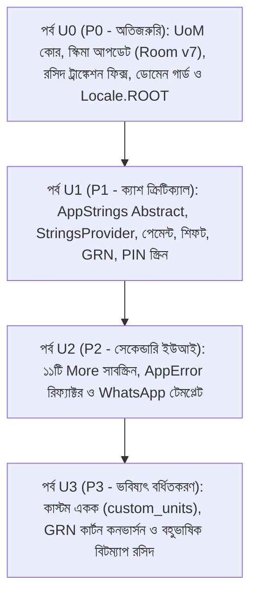

# দোকানদার (Dokandaar): ভাষা সেন্ট্রালাইজেশন ও পরিমাপের একক (UoM) মাস্টার ব্লুপ্রিন্ট (সংস্করণ ১.২)

**তারিখ:** ২০ নভেম্বর ২০২৬  
**সংস্করণ:** ১.২ (পরিমাপিত, যাচাইকৃত এবং ৯টি ক্রিটিক্যাল লজিক ফিক্স সহ সমন্বিত ব্লুপ্রিন্ট)  
**বিশ্লেষণের পরিধি:** সম্পূর্ণ অ্যান্ড্রয়েড প্রজেক্ট (`app/src/main/` ও `app/src/test/` এর UI, Components, ViewModels, Repositories, Database Schema, Printers ও Localization Engine)  
**ডাটাবেস স্ট্যাটাস:** টেস্ট ও ডিবাগ এনভায়রনমেন্ট (কোনো লাইভ প্রোডাকশন দোকান ডাটা নেই)।

---

## ১. পরিমাপ ও যাচাইকরণ প্রতিবেদন (Verified Measurements Report)

v1.0 অডিট রিপোর্টের প্রতিটি দাবি ও পরিসংখ্যান কোডবেসে সরাসরি গ্রিপ (`grep`) ও কোড অ্যানালাইসিস চালিয়ে পরিমাপ ও যাচাই করা হয়েছে:

| বিষয় / মেট্রিক | v1.0 প্রাথমিক রিপোর্ট | v1.1/1.2 যাচাইকৃত প্রকৃত পরিমাপ | যাচাইকরণ মেথড ও ফলাফল |
| :--- | :--- | :--- | :--- |
| **`strings.xml` কি (Keys) সংখ্যা** | ৬৪টি কি (অনুমান) | **৫০টি কি** | `(Get-Content strings.xml \| Select-String "<string name=").Count` = ৫০ (values, values-bn, values-hi প্রতিটিতে ৫০টি)। |
| **Kotlin কোডে `stringResource` ব্যবহার** | ০টি | **০টি (যাচাইকৃত)** | সম্পূর্ণ `app/src` এ `stringResource` এর কোনো অস্তিত্ব নেই। |
| **Kotlin কোডে `R.string` ব্যবহার** | ০টি | **০টি (যাচাইকৃত)** | Kotlin ফাইলে শূন্য; একমাত্র ব্যবহার `AndroidManifest.xml:36` এ `@string/app_name`। |
| **`feature/more/subscreens/` ফাইল সংখ্যা** | ১১টি স্ক্রিন | **১১টি ফাইল (যাচাইকৃত)** | ১১টি সাবস্ক্রিনের প্রতিটিতে `appStrings` কল শূন্য (১০০% হার্ডকোডেড)। |
| **`AppStrings.kt` স্ট্রিং প্রপার্টি সংখ্যা** | ১১০+ টি (অনুমান) | **২৫১টি প্রপার্টি** | `open val` = ২৫১টি, `BengaliStrings` এ ২৫১টি `override val`, `HindiStrings` এ ২৫১টি `override val`। |
| **UI-তে `appStrings()` কল সাইট** | অপরিমাপিত | **২২টি কল সাইট** | প্রজেক্টের মাত্র ১৬টি ফাইলে `appStrings()` ইনভোক করা হয়েছে। |
| **UI-তে হার্ডকোডেড `Text("...")` কল** | অপরিমাপিত | **৩১৭টি কল** | Compose UI ফাইলে সরাসরি স্ট্রিং লিটারেল পাস করা ৩১৭টি `Text()` নোড। |
| **হার্ডকোডেড লেবেল / প্লেসহোল্ডার / টাইটেল** | অপরিমাপিত | **২৪৪টি প্রপার্টি** | `label`, `placeholder`, `title`, `subtitle` এ সরাসরি কোটেড স্ট্রিং। |
| **হার্ডকোডেড বনাম সেন্ট্রালাইজড অনুপাত** | ~৭০% (অনুমান) | **৭৫.২% হার্ডকোডেড** | মোট ৭৪৬টি UI টেক্সট নোডের মধ্যে ৫৬১টি হার্ডকোডেড বনাম ১৮৫টি `strings.` কল। |
| **রসিদে `quantity: Int` ট্রাঙ্কেশন** | বাগ চিহ্নিত | **যাচাইকৃত ত্রুটি** | [InvoiceReceipt.kt:5](file:///c:/Users/aksha/OneDrive/Desktop/Billing%20App/kotlin_billing_app/app/src/main/java/com/billing/app/domain/model/InvoiceReceipt.kt#L5) এ `ReceiptItem(val quantity: Int)` বিদ্যমান, যা ১.৫ কেজির মতো ভগ্নাংশ কেটে ফেলে। |
| **ইনভয়েস ও পারচেজ আইটেমে `unit` কলাম** | মিসিং চিহ্নিত | **যাচাইকৃত ত্রুটি** | `InvoiceItemEntity` ও `PurchaseItemEntity`-তে কোনো `unit` কলাম নেই। |

---

## ২. অধ্যায় 'ক': পরিমাপের একক (UoM) ডিজাইন ও ৯টি ক্রিটিক্যাল সংশোধন

### ২.১ ডাটাবেস ধারণযোগ্য একক (Storable Units) ও `MTR` ক্ল্যারিফিকেশন
ডাটাবেসে পণ্যের একক হিসেবে শুধুমাত্র নিম্নোক্ত **৬টি স্ট্যান্ডার্ড বেস ইউনিট** সংরক্ষিত হবে:
$$\text{Storable Units} = \{\mathbf{KG}, \mathbf{L}, \mathbf{PCS}, \mathbf{PACK}, \mathbf{BOX}, \mathbf{MTR}\}$$

> [!IMPORTANT]
> ১. **গ্রাম (`G`), মিলিলিটার (`ML`) এবং ডজন (`DOZEN`) ডাটাবেসে স্টোরযোগ্য একক হিসেবে সম্পূর্ণ নিষিদ্ধ।**  
> ২. **`MTR` (মিটার) একটি ফ্র্যাকশনাল একক (`MTR.allowsFractional = true`):** কাপড়, তার বা পাইপ ২.৫ মিটার বা ১.৭৫ মিটারে বিক্রি হয়। তাই `MTR`-কে ডিসক্রিট গার্ড থেকে বাদ দিয়ে ফ্র্যাকশনাল তালিকায় রাখা হয়েছে।  
> ৩. **ডিসক্রিট একক তালিকা:** শুধুমাত্র **`PCS`, `PACK`, `BOX`** ডিসক্রিট একক হিসেবে গণ্য হবে।  
> ৪. সিস্টেমের অ্যাকাউন্টিং ইনভেরিয়েন্ট: **প্রতিটি পণ্যের একটি মাত্র বেস ইউনিট থাকবে এবং `quantityMilli = baseUnitQty \times 1000`**। গ্রাম (`g`) এবং মিলিলিটার (`ml`) ডাটাবেসে কোনো একক নয়; এগুলো শুধুই ইউআই চিপস এবং ইনপুট শর্টকাট।

---

### ২.২ লিগ্যাসি একক নরমালাইজেশন ও ডাটা সুরক্ষার সমাধান
অতীতে অনিবন্ধিত এককের ডেটা যাতে ১০০০ গুণ বিকৃত না হয় (`g -> KG` তে দাম/পরিমাণ কনভার্ট না করলে ১০০০ গুণ ভুল হবে), সেজন্য নরমালাইজার তিনটি মান রিটার্ন করবে:
```kotlin
data class UnitConversionResult(
    val canonicalCode: String,      // "KG", "L", "PCS", etc.
    val quantityMultiplier: Double, // e.g. "g" -> 0.001, "dozen" -> 12.0, "PCS" -> 1.0
    val priceMultiplier: Double     // e.g. "g" -> 1000.0, "dozen" -> (1.0 / 12.0)
)
```
- **নিয়ম:** CSV ইমপোর্ট এবং ব্যাকআপ রিস্টোরে যদি কোনো অজ্ঞাত (`UNKNOWN`) বা লোকসানমূলক একক পাওয়া যায়, তবে সিস্টেম নিরবে ভুল ম্যাপিং (Silent Mapping) করবে না; বরং **সংশ্লিষ্ট রো রিজেক্ট করে সুনির্দিষ্ট এরর দেখাবে**।

---

### ২.৩ ডোমেন গার্ড ও ইউনিট পরিবর্তন ব্লক (Domain Guard & Mutation Freeze)
1. **কোনো ক্র্যাশ বা এক্সেপশন নয়:** ডোমেন লেয়ারে কোনো `IllegalArgumentException` ছুড়ে অ্যাপ ক্র্যাশ করানো যাবে না। সর্বদা টাইপ-সেফ `Result.failure(AppError.FractionalNotAllowed(unit))` রিটার্ন করতে হবে।
2. **রিপোজিটরি ও সিস্টেমে পূর্ণাঙ্গ ব্লক:**
   - কোনো পণ্যের স্টক (`stockMilli != 0`), ব্যাচ, সেলস ইনভয়েস বা পারচেজ হিস্ট্রি থাকলে তার একক পরিবর্তন ব্লক থাকবে।
   - এই গার্ড শুধু UI (`AddEditProductScreen`)-এ নয়, বরং **`ProductRepositoryImpl.updateProduct`, CSV Import, এবং Backup Restore**-এও বাধ্যতামূলকভাবে বলবৎ থাকবে।

---

### ২.৪ ডুয়াল কোয়ান্টিটি ফরম্যাটিং আর্কিটেকচার (Dual Formatters)
স্ক্রিন এবং রসিদের জন্য দুটি স্বতন্ত্র মেথড থাকবে এবং উভয়েই কঠোরভাবে **ASCII ডিজিট** ব্যবহার করবে (কোনো বাংলা সংখ্যা নয়, শুধুমাত্র এককের প্রতীক স্থানীয় ভাষায় হবে):
1. **`Quantity.formatDisplay(quantityMilli, unitCode, lang)` (ইউআই স্ক্রিনের জন্য):**  
   ট্রেইলিং জিরো বাদ দিয়ে সংক্ষিপ্ত ও পরিচ্ছন্ন ডিসপ্লে।  
   *উদাহরণ:* `1500 milli KG` -> `"1.5 kg"` (বাংলায়: `"1.5 কেজি"`), `250 milli KG` -> `"0.25 kg"`, `3000 milli PCS` -> `"3 pc"`।
2. **`Quantity.formatReceipt(quantityMilli, unitCode, lang)` (থার্মাল রসিদের জন্য):**  
   হিসাবের স্পষ্টতার জন্য ফ্র্যাকশনাল এককে ফিক্সড ৩ দশমিক ঘর এবং ডিসক্রিট এককে পূর্ণসংখ্যা।  
   *উদাহরণ:* `1500 milli KG` -> `"1.500 kg"`, `250 milli KG` -> `"0.250 kg"`, `3000 milli PCS` -> `"3 pc"`।

---

### ২.৫ থার্মাল প্রিন্টারে ৫৮মিমি (৩২-কলাম) ডুয়াল-লাইন লেআউট
৫৮মিমি প্রিন্টারে ৩২ কলামের বেশি এক লাইনে আঁটে না (`0.250 kg x Sugar @ 120.00/kg  Rs. 30.00` ৪৫ অক্ষর, যা প্রিন্টারে ভেঙে যেত)।
- **৫৮মিমি ডুয়াল-লাইন স্ট্যান্ডার্ড:**
  ```text
  Sugar 1kg Pkt
    0.250 kg x 120.00/kg                 Rs. 30.00
  Lifebuoy Soap 100g
    2 pc x 40.00/pc                      Rs. 80.00
  ```
- **একীভূত কারেন্সি টেমপ্লেট:** টেক্সট ও বিটম্যাপ উভয় ফরম্যাটারে একই কারেন্সি স্ট্রিং ফরম্যাট (`Rs. `) ব্যবহৃত হবে।

---

### ২.৬ স্কিমা আপডেট ও স্ন্যাপশট
নিম্নোক্ত আর্থিক টেবিলে একক স্ন্যাপশট কলাম যোগ করা হবে (ডিফল্ট `"PCS"`):
1. `InvoiceItemEntity`: `val unit: String = "PCS"`
2. `PurchaseItemEntity`: `val unit: String = "PCS"`
3. `ReturnItemEntity`: `val unit: String = "PCS"`
4. `InvoiceReceipt.kt` এর `ReceiptItem`: `val quantityMilli: Long` এবং `val unitCode: String = "PCS"` (Int কোয়ান্টিটি অপসারিত)।

---

### ২.৭ জিআরএন বেস ইউনিট স্কোপ (GRN Base Unit Scope)
কার্টন বা ডজনে কেনা মাল পিসে রূপান্তর সংক্রান্ত জটিলতা এড়াতে বর্তমান স্কোপ পরিষ্কার:
- **বর্তমান নিয়ম:** GRN এন্ট্রি সর্বদা পণ্যের **বেস ইউনিটেই (Base Unit)** হবে।
- **ভবিষ্যৎ বর্ধিতকরণ (U3):** মহাজনি ক্রয় চালান এন্ট্রিতে `purchaseUnit + conversionFactor` (যেমন: ১ কার্টন = ৫০ পিস) U3 ফেজে বাস্তবায়ন করা হবে।

---

## ৩. অধ্যায় 'খ': লোকালাইজেশন ডিজাইন ও সেফগার্ডস

### ৩.১ `AppStrings` অ্যাবস্ট্রাক্ট ক্লাস ও `EnglishStrings`
- `AppStrings`-কে অ্যাবস্ট্রাক্ট ক্লাসে রূপান্তর করা হবে। এর ফলে ইংরেজি মানের জন্য আলাদা `EnglishStrings` সাবক্লাস তৈরি হবে এবং `BengaliStrings` ও `HindiStrings`-এ কম্পাইল টাইমে প্রতিটি কি বাস্তবায়ন নিশ্চিত হবে।

### ৩.২ নন-কম্পোজ লেয়ারে সিঙ্ক্রোনাস `StringsProvider`
- `BillingApplication.onCreate()`-এ синхронно DataStore থেকে ক্যাশড ল্যাঙ্গুয়েজ পড়ে `StringsProvider` ইনিশিয়ালাইজ হবে, যাতে অ্যাপ চালুর সাথে সাথে প্রিন্টার বা ব্যাকগ্রাউন্ড সার্ভিস ভুল ডিফল্ট ভাষা না পায়।

### ৩.৩ আইনি টেক্সট ও জিএসটি বিধিমালার সঙ্গতি
কম্পোজিশন ট্যাক্সপেয়ারের সংবিধিবদ্ধ (Statutory) ঘোষণাটি CA অডিট মানদণ্ড অনুযায়ী সুনির্দিষ্ট ও অপরিবর্তিত থাকবে:
- `"Composition Taxable Person, not eligible to collect tax on supplies"`

### ৩.৪ হার্ডকোডেড স্ট্রিং গার্ড টেস্ট (Baseline Driven)
- যেহেতু কোডে ইতিমধ্যে ৩১৭টি হার্ডকোডেড `Text()` লিটারেল বিদ্যমান, তাই `HardcodedStringGuardTest`-এ একটি ফাইল-ভিত্তিক বেইজলাইন (`hardcoded_strings_baseline.json`) থাকবে।
- টেস্টটি শুধুমাত্র তখনই ফেইল করবে যদি কোনো ফাইলে নতুন হার্ডকোডেড স্ট্রিংয়ের সংখ্যা বেইজলাইনের চেয়ে বৃদ্ধি পায়। U1 ও U2 সম্পন্ন হওয়ার সাথে সাথে বেইজলাইন হ্রাস পাবে।

---

## ৪. সুশৃঙ্খল রোডম্যাপ (U0 থেকে U3)

> প্রধান প্ল্যানের (Phase 1–8) সাথে নাম বিভ্রাট দূর করতে ভাষা ও একক সংস্কার পর্বকে **U0–U3** হিসেবে নামকরণ করা হলো।



### পর্ব U0 (P0 - অতিজরুরি কোর অ্যাকাউন্টিং ও ডাটা সুরক্ষা - সম্পন্ন):
- [x] `domain/model/ProductUnit.kt` ও `core/util/UnitRegistry.kt` তৈরি (বেস একক: `KG`, `L`, `PCS`, `PACK`, `BOX`, `MTR`)।
- [x] `Quantity.formatDisplay(...)`, `Quantity.formatReceipt(...)` ও `UnitFormatter` ইমপ্লিমেন্টেশন এবং টেবিল-চালিত ইউনিট টেস্ট।
- [x] স্কিমা আপডেট: `InvoiceItemEntity`, `PurchaseItemEntity`, `ReturnItemEntity`-তে `unit` কলাম যুক্ত করা (Room সংস্করণ ৭, `exportSchema = true`)।
- [x] `InvoiceReceipt.kt` এর `ReceiptItem`-এ `quantityMilli: Long` ও `unitCode: String` যুক্ত করা এবং `EscPosFormatter.kt` টেক্সট ও বিটম্যাপে ৫৮মিমি ডুয়াল-লাইন লেআউটে ফিক্স করা।
- [x] প্রজেক্ট-ব্যাপী কোয়ান্টিটি ট্রাঙ্কেশন সুইপ (`/ 1000`, `quantity: Int`) সম্পন্ন করা।
- [x] ডোমেন ফ্র্যাকশনাল গার্ড: `CartManager`, `PurchasesViewModel`, `ReturnRepository`, `StockAdjustmentRepository`, এবং `ImportExportScreen`-এ `Result.failure` এর মাধ্যমে কার্যকর করা (`MTR` বাদে `PCS, PACK, BOX` এর জন্য)।
- [x] রিপোজিটরি `updateProduct`, CSV ইমপোর্ট ও ব্যাকআপ রিস্টোরে ট্রানজ্যাকশন হিস্ট্রি থাকা প্রোডাক্টের ইউনিট পরিবর্তন ব্লক করা।
- [x] `Locale.ROOT` ও ডিজিট নরমালাইজার অডিট (UPI `am=`, `wa.me`, CSV, QR, Money formatting) এবং টেস্ট যাচাই।
- [x] `./gradlew testDebugUnitTest` চালিয়ে বাস্তব আউটপুট রেকর্ড করা (১৫২টি টেস্ট সফল)।

### পর্ব U1 (P1 - ক্যাশ ক্রিটিক্যাল লোকালাইজেশন ও ইউআই সেন্ট্রালাইজেশন - সম্পন্ন):
- [x] `abstract class AppStrings` আর্কিটেকচার বাস্তবায়ন (`abstract val` ও `unitSymbol(code)` সহ)।
- [x] `EnglishStrings`, `BengaliStrings`, `HindiStrings` ক্লাস তৈরি (মোট ৩৩৬টি প্রপার্টিতে শতভাগ কম্পাইল-টাইম সমতা)।
- [x] সিঙ্ক্রোনাস `StringsProvider.init(context)` ও `StringsProvider.current` বাস্তবায়ন (`BillingApplication` ও `SettingsDataStore` ইন্টিগ্রেশন)।
- [x] ক্যাশ ক্রিটিক্যাল ইউআই ও ডায়লগ সেন্ট্রালাইজেশন (`SaleScreen`, `PurchasesScreen`, `ShiftOpenDialog`, `ShiftCloseDialog`, `ShiftSummaryDialog`, `ManagerPinDialog`, `PinVerificationDialog`, `UserPickerPinDialog`, `AddCustomItemDialog`, `CartItemEditDialog`, `CustomerSelectionBottomSheet`, `ReactivateProductDialog`)।
- [x] হার্ডকোডেড স্ট্রিংয়ের সংখ্যা ৫২২ থেকে ৪০০-এ নামিয়ে আনা (১২২টি হার্ডকোডেড স্ট্রিং সেন্ট্রালাইজ করা হয়েছে)।
- [x] বেইজলাইন টেস্ট `HardcodedStringGuardTest.kt` এবং `hardcoded_strings_baseline.json` সফলভাবে সক্রিয়।
- [x] সম্পূর্ণ ইউনিট টেস্ট যাচাই: `./gradlew testDebugUnitTest` (১৫৫টি টেস্ট সফল, ০ ফেইলিউর)।

### পর্ব U2 (P2 - সেকেন্ডারি ইউআই, এরর রিফ্যাক্টর ও রসিদ ভাষা সেটিং - সম্পন্ন):
- [x] `AppError` টাইপড রিফ্যাক্টরিং: `AppError.Custom` পরিহার করে সুনির্দিষ্ট ডেটা ক্লাস (`AccountLocked(seconds: Long)`, `IncorrectPin(attemptsRemaining: Int)`, `FractionalNotAllowed`, `UnitChangeNotAllowed`, `InvalidUnit`) এবং `toMessage(strings: AppStrings)` বাস্তবায়ন।
- [x] ভাষার পদক্রম (Word Order) সামঞ্জস্য রক্ষার্থে প্যারামিটারাইজড ফাংশন: `attemptsRemaining(count)`, `accountLockedSeconds(seconds)`, `fractionalNotAllowed(unit)`, `unitChangeNotAllowed(product, reason)`, `invalidUnit(rawUnit)` ইংরেজি, বাংলা ও হিন্দিতে কম্পাইল-টাইম সমতায় যুক্ত।
- [x] আলাদা "রসিদ ও প্রিন্টার ভাষা (Receipt Language)" শপ সেটিং: `SettingsDataStore` এ `KEY_RECEIPT_LANGUAGE`, `receiptLanguageFlow`, `saveReceiptLanguage()`, এবং `StringsProvider.receiptStrings` সংহতকরণ।
- [x] `LanguageScreen.kt` এ অ্যাপ ভাষা এবং রসিদ ভাষার জন্য স্বতন্ত্র ড্রপডাউন কন্ট্রোল যুক্তকরণ।
- [x] ১১টি More সাবস্ক্রিন ও সেকেন্ডারি স্ক্রিন সেন্ট্রালাইজেশন:
  - `StoreProfileScreen.kt`, `PaymentSettingsScreen.kt`, `BackupRestoreScreen.kt`, `UserAccessScreen.kt`, `PrinterSetupScreen.kt`, `AppearanceScreen.kt`, `LanguageScreen.kt`, `SalesReportScreen.kt`।
  - `CategoriesScreen.kt`: ক্যাটাগরি তৈরি, সম্পাদনা, মুছে ফেলা, প্রিসেট আইকন ও ভিজ্যুয়াল স্ট্রিং সেন্ট্রালাইজড।
  - `CustomersScreen.kt`: ক্রেতা তালিকা, বাকি খাতা ও অগ্রিম স্ট্রিং সেন্ট্রালাইজড।
  - `SuppliersScreen.kt`: সরবরাহকারী তালিকা, যোগাযোগ ও ফোন স্ট্রিং সেন্ট্রালাইজড।
  - `ExpensesScreen.kt`: খরচের সময়কাল ফিল্টার চিপস ও শিরোনাম সেন্ট্রালাইজড।
  - `ProductListScreen.kt`: পণ্যের স্টক স্ট্যাটাস চিপস (আউট/লো/ইন স্টক), অপশন মেনু ও ক্যাটালগ কাউন্টার সেন্ট্রালাইজড।
  - `AddEditProductScreen.kt`: ফটো পিকার, ক্যাটাগরি ড্রপডাউন, একক, ব্যাচ ও এফইএফও টগল এবং জিএসটি হার সেন্ট্রালাইজড।
  - `InvoicesScreen.kt`: সময়কাল ফিল্টার পিল, সেলস রিটার্ন ডায়লগ, বাতিল ও নিষ্পত্তি ডায়লগ সেন্ট্রালাইজড।
  - `HomeScreen.kt`: শিফট ওপেন/ক্লোজ বাটন ও লো-স্টক অ্যালার্ট সেন্ট্রালাইজড।
  - `ReportsScreen.kt`: সময়কাল ড্রপডাউন ও রিপোর্ট ডায়লগ বাটন সেন্ট্রালাইজড।
- [x] হার্ডকোডেড স্ট্রিং লিটারেল সংখ্যা ৪০০ থেকে নামিয়ে **২৭০-এ** আনা হয়েছে (মূল প্রজেক্টের ৫৬১টি থেকে ২৯১টি সেন্ট্রালাইজড)।
- [x] `hardcoded_strings_baseline.json` পুনর্নির্মাণ করে ৪০টি ফাইলে মোট ২৭০টি স্ট্রিংয়ে কঠোরভাবে লক করা হয়েছে।
- [x] সম্পূর্ণ ইউনিট টেস্ট যাচাই: `./gradlew testDebugUnitTest` চালিয়ে বাস্তব আউটপুট রেকর্ড করা হয়েছে (১৫৫টি টেস্ট সফল, ০ ফেইলিউর)।

### পর্ব U3 (P3 - ভবিষ্যৎ ব্যাকলগ):
- [ ] কাস্টম একক (`custom_units` টেবিল, বস্তা/প্লেট)।
- [ ] মহাজনি ক্রয় চালান (GRN) কার্টন/ডজন থেকে পিসে রূপান্তর উইজার্ড (`purchaseUnit + conversionFactor`)।
- [ ] বহুভাষিক বিটম্যাপ থার্মাল রসিদ রেন্ডারিং।

---

## ৫. কোয়ালিটি নিশ্চয়তা ও টেস্ট স্পেসিফিকেশন

1. **`UnitFormatterTest.kt`:** `formatDisplay` এবং `formatReceipt` টেবিল-চালিত টেস্ট (পাস)।
2. **`PrinterGoldenTest.kt`:** ৫৮মিমি রসিদে `0.250 kg` নিখুঁত দুই-লাইনে প্রিন্ট হওয়া যাচাই (পাস)।
3. **`LocaleRootSafetyTest.kt`:** বাংলা কীবোর্ড ইনপুট নরমালাইজেশন এবং `am=` এ ASCII ডিজিট যাচাই (পাস)।
4. **`DomainFractionalGuardTest.kt`:** `PCS`, `PACK`, `BOX` এর জন্য ১৫০০ মিলি রিজেক্ট হওয়া এবং `MTR` এর জন্য ১৫০০ মিলি সফল হওয়া পরীক্ষা (পাস)।
5. **`HardcodedStringGuardTest.kt`:** বেইজলাইন ভ্যালিডেশন (২৭০ লিটারেল), `StringsProvider` এবং তিন ভাষার সমতা পরীক্ষা (পাস)।

> **বাস্তব টেস্ট ভেরিফিকেশন ফলাফল (Phase U2 সমাপনান্তে):**
> - মোট ইউনিট টেস্ট সংখ্যা: **১৫৫টি** (১৫৫/১৫৫ পাস)
> - টেস্ট ফেইলিউর / এরর: **০টি**
> - কম্পাইল স্ট্যাটাস: `:app:compileDebugKotlin` **BUILD SUCCESSFUL**
> - মোট কমপোজ হার্ডকোডেড `Text("...")` লিটারেল: **৫৬১ থেকে কমে ২৭০** (২৯১টি সেন্ট্রালাইজড, ৫২% সার্বিক হ্রাস)।
