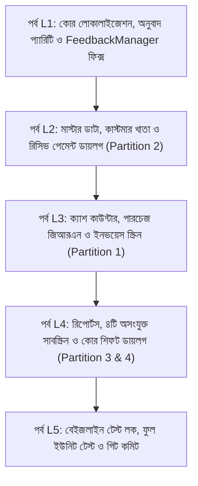

# দোকানদার (Dokandaar): পূর্ণাঙ্গ লোকালাইজেশন ও ডিপ ক্লিনআপ মাস্টার প্ল্যান

**তারিখ:** ২০ নভেম্বর ২০২৬  
**লক্ষ্য:** ৪টি সাব-এজেন্টের অডিট রিপোর্টের ভিত্তিতে কোডবেসের প্রতিটি স্ক্রিন, প্লেসহোল্ডার, লেবেল, টোস্ট, দ্বিভাষিক টেক্সট এবং বাংলা/হিন্দি অনুবাদের পুঙ্খানুপুঙ্খ সেন্ট্রালাইজেশন ও আর্কিটেকচারাল ফিক্স।  
**কাজের পদ্ধতি:** সাব-এজেন্ট ভিত্তিক ধাপে ধাপে বাস্তবায়ন ও কম্পাইল-টাইম ভেরিফিকেশন।

---

## ১. পর্বভিত্তিক বাস্তবায়ন রোডম্যাপ (Phases L1 – L5)

---

## ২. পর্বভিত্তিক বিস্তারিত কাজের তালিকা

### পর্ব L1: কোর লোকালাইজেশন, অনুবাদ প্যারিটি ও FeedbackManager ফিক্স
1. **বাংলা ও হিন্দির ৪টি অপরিবর্তিত কি ফিক্স:**
   - `badgePaid`: BN -> `"পরিশোধিত"`, HI -> `"चुकाया"`
   - `badgePending`: BN -> `"বাকি"`, HI -> `"बाकी"`
   - `badgeDraft`: BN -> `"খসড়া"`, HI -> `"ड्राफ्ट"`
   - `badgeReturned`: BN -> `"বাতিল"`, HI -> `"रद्द"`
2. **`unitSymbol(unitCode)` এ অতিরিক্ত ইউনিট সংযোজন:**
   - `"GM"` -> BN: `"গ্রাম"`, HI: `"ग्राम"`, EN: `"g"`
   - `"ML"` -> BN: `"মিলি"`, HI: `"मिली"`, EN: `"ml"`
   - `"BAG"` -> BN: `"বস্তা"`, HI: `"बोरी"`, EN: `"bag"`
3. **`FeedbackManager.kt` আর্কিটেকচারাল ফিক্স:**
   - `showToast(context, message, type: ToastType? = null)` ওভারলোড যোগ করা, যাতে ইংরেজি শব্দ ম্যাচিংয়ের বদলে যেকোনো ভাষায় সঠিক `ToastType` (SUCCESS / ERROR / INFO) বজায় থাকে।
4. **নতুন সেন্ট্রালাইজড কি ও ফাংশন যোগ করা:**
   - `AppStrings.kt`, `EnglishStrings.kt`, `BengaliStrings.kt`, `HindiStrings.kt`-এ প্লেসহোল্ডার, অ্যাকশন বাটন, ডায়লগ টেক্সট ও এরর মেসেজের জন্য নতুন কি যুক্ত করা (১০০% কম্পাইল-টাইম সমতা)।

---

### পর্ব L2: মাস্টার ডাটা, কাস্টমার খাতা ও পেমেন্ট ডায়লগ (Partition 2)
1. **`ReceivePaymentDialog.kt`:**
   - `val strings = appStrings()` ইনজেক্ট করা।
   - দ্বিভাষিক হার্ডকোডিং (`"Receive Payment / জমা নিন"`, `"Cash / নগদ"`, `"UPI / ইউপিআই"`, `"Confirm / জমা করুন"`) সম্পূর্ণ অপসারণ।
2. **`CustomerKhataDetailSheet.kt`:**
   - দ্বিভাষিক টেক্সট (`"Current Due Balance / মোট বাকি"`, `"+ Receive Payment / জমা নিন"`, `"WhatsApp / তাগাদা"`, `"Call / কল করুন"`, `"Ledger Statement / খাতা লেনদেন"`, `"Opening Balance / পূর্বের বাকি"`) সেন্ট্রালাইজড কি দিয়ে প্রতিস্থাপন।
3. **`AddEditProductScreen.kt` & `ProductViewModel.kt`:**
   - প্লেসহোল্ডার (`"e.g. Aashirvaad Atta (5 kg)"`, `"Scan or type barcode"`, `"e.g. ATT-5KG"`, `"e.g. 1901"`, `"5"`) সেন্ট্রালাইজড করা।
   - ফটো/ক্যামেরা এরর টোস্ট এবং সেভ/আপডেট বাটন সেন্ট্রালাইজ করা।
4. **`ProductListScreen.kt`, `CategoriesScreen.kt`, `CustomersScreen.kt`, `SuppliersScreen.kt`, `ExpensesScreen.kt`:**
   - সার্চ প্লেসহোল্ডার, ডিলিট প্রম্পট (`"Remove '$name'?"`), স্টক অ্যাডজাস্টমেন্ট ডায়লগ সেন্ট্রালাইজ করা।

---

### পর্ব L3: ক্যাশ কাউন্টার, পারচেজ জিআরএন ও ইনভয়েস স্ক্রিন (Partition 1)
1. **`SaleScreen.kt` & `CheckoutViewModel.kt`:**
   - L497 এর `if (strings.cartTitle == "কার্ট") "কাস্টম" else "Custom"` পরিবর্তন করে `strings.customItem` ব্যবহার।
   - কাস্টমার নাম ও ফোন প্লেসহোল্ডার (`"Name"`, `"Phone"`) সেন্ট্রালাইজ করা।
   - স্প্লিট পেমেন্ট ট্যাব (`"Split"`) সেন্ট্রালাইজ করা।
   - WhatsApp রসিদ টেমপ্লেট স্ট্রিংগুলোকে `StringsProvider.receiptStrings` এর সাথে সংযুক্ত করা।
2. **`PurchasesScreen.kt` & `PurchasesViewModel.kt`:**
   - জিএসটি টগল লেবেল (`"Buy prices INCLUDE GST"`, `"Inclusive"`, `"Exclusive"`) সেন্ট্রালাইজ করা।
   - প্লেসহোল্ডার (`"e.g. INV-98234"`, `"e.g. 10"`, `"e.g. 85.00"`, `"e.g. BATCH-2026-X"`) সেন্ট্রালাইজ করা।
   - ভ্যালিডেশন এরর টোস্টসমূহ সেন্ট্রালাইজ করা।
3. **`InvoicesScreen.kt` & `InvoiceViewModel.kt`:**
   - ট্যাব লিস্ট (`"All Invoices"`, `"Sales"`, `"Drafts (Hold)"`, ইত্যাদি) সেন্ট্রালাইজড কি দিয়ে তৈরি করা।
   - কেপিআই কার্ড টাইটেল (`"Today Sales"`, `"Invoices"`, `"Pending Bill"`, `"Total Items"`) সেন্ট্রালাইজ করা।
   - সার্চ প্লেসহোল্ডার ও ভয়েড/রিটার্ন ডায়লগ সাবটাইটেল সেন্ট্রালাইজ করা।
4. **`HomeScreen.kt`:**
   - `OverviewPeriod` এনামে হার্ডকোডেড ইংরেজি বাদ দিয়ে লোকালাইজড স্ট্রিং সংযুক্ত করা।
   - অফলাইন ব্যানার ও নোটিফিকেশন কার্ডের টেক্সট সেন্ট্রালাইজ করা।

---

### পর্ব L4: রিপোর্টস, ৪টি অসংযুক্ত সাবস্ক্রিন ও কোর শিফট ডায়লগ (Partition 3 & 4)
1. **৪টি স্ক্রিনে `appStrings()` ইনজেকশন:**
   - `AboutDokandaarScreen.kt`
   - `PrivacyPolicyScreen.kt`
   - `TermsConditionsScreen.kt`
   - `ImportExportScreen.kt`
2. **`ReportsScreen.kt`:**
   - L729 এর মিশ্র-ভাষার হেডার (`"আসল ক্রয়মূল্য ও ব্যাচ স্ন্যাপশট ভিত্তিক লাভ-ক্ষতি (Real COGS & Profit):"`) সেন্ট্রালাইজ করা।
   - কুইক রিপোর্ট টাইলস ও রিপোর্ট ডায়লগের ডাটা লেবেল সেন্ট্রালাইজ করা।
3. **`ShiftSummaryDialog.kt`:**
   - দ্বিভাষিক স্ল্যাশ শিরোনাম (`"Cash Drawer Reconciliation / ক্যাশ মিলান"`, `"Cash Flow Breakdown / নগদ প্রবাহ"`, `"Digital & Total Turnover / মোট লেনদেন"`, `"Shortage / ঘাটতি"`) সম্পূর্ণ সেন্ট্রালাইজ করা।
4. **`MoreScreen.kt`, `StoreProfileScreen.kt`, `PaymentSettingsScreen.kt`, `UserAccessScreen.kt`, `FullScannerScreen.kt`, `NavGraph.kt`:**
   - প্লেসহোল্ডার, রোলের নাম, পারমিশন রিকোয়ার্ড টেক্সট ও ন্যাভিগেশন গার্ড টাইটেল সেন্ট্রালাইজ করা।

---

### পর্ব L5: বেইজলাইন টেস্ট লক, ফুল ইউনিট টেস্ট ও গিট কমিট
1. **`HardcodedStringGuardTest.kt` ও বেইজলাইন:**
   - নতুন সেন্ট্রালাইজেশনের পর হার্ডকোডেড লিটারেলের সংখ্যা রেকর্ড করে `hardcoded_strings_baseline.json` আপডেট করা।
2. **সম্পূর্ণ ইউনিট টেস্ট চালানো:**
   - `./gradlew testDebugUnitTest --rerun-tasks` চালিয়ে ১৬৬+ টেস্ট সম্পূর্ণ পাস নিশ্চিত করা।
3. **গিট কমিট:**
   - পরিচ্ছন্ন ও ভেরিফাইড পরিবর্তনসমূহ গিট রিপোজিটরিতে কমিট করা।
